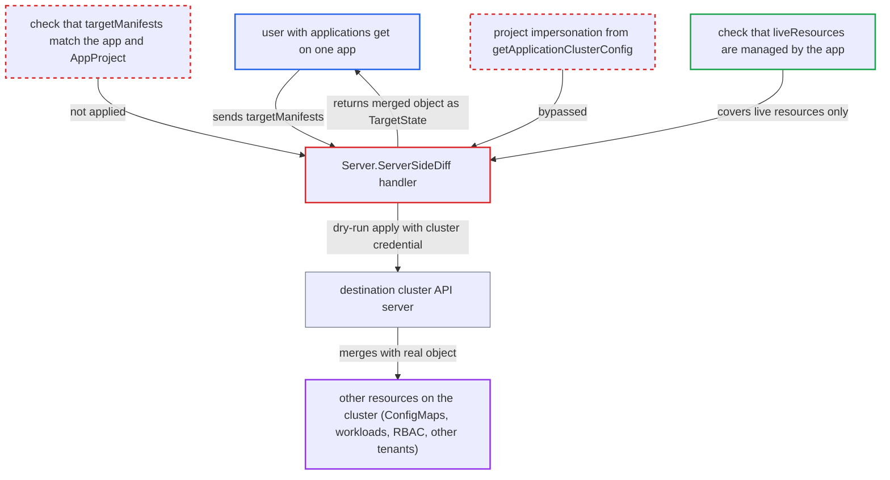

# ServerSideDiff dry-run applies arbitrary target manifests with cluster credentials, leaking any resource

| Field | Value |
|---|---|
| ID | `find_01NJmnzkyJ6diWTXNJz6HakZ` |
| Severity | **High** |
| Status | open |
| CWE | CWE-862 — Missing Authorization |
| Created | 2026-10-27T21:17:26.044482Z |
| Claude Security | https://claude.ai/security/findings/find_01NJmnzkyJ6diWTXNJz6HakZ |

## Description

A user who only has `applications, get` on one Application can read configuration of other resources on the application's destination cluster, including other tenants' resources. This works in the default configuration. The handler `Server.ServerSideDiff` dry-run applies caller-supplied `targetManifests` with the cluster's stored credential and returns the merged result. It never checks that those manifests belong to the app or are allowed by the AppProject.

1. **authenticated user** calls `ServerSideDiff` with one managed resource and a foreign target manifest. The user holds only `applications, get` on one Application. The user copies a managed resource's live state through `ManagedResources` and pairs it in `liveResources` with a `targetManifests` entry of the same kind that names another object, such as `argocd-cm` in namespace `argocd`. ([`server/application/application.go:3017`](https://github.com/cx-benchmark/argo-cd/blob/b7bc418289a96130340ea79964c4491b416c14f2/server/application/application.go#L3017))
2. **the handler `ServerSideDiff`** checks only the live resources and passes the target manifests on to `argodiff.StateDiffs`. Each `liveResources[i]` is checked against the app's managed resources. `targetManifests[i]` is never checked to name the same object, to belong to the app, or to be permitted by the AppProject. ([`server/application/application.go:3129-3138`](https://github.com/cx-benchmark/argo-cd/blob/b7bc418289a96130340ea79964c4491b416c14f2/server/application/application.go#L3129-L3138))
3. **the handler `ServerSideDiff`** builds the dry-run applier from `cluster.RawRestConfig()`. This is the stored cluster credential. The project's impersonation service account from `getApplicationClusterConfig` is not applied. ([`server/application/application.go:3036-3053`](https://github.com/cx-benchmark/argo-cd/blob/b7bc418289a96130340ea79964c4491b416c14f2/server/application/application.go#L3036-L3053))
4. **`K8sServerSideDryRunner.Run`** runs a server-side dry-run apply of the caller's object on the destination cluster. It runs `kubectl apply --server-side --dry-run=server --force-conflicts --field-manager=argocd-controller`. The API server merges the caller's object onto the real live object and returns the result. ([`gitops-engine/pkg/diff/diff_options.go:69-72`](https://github.com/cx-benchmark/argo-cd/blob/b7bc418289a96130340ea79964c4491b416c14f2/gitops-engine/pkg/diff/diff_options.go#L69-L72))
5. **`serverSideDiff` with `removeWebhookMutation`** filters the predicted object but keeps fields owned by `argocd-controller`. With the default `ignoreMutationWebhook`, fields owned by that manager are merged onto the attacker's live object. Every Argo CD-synced resource uses that manager, so same-kind resources in any project or namespace on that cluster still leak. ([`gitops-engine/pkg/diff/diff.go:172-223`](https://github.com/cx-benchmark/argo-cd/blob/b7bc418289a96130340ea79964c4491b416c14f2/gitops-engine/pkg/diff/diff.go#L172-L223))
6. **the handler `ServerSideDiff`** returns `diffRes.PredictedLive` to the caller as `TargetState`. Only core `v1/Secret` `data` and `stringData` are masked by `HideSecretData`. Every other kind is returned in full. ([`server/application/application.go:3187-3247`](https://github.com/cx-benchmark/argo-cd/blob/b7bc418289a96130340ea79964c4491b416c14f2/server/application/application.go#L3187-L3247))

## Assessment

The attacker is an authenticated Argo CD user or token with `applications, get` on at least one Application. No victim action is needed. The attacker copies one managed resource's live state from `ManagedResources`. They then call `GET /api/v1/applications/{app}/server-side-diff` with that resource in `liveResources` and a same-kind target manifest for the object they want in `targetManifests`. With the default `ignoreMutationWebhook`, this exposes the fields of resources that Argo CD manages with the field manager `argocd-controller`. An attacker who also has `update` on their own app can set the annotation `argocd.argoproj.io/compare-options: IncludeMutationWebhook=true`. That disables the filter and exposes any existing resource of any kind.

Impact: A read-only API user can read the full desired and live state of other tenants' Argo-managed resources in any project or namespace. With Argo CD managing itself, this includes `argocd-cm`, `argocd-rbac-cm` and `argocd-cmd-params-cm`. Secret values are masked, but their keys and metadata are exposed. The AppProject and RBAC boundary is defeated. Nothing is written, because the call is a dry run, so integrity and availability are not affected beyond admission-webhook invocations.

Subsequent-system impact: On the destination Kubernetes cluster, the dry run uses the stored cluster-admin-level credential, and impersonation is bypassed. The response discloses any existing non-Secret resource in any namespace. Examples are kube-system ConfigMaps, workload specs with inline credentials in env, Nodes, RBAC objects and custom resources. Mutating and validating admission webhooks are invoked with attacker-chosen objects, but nothing is persisted.

## Recommendation

(1) `ServerSideDiff` trusts the submitted `targetManifests`. It dry-run applies them and returns the merged result without checking that they identify an application-managed resource or one the AppProject permits.

Fix criteria: A target manifest is rejected unless its group, kind, namespace and name match the paired `liveResources[i]` entry, and that entry is in the app's managed resources. For a new object, it is accepted only if `proj.IsResourcePermitted` and `IsDestinationPermitted` allow it for the app's destination. Submitting a target manifest that names an object outside the app, such as `argocd/argocd-cm`, returns a PermissionDenied or InvalidArgument error, and no API call is made to the cluster.

(2) The dry-run applier is built from `cluster.RawRestConfig()`. This bypasses the project's impersonation service account, which `getApplicationClusterConfig` applies on every other API path and which the controller applies to its own server-side diff.

Fix criteria: The REST config used for the dry run is the one `getApplicationClusterConfig` returns, with impersonation applied or enforced when configured. With impersonation enforced, the dry-run request carries the `Impersonate-User` header of the project's service account. It fails when no mapping exists.

(3) The predicted-live object from the API server, which includes fields of the real live object, is returned to the caller as `TargetState`. The response is therefore a read primitive on the cluster instead of a diff of the application's own resources.

Fix criteria: Predicted state is returned only for objects that were authorized by the checks above. Alternatively, the returned `TargetState` is restricted to the diff against the caller-supplied live object. No field of a cluster object that the caller cannot otherwise read via `GetResource` or `ManagedResources` appears in any response.

## Evidence

**https://github.com/cx-benchmark/argo-cd**

- [`server/application/application.go:3129-3138`](https://github.com/cx-benchmark/argo-cd/blob/b7bc418289a96130340ea79964c4491b416c14f2/server/application/application.go#L3129-L3138)
- [`server/application/application.go:3017`](https://github.com/cx-benchmark/argo-cd/blob/b7bc418289a96130340ea79964c4491b416c14f2/server/application/application.go#L3017)
- [`server/application/application.go:3036-3053`](https://github.com/cx-benchmark/argo-cd/blob/b7bc418289a96130340ea79964c4491b416c14f2/server/application/application.go#L3036-L3053)
- [`server/application/application.go:3187-3247`](https://github.com/cx-benchmark/argo-cd/blob/b7bc418289a96130340ea79964c4491b416c14f2/server/application/application.go#L3187-L3247)
- [`server/application/application.go:3076`](https://github.com/cx-benchmark/argo-cd/blob/b7bc418289a96130340ea79964c4491b416c14f2/server/application/application.go#L3076)
- [`gitops-engine/pkg/diff/diff.go:172-223`](https://github.com/cx-benchmark/argo-cd/blob/b7bc418289a96130340ea79964c4491b416c14f2/gitops-engine/pkg/diff/diff.go#L172-L223)
- [`gitops-engine/pkg/diff/diff_options.go:69-72`](https://github.com/cx-benchmark/argo-cd/blob/b7bc418289a96130340ea79964c4491b416c14f2/gitops-engine/pkg/diff/diff_options.go#L69-L72)

