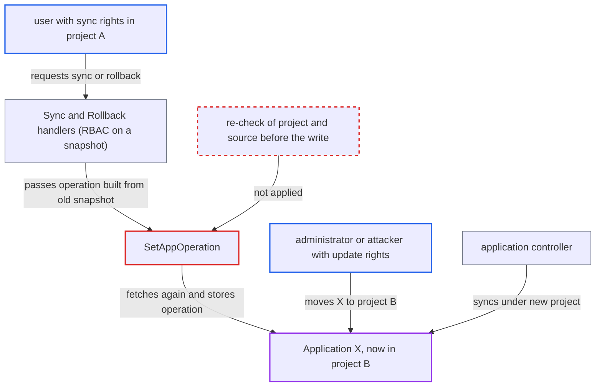

# SetAppOperation writes operation to freshly fetched app without re-checking project or RBAC

| Field | Value |
|---|---|
| ID | `find_019DXnqgByqc4XbqrkdZV5TU` |
| Severity | **High** |
| Status | open |
| CWE | CWE-367 — Race condition |
| Created | 2026-10-27T21:48:36.785606Z |
| Claude Security | https://claude.ai/security/findings/find_019DXnqgByqc4XbqrkdZV5TU |

## Description

A user who may sync an Application in one project can get a sync run on that Application after it has moved to another project, where the user has no sync or override rights. The race needs the Application's project to change while the `Sync` or `Rollback` request is in flight. `SetAppOperation` re-reads the Application and stores the operation without checking that the project or source still match what was authorized.

1. **attacker** calls `Sync` on application X in project A. The attacker holds `applications, sync` (optionally `override`) in project A and may send a branch revision and local `manifests`. ([`server/application/application.go:2100-2125`](https://github.com/cx-benchmark/argo-cd/blob/b7bc418289a96130340ea79964c4491b416c14f2/server/application/application.go#L2100-L2125))
2. **the handler `Sync`** checks permissions against a snapshot of X. The `applications, sync` check, the `applications, override` check for local manifests, and the sync-window and source-integrity checks all use the project from this snapshot. ([`server/application/application.go:2100-2125`](https://github.com/cx-benchmark/argo-cd/blob/b7bc418289a96130340ea79964c4491b416c14f2/server/application/application.go#L2100-L2125))
3. **the handler `Sync`** resolves the revision through the repo-server and builds the operation. A non-SHA revision makes the repo-server run `git ls-remote` with `NoRevisionCache: true`, which widens the window; the operation copies `Source`/`Sources` from the old snapshot and `Manifests` from the request. ([`server/application/application.go:2132-2198`](https://github.com/cx-benchmark/argo-cd/blob/b7bc418289a96130340ea79964c4491b416c14f2/server/application/application.go#L2132-L2198))
4. **administrator or attacker** changes `spec.project` of X to project B during this window. This is an ordinary `Update` on the same object; the attacker can do it only with `applications, update` on A/X and `create` on B/X.
5. **the helper `SetAppOperation`** fetches X again and stores the operation on it. It only checks that `a.Operation` is nil, never compares `spec.project` or the source with the authorized snapshot, and on `409 Conflict` it repeats the same fetch and write. ([`util/argo/argo.go:1031-1055`](https://github.com/cx-benchmark/argo-cd/blob/b7bc418289a96130340ea79964c4491b416c14f2/util/argo/argo.go#L1031-L1055))
6. **the application controller** starts the operation and syncs X under project B. It uses the project from `ctrl.getAppProj(app)` with the stale `Source`/`Sources` and the supplied `Manifests`, and none of these are checked against B's `sourceRepos`. ([`controller/appcontroller.go:1722-1733`](https://github.com/cx-benchmark/argo-cd/blob/b7bc418289a96130340ea79964c4491b416c14f2/controller/appcontroller.go#L1722-L1733))

## Assessment

The attacker is an authenticated user with `applications, sync` (optionally `override`) in project A, where application X lives, and no rights in project B. The attacker calls `Sync` with a branch revision, which forces a `git ls-remote` and makes the window longer, and optionally sends local `manifests`. The attack succeeds if X's `spec.project` is changed to B during the handler. An administrator can make that change, or the attacker can if they hold `applications, update` on A/X and `create` on B/X but not `sync` or `override` on B. `Rollback` has the same shape: it checks permissions on a snapshot, builds the operation from that snapshot's `status.history`, and calls `SetAppOperation` on a freshly fetched object. Attempts can be repeated, and a failed attempt is just an ordinary sync of X in A.

Impact: The attacker can get a sync run on an Application in a project they have no `sync` or `override` rights for. The operation carries their revision, prune flag, strategy or local manifests, and it bypasses that project's RBAC, sync windows and source-integrity settings. The report says reading project B's data is not gained, and the operation state is visible only through B's own RBAC.

Subsequent-system impact: The controller applies the operation to project B's destination cluster and namespace with Argo CD's cluster credentials. With `Manifests` set, any namespaced kind that B's resource lists permit can be created or replaced there. With prune, B's live resources are deleted. The attacker's content therefore runs inside B's tenant namespace.

## Recommendation

`SetAppOperation` makes the write on a freshly fetched Application without checking that its `spec.project`, source(s) and destination are still what `Sync` or `Rollback` authorized. It also retries on `409 Conflict` without checking again.

Fix criteria: An operation is rejected, not retried, when the Application fetched for the write differs from the authorized snapshot in `spec.project` or in the fields the operation was derived from, such as `spec.source(s)`. Alternatively, the write is conditional on the snapshot's `resourceVersion`, so a concurrent change returns an error to the caller. To check, change `spec.project` between the RBAC check and the write, for example in a unit test with a fake clientset, and confirm no operation is stored on the moved Application.

## Evidence

**https://github.com/cx-benchmark/argo-cd**

- [`util/argo/argo.go:1031-1055`](https://github.com/cx-benchmark/argo-cd/blob/b7bc418289a96130340ea79964c4491b416c14f2/util/argo/argo.go#L1031-L1055)
- [`server/application/application.go:2100-2125`](https://github.com/cx-benchmark/argo-cd/blob/b7bc418289a96130340ea79964c4491b416c14f2/server/application/application.go#L2100-L2125)
- [`server/application/application.go:2132-2198`](https://github.com/cx-benchmark/argo-cd/blob/b7bc418289a96130340ea79964c4491b416c14f2/server/application/application.go#L2132-L2198)
- [`server/application/application.go:2281-2347`](https://github.com/cx-benchmark/argo-cd/blob/b7bc418289a96130340ea79964c4491b416c14f2/server/application/application.go#L2281-L2347)
- [`controller/appcontroller.go:1722-1733`](https://github.com/cx-benchmark/argo-cd/blob/b7bc418289a96130340ea79964c4491b416c14f2/controller/appcontroller.go#L1722-L1733)

