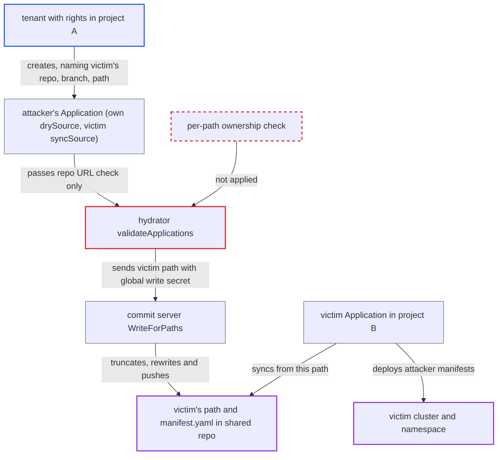

# Source hydrator lets any permitted project overwrite another app's hydrated path

| Field | Value |
|---|---|
| ID | `find_01VgcfLjHoyFZpfNdfZ79Jxk` |
| Severity | **High** |
| Status | open |
| CWE | CWE-862 — Missing Authorization |
| Created | 2026-10-27T21:41:59.141949Z |
| Claude Security | https://claude.ai/security/findings/find_01VgcfLjHoyFZpfNdfZ79Jxk |

## Description

A tenant with limited Argo CD rights can overwrite the manifests of another project's application and have them deployed under the victim's project, cluster and namespace. It needs `applications` create/update/get in a project whose `sourceRepos` allows the shared destination repo. It also needs the hydrator enabled and a global (non-project-scoped) write credential for that repo. The hydrator in `validateApplications` checks only repo URLs and never checks who owns the branch and path.

1. **attacker** creates an Application whose `drySource` is their own repo and whose `syncSource` is the victim's repo, branch and path. `ValidatePermissions` only requires that the dry repo and the sync repo URLs are allowed by the attacker project's `sourceRepos`, so branch and path are never authorized. ([`util/argo/argo.go:734-757`](https://github.com/cx-benchmark/argo-cd/blob/b7bc418289a96130340ea79964c4491b416c14f2/util/argo/argo.go#L734-L757))
2. **the hydrator `validateApplications`** accepts the new Application. It checks `IsSourcePermitted` on the repo URL, and its duplicate-destination check compares only apps in the same hydration group by raw path string. ([`controller/hydrator/hydrator.go:371-421`](https://github.com/cx-benchmark/argo-cd/blob/b7bc418289a96130340ea79964c4491b416c14f2/controller/hydrator/hydrator.go#L371-L421))
3. **the hydrator `getHydrationQueueKey`** puts the attacker's app in its own hydration group. The key includes the dry repo and dry revision, so a different dry repo means the victim's app is never compared with the attacker's. ([`controller/hydrator/hydrator.go:173-181`](https://github.com/cx-benchmark/argo-cd/blob/b7bc418289a96130340ea79964c4491b416c14f2/controller/hydrator/hydrator.go#L173-L181))
4. **the hydrator** sends the victim's path to the commit server with the global write credential. `getManifests` forwards `syncSource.path` unchanged, and the write credential lookup for the attacker's project falls back to the project-less `repository-write` secret. ([`controller/hydrator/hydrator.go:596-606`](https://github.com/cx-benchmark/argo-cd/blob/b7bc418289a96130340ea79964c4491b416c14f2/controller/hydrator/hydrator.go#L596-L606))
5. **the commit server `WriteForPaths`** truncates and rewrites `<victim path>/manifest.yaml`, then commits and pushes to the victim's sync branch. The file is opened with `O_TRUNC` and nothing checks who wrote the directory before. The push is made as Argo CD's own identity, so branch protection does not stop it. ([`commitserver/commit/hydratorhelper.go:57-75`](https://github.com/cx-benchmark/argo-cd/blob/b7bc418289a96130340ea79964c4491b416c14f2/commitserver/commit/hydratorhelper.go#L57-L75))
6. **the victim application's controller** reads the attacker's manifests from the path and syncs them. A hydrator app reconciles from `GetSyncSource()`, so the content is deployed under the victim's project, destination and cluster credentials. With automated sync no human action is needed. ([`controller/appcontroller.go:2272-2280`](https://github.com/cx-benchmark/argo-cd/blob/b7bc418289a96130340ea79964c4491b416c14f2/controller/appcontroller.go#L2272-L2280))
7. **attacker** re-runs the overwrite on demand with `argocd app get <own-app> --hard-refresh`. A hard refresh sets the `argocd.argoproj.io/hydrate: hard` annotation, which forces hydration without a new dry commit, so the path stays attacker-controlled until the victim's own dry source changes. ([`server/application/application.go:830-839`](https://github.com/cx-benchmark/argo-cd/blob/b7bc418289a96130340ea79964c4491b416c14f2/server/application/application.go#L830-L839))

## Assessment

The attacker is an Argo CD user with `applications` create/update/get in project A. Project A's `sourceRepos` must allow a shared destination repo that the victim app in project B also hydrates into. The hydrator must be enabled, and the repo must have a non-project-scoped write credential, which the docs require when several projects hydrate into one repo and branch. The attacker needs no action from the victim. A second route works inside one hydration group: with the same dry repo and revision, the attacker spells the path `./apps/x`, which the raw-string duplicate check treats as different from `apps/x`. The last path written wins, and the attacker controls the order by choosing an app name that sorts after the victim's, since `apps[0]` is the first item of the Kubernetes List. Spellings such as `apps/x/` and `apps//x` are also treated as different paths.

Impact: The attacker replaces the manifests the victim application syncs, so their content is deployed as the victim's app and the intended workload is replaced. The hydrated branch in the shared repo is corrupted under Argo CD's own commit identity. If commit signing is enabled, the content is signed with the commit server's key and also passes the victim project's source-integrity policy. The flaw itself discloses no Argo CD data.

Subsequent-system impact: The victim project's destination cluster and namespace receive arbitrary attacker-chosen Kubernetes objects, applied with the controller's cluster credentials. A deployed workload can mount the namespace's Secrets and ServiceAccounts, run arbitrary code, and delete or replace the project's resources, since pruning removes the legitimate ones. The only limits are project B's destination and resource allow/deny lists.

## Recommendation

(1) The hydrator authorizes a destination by repo URL only (`validateApplications`, `ValidatePermissions`). Nothing records which Application or AppProject owns a repo, branch and path, so any project allowed to use the repo can write any path that other apps sync from.

Fix criteria: A hydration destination (normalized repo URL, branch, cleaned path) is writable only by the Application recorded as its owner, or by apps of the same project if the project owner opts in. The controller refuses to hydrate, and the API server refuses to create or update, an Application whose destination is owned by another Application or project, whatever its dry source or hydration group. Creating the attacker app from the assessment is rejected and the victim's `manifest.yaml` stays unchanged.

(2) The duplicate-destination check compares the raw `syncSource.path` string and only within one hydration group. Equivalent spellings such as `./apps/x`, `apps/x/` and `apps//x`, and apps in other groups, are not detected.

Fix criteria: Destination comparison uses a canonical path (`filepath.Clean`, no leading `./`, no trailing `/`) and the normalized repo URL. It is applied across all Applications targeting the same repo and branch, not just those sharing a dry source. Two apps with `apps/x` and `./apps/x` on the same branch are detected as the same destination. An app with a different dry repo but the same destination path is also detected.

(3) AppProject `sourceRepos`, which is a read grant, is reused as a write grant for the hydrator. A project owner cannot restrict which repos, branches or path prefixes the project's apps may push to.

Fix criteria: Hydration destinations are authorized by a project-level write allowlist (repo plus branch and path patterns) that is separate from `sourceRepos` and denies by default when absent. The hydrator uses write credentials scoped to the app's project unless the operator explicitly allows global write credentials for cross-project destinations. An app in project A cannot hydrate into a repo, branch or path missing from A's write allowlist, even when the repo is in A's `sourceRepos`.

## Evidence

**https://github.com/cx-benchmark/argo-cd**

- [`controller/hydrator/hydrator.go:371-421`](https://github.com/cx-benchmark/argo-cd/blob/b7bc418289a96130340ea79964c4491b416c14f2/controller/hydrator/hydrator.go#L371-L421)
- [`controller/hydrator/hydrator.go:173-181`](https://github.com/cx-benchmark/argo-cd/blob/b7bc418289a96130340ea79964c4491b416c14f2/controller/hydrator/hydrator.go#L173-L181)
- [`controller/hydrator/hydrator.go:596-606`](https://github.com/cx-benchmark/argo-cd/blob/b7bc418289a96130340ea79964c4491b416c14f2/controller/hydrator/hydrator.go#L596-L606)
- [`commitserver/commit/hydratorhelper.go:57-75`](https://github.com/cx-benchmark/argo-cd/blob/b7bc418289a96130340ea79964c4491b416c14f2/commitserver/commit/hydratorhelper.go#L57-L75)
- [`util/argo/argo.go:734-757`](https://github.com/cx-benchmark/argo-cd/blob/b7bc418289a96130340ea79964c4491b416c14f2/util/argo/argo.go#L734-L757)
- [`controller/appcontroller.go:2272-2280`](https://github.com/cx-benchmark/argo-cd/blob/b7bc418289a96130340ea79964c4491b416c14f2/controller/appcontroller.go#L2272-L2280)
- [`server/application/application.go:830-839`](https://github.com/cx-benchmark/argo-cd/blob/b7bc418289a96130340ea79964c4491b416c14f2/server/application/application.go#L830-L839)

