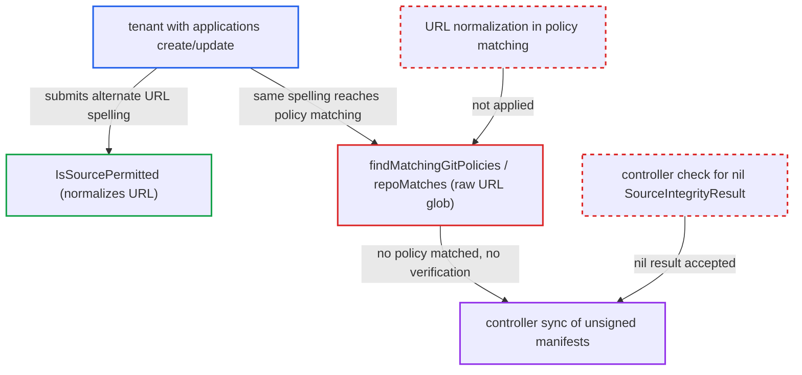

# Source-integrity policy matches raw repo URL while project allowlist normalizes it

| Field | Value |
|---|---|
| ID | `find_0158zwozVomyuR6AaW3RCzsQ` |
| Severity | **High** |
| Status | open |
| CWE | CWE-863 — Improper authorization |
| Created | 2026-10-27T21:22:11.328719Z |
| Claude Security | https://claude.ai/security/findings/find_0158zwozVomyuR6AaW3RCzsQ |

## Description

A tenant who can create or update applications in an Argo CD project that requires signed commits can deploy unsigned commits from a permitted repository. They write the repository URL in a different spelling, and the signature check is then skipped. Anyone with `applications, override` can also use `sync --local`. The cause is that `repoMatches` globs the raw URL, while `IsSourcePermitted` normalizes it. A source that matches no policy is left unverified.

1. **tenant** pushes an unsigned commit to a branch of a permitted repository. The tenant does not have the trusted signing key, so the commit is unsigned.
2. **tenant** creates or updates an application with another spelling of the repository URL. For example `https://GitHub.com/org/app` with upper-case host or org, with `targetRevision` set to the unsigned branch.
3. **`IsSourcePermitted`** accepts the URL against `spec.sourceRepos`. It normalizes both the application URL and each allowlist pattern with `git.NormalizeGitURL`, so the alternate spelling matches the same entry as the canonical one. ([`pkg/apis/application/v1alpha1/app_project_types.go:458-480`](https://github.com/cx-benchmark/argo-cd/blob/b7bc418289a96130340ea79964c4491b416c14f2/pkg/apis/application/v1alpha1/app_project_types.go#L458-L480))
4. **`getRepository`** passes the application's raw URL to the repo-server. When no dedicated repository secret matches, it returns `Repository{Repo: repoURL}` verbatim, and credential templates do not rewrite `Repo`. ([`util/db/repository.go:151-165`](https://github.com/cx-benchmark/argo-cd/blob/b7bc418289a96130340ea79964c4491b416c14f2/util/db/repository.go#L151-L165))
5. **`findMatchingGitPolicies`/`repoMatches`** finds no policy for the raw spelling. It globs the raw string case-sensitively with no `.git` or SSH normalization, so `https://github.com/org/*` does not match `https://GitHub.com/org/app`. ([`util/sourceintegrity/source_integrity.go:92-123`](https://github.com/cx-benchmark/argo-cd/blob/b7bc418289a96130340ea79964c4491b416c14f2/util/sourceintegrity/source_integrity.go#L92-L123))
6. **`VerifyGit`** returns a nil result without checking signatures. A source matched by no policy is documented as not verified, and `lookupGit` returns nil. ([`util/sourceintegrity/source_integrity.go:22-51`](https://github.com/cx-benchmark/argo-cd/blob/b7bc418289a96130340ea79964c4491b416c14f2/util/sourceintegrity/source_integrity.go#L22-L51))
7. **the controller in `controller/state.go`** accepts the nil result and syncs the unsigned manifests. It raises a `ComparisonError` only for a non-nil failing `SourceIntegrityResult`. ([`controller/state.go:1115-1123`](https://github.com/cx-benchmark/argo-cd/blob/b7bc418289a96130340ea79964c4491b416c14f2/controller/state.go#L1115-L1123))

## Assessment

The attacker is a tenant with `applications, create/update` in a project whose policy requires signatures. They must be able to push an unsigned commit to a permitted repo, for example to a branch, without the signing key. No dedicated repository secret may match the URL, so the repo is public or served by a credential template. A dedicated secret is matched with `git.SameURL` and substitutes its own canonical URL. Another route is for holders of `applications, override` to use `sync --local`. The same raw `HasCriteria` matching on `source.RepoURL` lets the alternate spelling past that guard.

Impact: The project's signature requirement is skipped, so arbitrary unsigned manifests from the repository are rendered and applied with Argo CD's cluster credentials. The project's destination and resource-kind allowlists still limit what can be deployed. Within those limits the attacker can run arbitrary workloads, read secrets in the target namespaces, and replace or remove managed resources.

## Recommendation

(1) Policy repository globs are matched against the raw URL string, while `sourceRepos` permission uses `git.NormalizeGitURL`. One repository therefore has permitted spellings that no policy covers, and unmatched sources are not verified.

Fix criteria: Policy matching uses the same URL canonicalization as `IsSourcePermitted`. Both the policy glob and the source URL are normalized, including when `HasCriteria` evaluates `source.RepoURL`. `https://GitHub.com/org/app`, `https://github.com/org/app.git` and `https://github.com/org/app` all select the same policy. All three fail verification for an unsigned commit.

(2) The application controller silently treats a source that matches no policy, or whose repo-server result is nil, as verified. Any mismatch between the matchers therefore fails open.

Fix criteria: When the controller's own `HasCriteria` evaluation says a source is policy-covered but the manifest response has no `SourceIntegrityResult`, the application gets a `ComparisonError` instead of syncing, as the hydrator already does. Forcing a nil result for a covered source produces a blocking condition.

## Evidence

**https://github.com/cx-benchmark/argo-cd**

- [`util/sourceintegrity/source_integrity.go:92-123`](https://github.com/cx-benchmark/argo-cd/blob/b7bc418289a96130340ea79964c4491b416c14f2/util/sourceintegrity/source_integrity.go#L92-L123)
- [`util/sourceintegrity/source_integrity.go:22-51`](https://github.com/cx-benchmark/argo-cd/blob/b7bc418289a96130340ea79964c4491b416c14f2/util/sourceintegrity/source_integrity.go#L22-L51)
- [`pkg/apis/application/v1alpha1/app_project_types.go:458-480`](https://github.com/cx-benchmark/argo-cd/blob/b7bc418289a96130340ea79964c4491b416c14f2/pkg/apis/application/v1alpha1/app_project_types.go#L458-L480)
- [`util/db/repository.go:151-165`](https://github.com/cx-benchmark/argo-cd/blob/b7bc418289a96130340ea79964c4491b416c14f2/util/db/repository.go#L151-L165)
- [`reposerver/repository/repository.go:535-566`](https://github.com/cx-benchmark/argo-cd/blob/b7bc418289a96130340ea79964c4491b416c14f2/reposerver/repository/repository.go#L535-L566)
- [`controller/state.go:1115-1123`](https://github.com/cx-benchmark/argo-cd/blob/b7bc418289a96130340ea79964c4491b416c14f2/controller/state.go#L1115-L1123)
- [`server/application/application.go:2154-2156`](https://github.com/cx-benchmark/argo-cd/blob/b7bc418289a96130340ea79964c4491b416c14f2/server/application/application.go#L2154-L2156)

