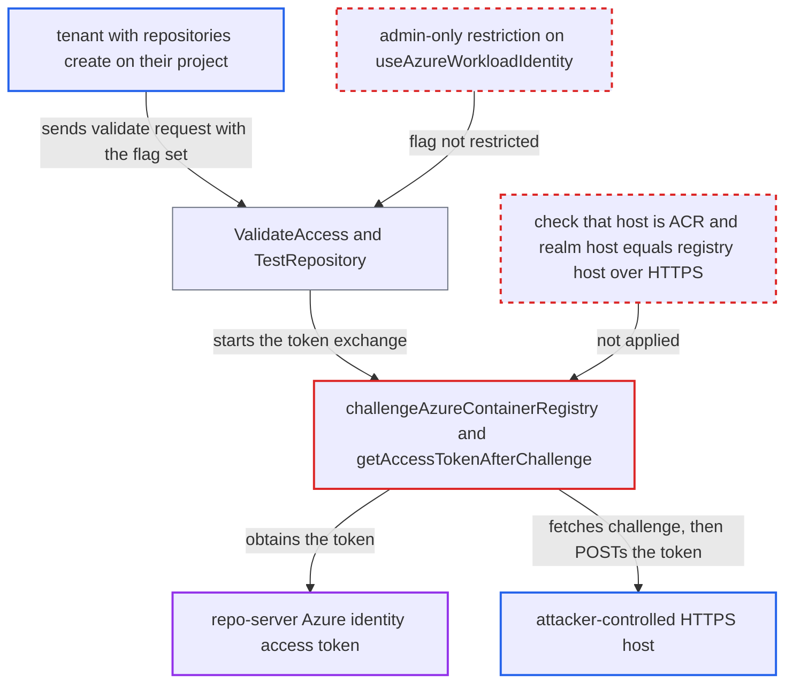

# Tenant-created Helm OCI repository makes repo-server POST its Azure identity token to an attacker-chosen realm

| Field | Value |
|---|---|
| ID | `find_01FRVbmm9JYd4HN6fiSWTub8` |
| Severity | **High** |
| Status | open |
| CWE | CWE-522 — Credential exposure |
| Created | 2026-10-27T21:24:41.886686Z |
| Claude Security | https://claude.ai/security/findings/find_01FRVbmm9JYd4HN6fiSWTub8 |

## Description

A tenant who can create repositories in their own project can make Argo CD's repo-server send its Azure identity access token to a server the tenant controls. The tenant can then use that token as the repo-server's identity in Azure. The cause is that `getAccessTokenAfterChallenge` POSTs the token to a `realm` taken from the remote server's challenge, and nothing checks the registry host, the realm host or HTTPS. The flag `useAzureWorkloadIdentity` can also be set by a project-scoped user.

1. **Tenant with `repositories, create` on their project** sends a validate request for a Helm OCI repository on their own host. The request sets `type: helm`, `enableOci: true`, `useAzureWorkloadIdentity: true` and `project`, and `Repo` is the attacker's HTTPS host. ([`server/repository/repository.go:683-727`](https://github.com/cx-benchmark/argo-cd/blob/b7bc418289a96130340ea79964c4491b416c14f2/server/repository/repository.go#L683-L727))
2. **the API handler `ValidateAccess`** copies `Repo`, `EnableOCI` and `UseAzureWorkloadIdentity` from the request and passes them on to the repo-server. The only check is the `repositories, create, <project>/<url>` permission, so the attacker's chosen host is accepted. ([`server/repository/repository.go:683-727`](https://github.com/cx-benchmark/argo-cd/blob/b7bc418289a96130340ea79964c4491b416c14f2/server/repository/repository.go#L683-L727))
3. **the repo-server `TestRepository`** builds Helm credentials with `GetHelmCreds` and calls `TestHelmOCI`. `GetHelmCreds` returns `AzureWorkloadIdentityCreds` bound to the repository's own `Repo` URL without checking the host, and `TestHelmOCI` calls `GetPassword()` unconditionally. ([`reposerver/repository/repository.go:3255-3287`](https://github.com/cx-benchmark/argo-cd/blob/b7bc418289a96130340ea79964c4491b416c14f2/reposerver/repository/repository.go#L3255-L3287))
4. **the function `challengeAzureContainerRegistry`** sends an unauthenticated GET to `https://<host>/v2/` on the attacker's host. `GetAccessToken` takes the host from the repository URL, and the attacker's server answers 401 with a `Www-Authenticate` header carrying its own `realm` and `service`, which the function accepts without restriction. ([`util/helm/creds.go:243-296`](https://github.com/cx-benchmark/argo-cd/blob/b7bc418289a96130340ea79964c4491b416c14f2/util/helm/creds.go#L243-L296))
5. **the function `getAccessTokenAfterChallenge`** gets the pod identity's Entra ID token and POSTs it as `access_token=` to `<realm>/oauth2/exchange`. The token comes from `azidentity.NewDefaultAzureCredential` for `AZURE_ARM_TOKEN_RESOURCE/.default`, and the realm host and scheme are not validated, so the token lands on the attacker's server. ([`util/helm/creds.go:180-213`](https://github.com/cx-benchmark/argo-cd/blob/b7bc418289a96130340ea79964c4491b416c14f2/util/helm/creds.go#L180-L213))

## Assessment

The attacker is a tenant with `repositories, create` permission on their project, which project roles may grant and which the project-scoped repositories feature exists to give out. They control an HTTPS host. The repo-server must have an Azure identity, such as Workload Identity on AKS, which is the documented setup. No victim action is needed, and the attacker can repeat the call to get a fresh token. Besides the validate call, a persisted project-scoped repository (`CreateRepository`) and Chart.yaml dependency credentials reach the same code.

Impact: The attacker obtains a live bearer token for the repo-server's Azure identity, valid until its `exp` and renewable by repeating the call. Argo CD data is not modified and the service is not disrupted.

Subsequent-system impact: The token is the kind the real ACR `/oauth2/exchange` accepts, so the attacker can act as the identity in Azure and pull every chart and image it can read. With the default scope `https://management.core.windows.net` it is also an Azure Resource Manager token, so the attacker can take any further action the identity's Azure roles allow. Write impact depends on roles the code does not show, such as AcrPush.

## Recommendation

(1) The ACR token exchange sends the pod identity's ARM access token to a URL taken from an untrusted server's challenge. It also does so for any registry host that a low-privileged repository object names.

Fix criteria: The exchange runs only when the registry host is a trusted ACR endpoint (for example it matches `*.azurecr.io` or an admin-configured allowlist). The challenge `realm` host must also equal the registry host and use HTTPS. Otherwise the call fails without requesting the token. A repository pointing at a non-ACR host with `useAzureWorkloadIdentity: true` causes no token request and no POST.

(2) The `useAzureWorkloadIdentity` flag spends the repo-server's own cloud identity, yet any user with project-scoped `repositories, create` RBAC can set it.

Fix criteria: Enabling workload-identity authentication on a repository requires an administrative privilege, or is limited to admin-managed credential templates. A project-scoped user cannot persist the flag.

## Evidence

**https://github.com/cx-benchmark/argo-cd**

- [`util/helm/creds.go:180-213`](https://github.com/cx-benchmark/argo-cd/blob/b7bc418289a96130340ea79964c4491b416c14f2/util/helm/creds.go#L180-L213)
- [`util/helm/creds.go:243-296`](https://github.com/cx-benchmark/argo-cd/blob/b7bc418289a96130340ea79964c4491b416c14f2/util/helm/creds.go#L243-L296)
- [`util/helm/creds.go:126-160`](https://github.com/cx-benchmark/argo-cd/blob/b7bc418289a96130340ea79964c4491b416c14f2/util/helm/creds.go#L126-L160)
- [`pkg/apis/application/v1alpha1/repository_types.go:307-316`](https://github.com/cx-benchmark/argo-cd/blob/b7bc418289a96130340ea79964c4491b416c14f2/pkg/apis/application/v1alpha1/repository_types.go#L307-L316)
- [`server/repository/repository.go:683-727`](https://github.com/cx-benchmark/argo-cd/blob/b7bc418289a96130340ea79964c4491b416c14f2/server/repository/repository.go#L683-L727)
- [`reposerver/repository/repository.go:3255-3287`](https://github.com/cx-benchmark/argo-cd/blob/b7bc418289a96130340ea79964c4491b416c14f2/reposerver/repository/repository.go#L3255-L3287)
- [`util/helm/client.go:352-375`](https://github.com/cx-benchmark/argo-cd/blob/b7bc418289a96130340ea79964c4491b416c14f2/util/helm/client.go#L352-L375)
- [`util/workloadidentity/workloadidentity_cgo.go:17-35`](https://github.com/cx-benchmark/argo-cd/blob/b7bc418289a96130340ea79964c4491b416c14f2/util/workloadidentity/workloadidentity_cgo.go#L17-L35)

