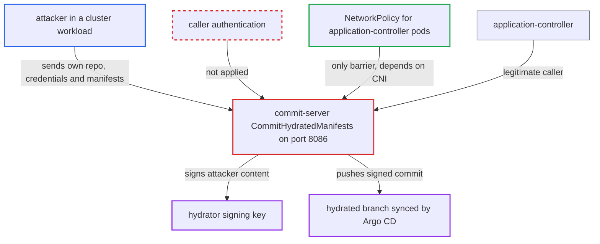

# Unauthenticated commit-server lets network peers obtain commits signed with the hydrator key

| Field | Value |
|---|---|
| ID | `find_01K9qsSVrfLvwXVJGrWY335s` |
| Severity | **High** |
| Status | open |
| CWE | CWE-306 — Missing authentication |
| Created | 2026-10-27T21:31:07.350409Z |
| Claude Security | https://claude.ai/security/findings/find_01K9qsSVrfLvwXVJGrWY335s |

## Description

A compromised workload in the cluster can get commits with arbitrary manifests signed by the hydrator key and pushed to a hydrated branch. Argo CD then accepts those commits as its own output. This needs network reach to port 8086 and push access to the target repo. It also needs signing enabled and a CNI that does not enforce NetworkPolicy. The cause is that the commit-server's gRPC server has no caller authentication.

1. **attacker** connects to the commit-server on port 8086. The gRPC server is built with `grpc.NewServer` and has no transport credentials, no interceptors and no caller check, so any peer that reaches the port can call it. ([`commitserver/server.go:30-41`](https://github.com/cx-benchmark/argo-cd/blob/b7bc418289a96130340ea79964c4491b416c14f2/commitserver/server.go#L30-L41))
2. **attacker** sends a `CommitHydratedManifestsRequest` with their own repository, credentials, branch and manifests. `handleCommitRequest` only checks that the repo URL, `TargetBranch` and `SyncBranch` are non-empty, and takes everything else from the caller. ([`commitserver/commit/commit.go:105-118`](https://github.com/cx-benchmark/argo-cd/blob/b7bc418289a96130340ea79964c4491b416c14f2/commitserver/commit/commit.go#L105-L118))
3. **commit-server** builds a git client from the caller's `Repository`. The client uses the URL, credentials, `Insecure`, `Proxy` and `NoProxy` from the request, so the server fetches from and pushes to any destination the caller names. ([`commitserver/commit/repo_client_factory.go:27-32`](https://github.com/cx-benchmark/argo-cd/blob/b7bc418289a96130340ea79964c4491b416c14f2/commitserver/commit/repo_client_factory.go#L27-L32))
4. **commit-server** commits the attacker's manifests signed with the hydrator key. When signing is enabled, `Commit` passes `-c user.signingkey=<KeyID> -c commit.gpgsign=true`. The key sits in a shared GNUPGHOME with its passphrase preset, so it signs without interaction. ([`util/git/client.go:1968-2003`](https://github.com/cx-benchmark/argo-cd/blob/b7bc418289a96130340ea79964c4491b416c14f2/util/git/client.go#L1968-L2003))
5. **commit-server** checks its own signature and pushes to the caller's `TargetBranch`. The push uses the caller's credentials, and nothing ties the request to a verified dry commit or a configured destination. ([`commitserver/commit/commit.go:195-239`](https://github.com/cx-benchmark/argo-cd/blob/b7bc418289a96130340ea79964c4491b416c14f2/commitserver/commit/commit.go#L195-L239))
6. **Argo CD sync** accepts the commit and applies the attacker's manifests. `SourceIntegrity` only checks that the signer key is in the allowed keys, so the hydrator-signed commit passes on a hydrated branch set up as the docs instruct. ([`util/sourceintegrity/source_integrity.go:219-231`](https://github.com/cx-benchmark/argo-cd/blob/b7bc418289a96130340ea79964c4491b416c14f2/util/sourceintegrity/source_integrity.go#L219-L231))

## Assessment

The attacker runs code in a cluster workload that can reach `argocd-commit-server:8086`. They also hold ordinary push access to the repo of a hydrated branch. Signing must be enabled through `commitserver.signing.key.path`. The hydrated branch must be verified by `SourceIntegrity`. The cluster's CNI must not enforce the shipped ingress NetworkPolicy, which admits only pods labelled `argocd-application-controller`. The attacker needs no other login. Without signing, the endpoint still does `git fetch` and `git push` to any URL the caller names, through the commit-server's network position.

Impact: The attacker can forge commits signed by the operator's hydrator key, with any manifests at any paths, and push them to the hydrated branch. The key itself is not disclosed. The outbound fetch and push to caller-chosen URLs gives no confidential data, and the service stays available.

Subsequent-system impact: Applications syncing the hydrated branch accept the forged commit as Argo CD output, because `SourceIntegrity` passes. Argo CD applies the attacker's manifests to the destination cluster, bounded only by the AppProject's destination and resource allowlists. Within those limits the attacker can run arbitrary workloads that read secrets in the allowed namespaces, change resources there, or replace and prune them.

## Recommendation

(1) `CommitService` authenticates no caller, so the hydrator signing key and the push capability are open to any network peer instead of only the application-controller. The only barrier is a NetworkPolicy whose enforcement depends on the cluster CNI.

Fix criteria: `CommitHydratedManifests` rejects callers that cannot prove they are the application-controller, for example with mutual TLS using a configured client CA as the repo-server supports. It does not rely only on NetworkPolicy. A gRPC call from a pod without the controller's client identity fails before any git operation or signature. The controller's hydration still succeeds.

(2) The commit-server signs and pushes any repository, branch and content in the request. It has no server-side notion of which destinations hydration may write, or of the verified dry commit the signature is meant to attest.

Fix criteria: Signing is limited to requests the server can tie to an authorized hydration: an authenticated controller, and a destination repo and branch configured for hydration. A direct request for an unconfigured destination produces no signed commit. Such a request is refused, and no signed object is created or pushed.

## Evidence

**https://github.com/cx-benchmark/argo-cd**

- [`commitserver/server.go:30-41`](https://github.com/cx-benchmark/argo-cd/blob/b7bc418289a96130340ea79964c4491b416c14f2/commitserver/server.go#L30-L41)
- [`commitserver/commit/commit.go:105-118`](https://github.com/cx-benchmark/argo-cd/blob/b7bc418289a96130340ea79964c4491b416c14f2/commitserver/commit/commit.go#L105-L118)
- [`commitserver/commit/commit.go:195-239`](https://github.com/cx-benchmark/argo-cd/blob/b7bc418289a96130340ea79964c4491b416c14f2/commitserver/commit/commit.go#L195-L239)
- [`util/git/client.go:1968-2003`](https://github.com/cx-benchmark/argo-cd/blob/b7bc418289a96130340ea79964c4491b416c14f2/util/git/client.go#L1968-L2003)
- [`commitserver/commit/repo_client_factory.go:27-32`](https://github.com/cx-benchmark/argo-cd/blob/b7bc418289a96130340ea79964c4491b416c14f2/commitserver/commit/repo_client_factory.go#L27-L32)
- [`cmd/argocd-commit-server/commands/argocd_commit_server.go:66-88`](https://github.com/cx-benchmark/argo-cd/blob/b7bc418289a96130340ea79964c4491b416c14f2/cmd/argocd-commit-server/commands/argocd_commit_server.go#L66-L88)
- [`controller/hydrator/hydrator.go:583-590`](https://github.com/cx-benchmark/argo-cd/blob/b7bc418289a96130340ea79964c4491b416c14f2/controller/hydrator/hydrator.go#L583-L590)
- [`util/sourceintegrity/source_integrity.go:219-231`](https://github.com/cx-benchmark/argo-cd/blob/b7bc418289a96130340ea79964c4491b416c14f2/util/sourceintegrity/source_integrity.go#L219-L231)
- [`manifests/base/commit-server/argocd-commit-server-network-policy.yaml:9-22`](https://github.com/cx-benchmark/argo-cd/blob/b7bc418289a96130340ea79964c4491b416c14f2/manifests/base/commit-server/argocd-commit-server-network-policy.yaml#L9-L22)
- [`docs/user-guide/source-hydrator.md:674-731`](https://github.com/cx-benchmark/argo-cd/blob/b7bc418289a96130340ea79964c4491b416c14f2/docs/user-guide/source-hydrator.md#L674-L731)

