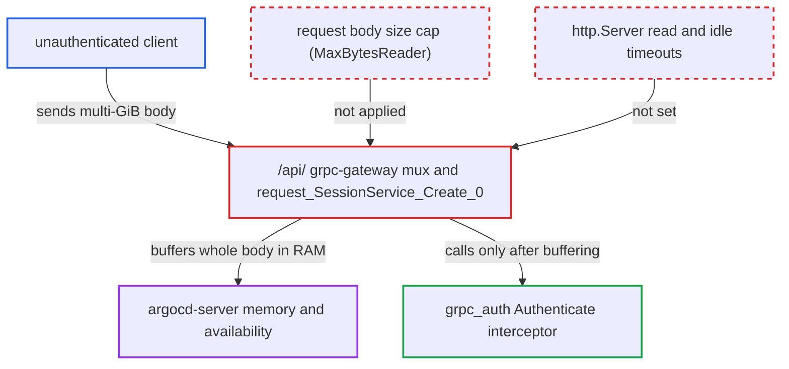

# Unauthenticated REST requests are buffered whole in memory with no body size limit

| Field | Value |
|---|---|
| ID | `find_01RdoZHipSe1MfcfAJYNeJe3` |
| Severity | **High** |
| Status | open |
| CWE | CWE-770 — Resource allocation without limits |
| Created | 2026-10-27T21:19:46.384065Z |
| Claude Security | https://claude.ai/security/findings/find_01RdoZHipSe1MfcfAJYNeJe3 |

## Description

An unauthenticated network client can crash argocd-server by sending very large request bodies, which takes down the UI, API, SSO login, webhooks and terminal for every user. No login is needed, and the default configuration is affected. The REST gateway mounted at `/api/` reads the whole body into memory before authentication, with no size cap and no server timeouts.

1. **attacker** sends `POST /api/v1/session` with a multi-GiB body. The request uses `Content-Type: application/json`, the default value of `--api-content-types`, and the body can be sent at once or slowly. Many such requests can also run in parallel. ([`pkg/apiclient/session/session.pb.gw.go:54-69`](https://github.com/cx-benchmark/argo-cd/blob/b7bc418289a96130340ea79964c4491b416c14f2/pkg/apiclient/session/session.pb.gw.go#L54-L69))
2. **`http.Server`** accepts the connection and passes it on without limits. The server sets no `ReadTimeout`, `ReadHeaderTimeout`, `WriteTimeout` or `IdleTimeout`, so a client may stream the body as slowly as it likes. ([`server/server.go:1230-1241`](https://github.com/cx-benchmark/argo-cd/blob/b7bc418289a96130340ea79964c4491b416c14f2/server/server.go#L1230-L1241))
3. **the `/api/` mux chain** routes the request to the grpc-gateway handler without touching the body. Only `withTracingHandler`, `enforceContentTypes` and `withNoCacheHeaders` wrap the `runtime.ServeMux`, and none of them limits the body; no `http.MaxBytesReader` is applied. ([`server/server.go:1265-1288`](https://github.com/cx-benchmark/argo-cd/blob/b7bc418289a96130340ea79964c4491b416c14f2/server/server.go#L1265-L1288))
4. **the generated handler `request_SessionService_Create_0`** reads the entire body into memory and decodes it. `utilities.IOReaderFactory(req.Body)` does `ioutil.ReadAll` in grpc-gateway v1.16.0, and the JSON decoder then buffers the value a second time, all before `client.Create` is called. ([`pkg/apiclient/session/session.pb.gw.go:54-69`](https://github.com/cx-benchmark/argo-cd/blob/b7bc418289a96130340ea79964c4491b416c14f2/pkg/apiclient/session/session.pb.gw.go#L54-L69))
5. **argocd-server** authenticates only after the body is in memory. `grpc_auth.UnaryServerInterceptor(server.Authenticate)` and the 200 MiB `MaxRecvMsgSize` apply only in the in-process gRPC server, so memory use reaches roughly two to three times the bytes received until the process is OOM-killed.

## Assessment

The attacker is any unauthenticated client who can reach argocd-server over the network. No credentials or victim action are needed, and the default configuration is affected. The attacker sends `POST /api/v1/session` with `Content-Type: application/json` and a body of several GiB, either at once or slowly, or sends many such requests in parallel. Every POST, PUT and PATCH route under `/api/` behaves the same way, not only the ones with `AuthFuncOverride`. The default manifest `manifests/base/server/argocd-server-deployment.yaml` sets no memory limit, so the node's kernel OOM killer ends the process rather than a pod limit.

Impact: The attacker can exhaust argocd-server's memory until the process is killed. The API, UI, SSO login, webhook and terminal endpoints, which all run in this process, are unavailable to every user until the pod restarts, and repeated requests keep it down. The report finds no confidentiality or integrity impact.

## Recommendation

The REST gateway handler chain accepts and fully buffers request bodies of unlimited size from unauthenticated clients, so the memory used per request is under the attacker's control. The `http.Server` also has no read, header or idle timeouts.

Fix criteria: Every request body reaching the `/api/` gateway, and other body-accepting HTTP routes, is capped at a configured maximum before it is read. The cap is at most the gRPC message limit and ideally far lower for unauthenticated endpoints such as session creation. A body over the cap gets a `413` response. The HTTP server also has read, header and idle timeouts. Verification: a request whose `Content-Length` or streamed body exceeds the cap is rejected, and the server's memory does not grow beyond the cap.

## Evidence

**https://github.com/cx-benchmark/argo-cd**

- [`server/server.go:1265-1288`](https://github.com/cx-benchmark/argo-cd/blob/b7bc418289a96130340ea79964c4491b416c14f2/server/server.go#L1265-L1288)
- [`server/server.go:1230-1241`](https://github.com/cx-benchmark/argo-cd/blob/b7bc418289a96130340ea79964c4491b416c14f2/server/server.go#L1230-L1241)
- [`pkg/apiclient/session/session.pb.gw.go:54-69`](https://github.com/cx-benchmark/argo-cd/blob/b7bc418289a96130340ea79964c4491b416c14f2/pkg/apiclient/session/session.pb.gw.go#L54-L69)
- [`util/webhook/scm.go:133`](https://github.com/cx-benchmark/argo-cd/blob/b7bc418289a96130340ea79964c4491b416c14f2/util/webhook/scm.go#L133)

