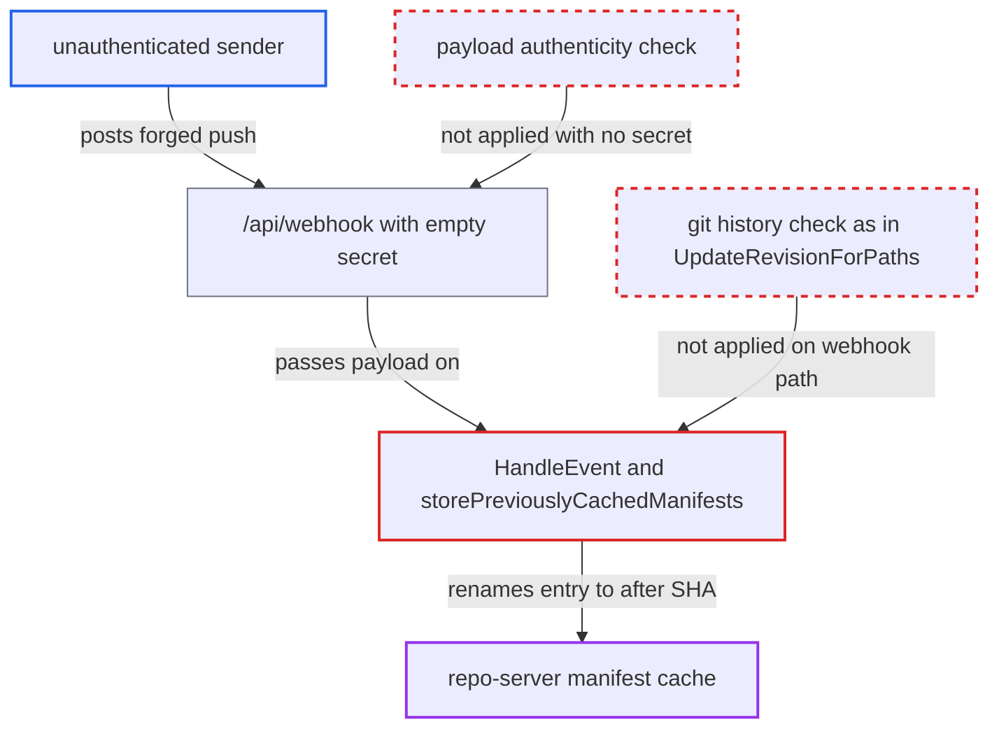

# Unauthenticated webhook before/after SHAs move repo-server manifest cache onto arbitrary revisions

| Field | Value |
|---|---|
| ID | `find_01R6w3Qa7PgC8zf3XzfS9qZS` |
| Severity | **High** |
| Status | open |
| CWE | CWE-345 — Insufficient authenticity verification |
| Created | 2026-10-27T21:23:23.390497Z |
| Claude Security | https://claude.ai/security/findings/find_01R6w3Qa7PgC8zf3XzfS9qZS |

## Description

An unauthenticated sender can make Argo CD treat an old cached rendering as the manifests of a newer commit. A new commit's changes then go undeployed while the app shows Synced, or an older rendering is re-applied, for the cache TTL (24h default). It needs an SCM provider with no webhook secret (the default), an app with the `argocd.argoproj.io/manifest-generate-paths` annotation, and the full commit SHAs. The cause is `HandleEvent`, which renames the manifest cache from a forged push payload's `before`/`after` SHAs.

1. **attacker** posts a forged push event to `/api/webhook`. The endpoint has no authentication, and with an empty provider secret (the default) the parser does no signature or token check, so the payload is accepted as genuine. ([`util/webhook/scm.go:54-115`](https://github.com/cx-benchmark/argo-cd/blob/b7bc418289a96130340ea79964c4491b416c14f2/util/webhook/scm.go#L54-L115))
2. **parser `ParsePushEvent`** copies the payload fields into the event. The repo URL, ref, `before`/`after` SHAs and changed-file lists are taken verbatim from the request body. ([`util/webhook/push.go:26-115`](https://github.com/cx-benchmark/argo-cd/blob/b7bc418289a96130340ea79964c4491b416c14f2/util/webhook/push.go#L26-L115))
3. **the handler `HandleEvent`** takes the cache-move branch for each matching annotated app. The attacker lists only files outside the app's refresh paths, so `AppFilesHaveChanged` returns false and the handler does not treat the push as a real change. ([`util/app/path/path.go:159-188`](https://github.com/cx-benchmark/argo-cd/blob/b7bc418289a96130340ea79964c4491b416c14f2/util/app/path/path.go#L159-L188))
4. **the handler `HandleEvent`** calls `storePreviouslyCachedManifests` with the attacker's `shaBefore` and `shaAfter`. No check ties either SHA to the app's synced revision or to git history, and nothing verifies that the payload was authenticated. ([`util/webhook/webhook.go:403-409`](https://github.com/cx-benchmark/argo-cd/blob/b7bc418289a96130340ea79964c4491b416c14f2/util/webhook/webhook.go#L403-L409))
5. **`storePreviouslyCachedManifests`** renames the cached entry for `shaBefore` to `shaAfter`. It rewrites `Revision` to `shaAfter` and the Redis `RENAME` overwrites any existing entry for `shaAfter`. ([`util/webhook/webhook.go:461-531`](https://github.com/cx-benchmark/argo-cd/blob/b7bc418289a96130340ea79964c4491b416c14f2/util/webhook/webhook.go#L461-L531))
6. **the repo-server** serves the moved entry as the rendering of `shaAfter`. `GetManifests` stamps the requested revision onto the entry, and `runRepoOperation` returns it once the branch resolves to `shaAfter` and `noCache` is false. ([`reposerver/repository/repository.go:396-400`](https://github.com/cx-benchmark/argo-cd/blob/b7bc418289a96130340ea79964c4491b416c14f2/reposerver/repository/repository.go#L396-L400))
7. **the controller** compares and syncs using the substituted manifests. Sync runs with `noCache=false`, so the old manifests are what gets applied. ([`controller/sync.go:214`](https://github.com/cx-benchmark/argo-cd/blob/b7bc418289a96130340ea79964c4491b416c14f2/controller/sync.go#L214))

## Assessment

The attacker needs network access to `/api/webhook`. At least one SCM provider must have no webhook secret, which is the default. The target must be a single-source git app with the `argocd.argoproj.io/manifest-generate-paths` annotation, and webhook cache warming must not be disabled (it is on by default). The attacker must know the full commit SHAs, which are public for public repos or visible to any app reader. The forged push names the app's repo URL and branch, with `commits[].modified` outside the app's `manifest-generate-paths`, `before` set to a commit whose manifests are cached (for example the synced revision) and `after` set to the branch's current or next HEAD. There is a further variant. A read-only user with `applications, get` can call `GET /api/v1/applications/{name}/manifests?revision=<sha>` to render and cache the app at any fetchable commit under the same key fields, when the project has no source-integrity policy. If that user can push to any branch, the forged rename can promote an unreviewed commit onto the tracked branch's HEAD.

Impact: The attacker decides which cached rendering Argo CD treats as a given commit of an annotated app, in any project, for the cache TTL (24h default). A later unrelated commit carries the substitution forward. A new commit's changes can be silently left undeployed while the app reports Synced, or an older rendering can be re-applied by self-heal, a manual sync or the next auto-sync. Nothing is disclosed and the service keeps running.

Subsequent-system impact: The controller applies the substituted manifests to the destination cluster with the app's credentials, within the AppProject's allowed destinations and kinds. An unauthenticated attacker is limited to renderings already cached for that app. Workloads can be rolled back or frozen, for example a security fix withheld, but not given attacker-authored content.

## Recommendation

(1) `HandleEvent` moves the manifest cache based on `before`/`after` SHAs and a changed-file list from a payload whose authenticity was never established. This contradicts the documented promise that unauthenticated payloads only cause a refresh.

Fix criteria: The manifest cache is never moved or rewritten for a payload that did not pass provider signature or token verification, and an unconfigured secret counts as unauthenticated. Test: send a forged push with arbitrary before/after to an installation without secrets. Confirm the cache entry for `after` is not created or overwritten and the `before` entry is untouched.

(2) Even for authenticated payloads, the rename trusts that `shaBefore` is the rendering relevant to the app and that the diff to `shaAfter` misses its paths. The repo-server also stamps the requested revision onto whatever entry it finds.

Fix criteria: Before an entry is moved, the change set between the two revisions is verified against the repository, as `UpdateRevisionForPaths` does, and `shaBefore` matches the app's compared revision. Alternatively, the cache entry records the commit it was rendered from and a lookup mismatch counts as a miss. Test: a renamed, mismatched entry causes the manifests to be regenerated.

## Evidence

**https://github.com/cx-benchmark/argo-cd**

- [`util/webhook/webhook.go:403-409`](https://github.com/cx-benchmark/argo-cd/blob/b7bc418289a96130340ea79964c4491b416c14f2/util/webhook/webhook.go#L403-L409)
- [`util/webhook/webhook.go:461-531`](https://github.com/cx-benchmark/argo-cd/blob/b7bc418289a96130340ea79964c4491b416c14f2/util/webhook/webhook.go#L461-L531)
- [`util/webhook/scm.go:54-115`](https://github.com/cx-benchmark/argo-cd/blob/b7bc418289a96130340ea79964c4491b416c14f2/util/webhook/scm.go#L54-L115)
- [`util/webhook/push.go:26-115`](https://github.com/cx-benchmark/argo-cd/blob/b7bc418289a96130340ea79964c4491b416c14f2/util/webhook/push.go#L26-L115)
- [`util/webhook/webhook.go:204-213`](https://github.com/cx-benchmark/argo-cd/blob/b7bc418289a96130340ea79964c4491b416c14f2/util/webhook/webhook.go#L204-L213)
- [`util/cache/redis.go:120-127`](https://github.com/cx-benchmark/argo-cd/blob/b7bc418289a96130340ea79964c4491b416c14f2/util/cache/redis.go#L120-L127)
- [`reposerver/cache/cache.go:393-431`](https://github.com/cx-benchmark/argo-cd/blob/b7bc418289a96130340ea79964c4491b416c14f2/reposerver/cache/cache.go#L393-L431)
- [`reposerver/cache/cache.go:133-145`](https://github.com/cx-benchmark/argo-cd/blob/b7bc418289a96130340ea79964c4491b416c14f2/reposerver/cache/cache.go#L133-L145)
- [`reposerver/repository/repository.go:396-400`](https://github.com/cx-benchmark/argo-cd/blob/b7bc418289a96130340ea79964c4491b416c14f2/reposerver/repository/repository.go#L396-L400)
- [`controller/sync.go:214`](https://github.com/cx-benchmark/argo-cd/blob/b7bc418289a96130340ea79964c4491b416c14f2/controller/sync.go#L214)
- [`reposerver/repository/repository.go:3564-3720`](https://github.com/cx-benchmark/argo-cd/blob/b7bc418289a96130340ea79964c4491b416c14f2/reposerver/repository/repository.go#L3564-L3720)
- [`util/app/path/path.go:159-188`](https://github.com/cx-benchmark/argo-cd/blob/b7bc418289a96130340ea79964c4491b416c14f2/util/app/path/path.go#L159-L188)
- [`server/application/application.go:493-616`](https://github.com/cx-benchmark/argo-cd/blob/b7bc418289a96130340ea79964c4491b416c14f2/server/application/application.go#L493-L616)

