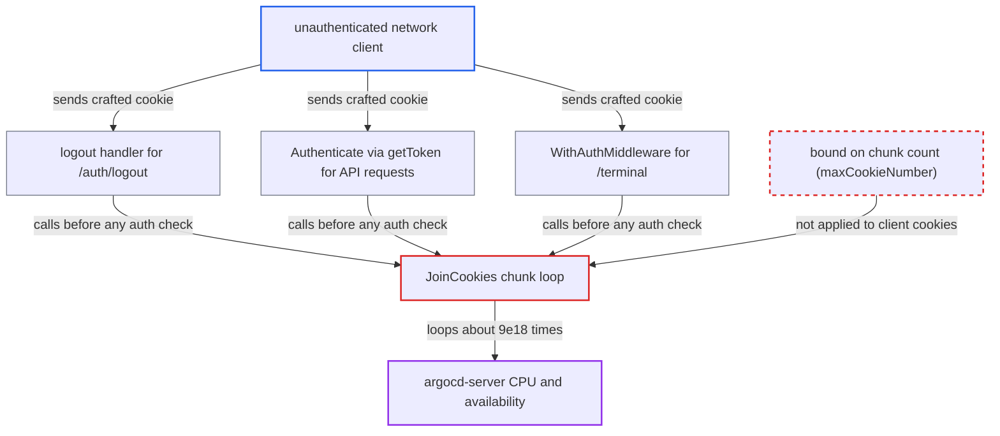

# Unbounded client-supplied chunk count in auth cookie reassembly causes unauthenticated CPU exhaustion

| Field | Value |
|---|---|
| ID | `find_01YVbS3id6DPkMj859JezmME` |
| Severity | **High** |
| Status | open |
| CWE | CWE-606 — Unchecked loop condition |
| Created | 2026-10-27T21:18:07.062354Z |
| Claude Security | https://claude.ai/security/findings/find_01YVbS3id6DPkMj859JezmME |

## Description

An unauthenticated network client can make argocd-server burn CPU without end, using one request with a crafted cookie. A few hundred such requests make the API, UI, SSO, webhook and terminal traffic unresponsive until the process restarts. No data is read or changed. The cause is `JoinCookies`, which uses the client-supplied chunk count in the `argocd.token` cookie as a loop bound with no upper limit.

1. **attacker** sends a request with a crafted cookie header. The header is `Cookie: argocd.token=9223372036854775807:x`, sent to `GET /auth/logout`, any `/api/v1/...` path, or `/terminal`, with no login.
2. **the logout handler** passes the request cookies to `JoinCookies`. This happens before any credential is checked, and `/auth/logout` has no authentication middleware in front of it. ([`server/logout/logout.go:51-80`](https://github.com/cx-benchmark/argo-cd/blob/b7bc418289a96130340ea79964c4491b416c14f2/server/logout/logout.go#L51-L80))
3. **`JoinCookies`** reads the chunk count from the first cookie. It parses the text before the colon with `strconv.Atoi`, which on 64-bit builds accepts values up to `9223372036854775807`. ([`util/http/http.go:104-120`](https://github.com/cx-benchmark/argo-cd/blob/b7bc418289a96130340ea79964c4491b416c14f2/util/http/http.go#L104-L120))
4. **`JoinCookies`** loops once per claimed chunk. Each pass builds a key with `fmt.Sprintf` and looks it up in a map. Missing chunks read as empty strings, so the loop runs about 9.2×10^18 times, and nothing compares the count with the cookies actually present or checks the request context. ([`util/http/http.go:104-120`](https://github.com/cx-benchmark/argo-cd/blob/b7bc418289a96130340ea79964c4491b416c14f2/util/http/http.go#L104-L120))
5. **the handling goroutine** keeps a CPU busy and never returns. Memory stays flat, but the goroutine spins until the process restarts, and the attacker can repeat the request at once.

## Assessment

The attacker is any unauthenticated client who can reach argocd-server over the network. No credentials, victim action or special configuration are needed. Entry points that reach `JoinCookies` before any authentication decision are `GET /auth/logout`, the `Authenticate` gRPC interceptor through `getToken` for REST requests relayed by grpc-gateway as `grpcgateway-cookie` metadata, `WithAuthMiddleware` in front of `/terminal`, and the terminal websocket `getToken`. One request per CPU, or a few hundred requests, saturates every scheduler thread of the process.

Impact: The attacker can make argocd-server unresponsive for API, UI, SSO, webhook and terminal traffic until the pod or process restarts. The attack is repeatable at once. The report states that no data is disclosed or modified.

## Recommendation

`JoinCookies` uses the client-supplied chunk count as its loop bound. It does not compare the count with `maxCookieNumber` (default 20, enforced only in `MakeCookieMetadata` when the server issues cookies) or with the number of `argocd.token-N` cookies actually present. The work per request is therefore chosen by the attacker.

Fix criteria: A count above `maxCookieNumber`, a negative count, or a count larger than the number of matching cookies present is rejected before any iteration. A request with `argocd.token=9223372036854775807:x` returns promptly with an error on `/auth/logout`, `/api/v1/*` and `/terminal`. Legitimate multi-chunk tokens up to the limit still reassemble correctly.

## Evidence

**https://github.com/cx-benchmark/argo-cd**

- [`util/http/http.go:104-120`](https://github.com/cx-benchmark/argo-cd/blob/b7bc418289a96130340ea79964c4491b416c14f2/util/http/http.go#L104-L120)
- [`util/http/http.go:32-48`](https://github.com/cx-benchmark/argo-cd/blob/b7bc418289a96130340ea79964c4491b416c14f2/util/http/http.go#L32-L48)
- [`server/logout/logout.go:51-80`](https://github.com/cx-benchmark/argo-cd/blob/b7bc418289a96130340ea79964c4491b416c14f2/server/logout/logout.go#L51-L80)
- [`server/server.go:1233-1238`](https://github.com/cx-benchmark/argo-cd/blob/b7bc418289a96130340ea79964c4491b416c14f2/server/server.go#L1233-L1238)
- [`server/server.go:1746-1756`](https://github.com/cx-benchmark/argo-cd/blob/b7bc418289a96130340ea79964c4491b416c14f2/server/server.go#L1746-L1756)
- [`util/session/sessionmanager.go:546-560`](https://github.com/cx-benchmark/argo-cd/blob/b7bc418289a96130340ea79964c4491b416c14f2/util/session/sessionmanager.go#L546-L560)

