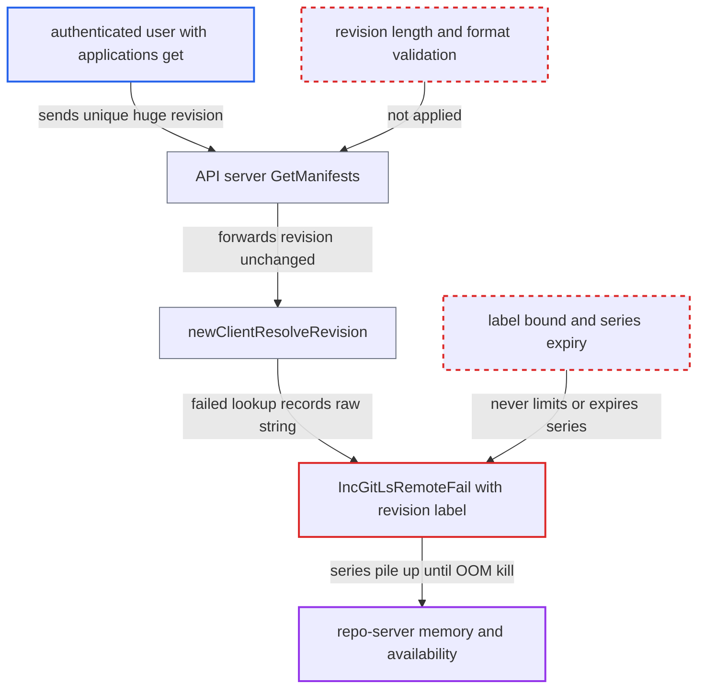

# Unbounded repo-server metric cardinality from attacker-chosen revision strings exhausts memory

| Field | Value |
|---|---|
| ID | `find_01P3XHjW4BFkGwUWCiLQiUuC` |
| Severity | **High** |
| Status | open |
| CWE | CWE-770 — Resource exhaustion |
| Created | 2026-10-27T21:12:27.565484Z |
| Claude Security | https://claude.ai/security/findings/find_01P3XHjW4BFkGwUWCiLQiUuC |

## Description

An authenticated user with `applications, get` on one git-sourced application can crash the repo-server by running it out of memory. This stops manifest generation, refreshes and syncs for all applications and tenants, and the attacker can repeat it after each restart. The cause is that `IncGitLsRemoteFail` uses the caller's `revision` string as a Prometheus label with no length limit and no expiry.

1. **authenticated user** sends a manifests request with a unique, very large revision. The call is `GET /api/v1/applications/{name}/manifests?revision=<arbitrary>` or the gRPC `GetManifests`. It needs only `applications, get` on one application. ([`server/application/application.go:550-552`](https://github.com/cx-benchmark/argo-cd/blob/b7bc418289a96130340ea79964c4491b416c14f2/server/application/application.go#L550-L552))
2. **API server `GetManifests`** copies the revision into `source.TargetRevision` and sends it on as `ManifestRequest.Revision`. It checks only the `applications, get` permission and does not check the revision's length or format. ([`server/application/application.go:550-552`](https://github.com/cx-benchmark/argo-cd/blob/b7bc418289a96130340ea79964c4491b416c14f2/server/application/application.go#L550-L552))
3. **repo-server `runRepoOperation`** resolves the request revision through `newClientResolveRevision` for a git source. `GenerateManifest` passes `q.Revision` into this path. ([`reposerver/repository/repository.go:374-384`](https://github.com/cx-benchmark/argo-cd/blob/b7bc418289a96130340ea79964c4491b416c14f2/reposerver/repository/repository.go#L374-L384))
4. **`newClientResolveRevision`** fails to resolve the unknown revision and calls `IncGitLsRemoteFail` with the raw string. The failure is cheap, because the string is compared with the cached ref list, so the attacker can send many requests quickly. ([`reposerver/repository/repository.go:3038-3048`](https://github.com/cx-benchmark/argo-cd/blob/b7bc418289a96130340ea79964c4491b416c14f2/reposerver/repository/repository.go#L3038-L3048))
5. **metrics code `IncGitLsRemoteFail`** calls `WithLabelValues(repo, revision)`, which creates and keeps a new series for each distinct revision. Nothing in `reposerver/` calls `Delete*` or `Reset` on these vectors, so the series stay for the life of the process. ([`reposerver/metrics/metrics.go:209-215`](https://github.com/cx-benchmark/argo-cd/blob/b7bc418289a96130340ea79964c4491b416c14f2/reposerver/metrics/metrics.go#L209-L215))
6. **repo-server process** grows in memory with each request until it is killed for running out of memory. Each `/metrics` scrape must also serialise all the accumulated series, and the attacker can repeat after each restart.

## Assessment

The attacker is any authenticated Argo CD user with `applications, get` on a single git-sourced application, such as a tenant with limited RBAC. No victim action and no non-default setting are needed. There are two ways in: the REST call `GET /api/v1/applications/{name}/manifests?revision=<arbitrary>` and the gRPC `GetManifests`. The REST path accepts revisions up to the HTTP header limit, about 1 MB per call. The gRPC path accepts far more, tens of MB per call.

Impact: The attacker can push the repo-server to its memory limit and get it killed, or exhaust the node's memory. While it is down, manifest generation, refreshes and syncs stop for every application and tenant. Nothing is disclosed or modified.

## Recommendation

(1) The repo-server failure counters, including `argocd_git_fetch_fail_total`, `argocd_git_lsremote_fail_total` and the OCI `*_fail_total` family, use the caller's unbounded `revision` string as a label value. The registry never evicts series, so memory grows with attacker input.

Fix criteria: Metric label values come from a bounded set. This means the `revision` label is dropped from the failure counters, or reduced to a fixed-size form such as a bounded hash or truncated value, or the repo-server vectors expire as the controller's do. Repeated `GetManifests` calls with distinct large revisions do not increase the number of series or the repo-server's resident memory.

(2) The API server forwards `?revision=` to the repo-server without checking its length or shape. Arbitrary-size strings therefore reach every downstream consumer, including metrics, logs and tracing attributes.

Fix criteria: Revisions that are too long, or that contain characters invalid for git refs, are rejected before the repo-server is contacted. An oversize revision in `GetManifests` is refused with InvalidArgument and never reaches `IncGitLsRemoteFail`.

## Evidence

**https://github.com/cx-benchmark/argo-cd**

- [`reposerver/repository/repository.go:3038-3048`](https://github.com/cx-benchmark/argo-cd/blob/b7bc418289a96130340ea79964c4491b416c14f2/reposerver/repository/repository.go#L3038-L3048)
- [`reposerver/metrics/metrics.go:209-215`](https://github.com/cx-benchmark/argo-cd/blob/b7bc418289a96130340ea79964c4491b416c14f2/reposerver/metrics/metrics.go#L209-L215)
- [`reposerver/metrics/metrics.go:46-62`](https://github.com/cx-benchmark/argo-cd/blob/b7bc418289a96130340ea79964c4491b416c14f2/reposerver/metrics/metrics.go#L46-L62)
- [`reposerver/repository/repository.go:374-384`](https://github.com/cx-benchmark/argo-cd/blob/b7bc418289a96130340ea79964c4491b416c14f2/reposerver/repository/repository.go#L374-L384)
- [`server/application/application.go:550-552`](https://github.com/cx-benchmark/argo-cd/blob/b7bc418289a96130340ea79964c4491b416c14f2/server/application/application.go#L550-L552)

