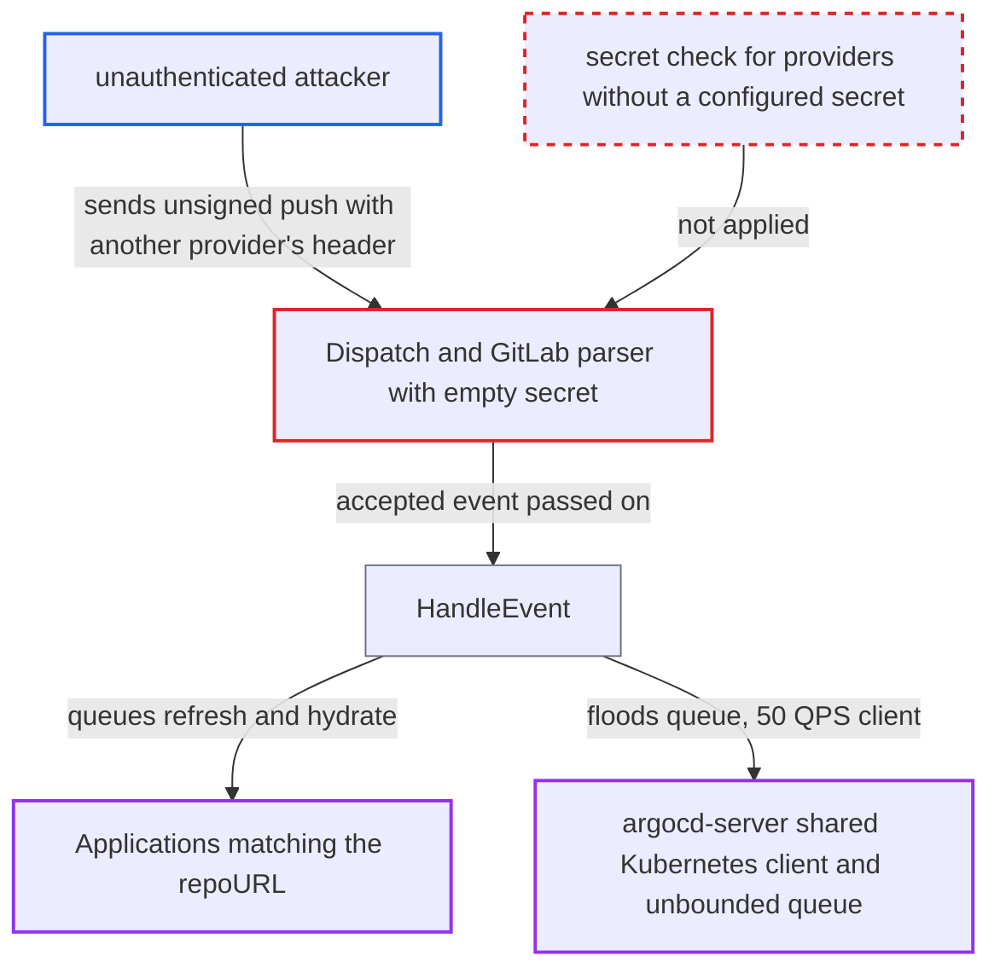

# Webhook secret for one SCM provider is bypassed by sending another provider's unsigned event

| Field | Value |
|---|---|
| ID | `find_01QM5ZskDcwVfuJZftSxZSQF` |
| Severity | **High** |
| Status | open |
| CWE | CWE-288 — Authentication Bypass |
| Created | 2026-10-27T21:23:57.167Z |
| Claude Security | https://claude.ai/security/findings/find_01QM5ZskDcwVfuJZftSxZSQF |

## Description

An unauthenticated attacker who can reach the webhook endpoint can trigger refreshes of Argo CD Applications, and of ApplicationSets on the ApplicationSet controller, even when the operator has set a webhook secret. A flood of requests can exhaust server memory and slow Application API writes. The attacker needs a target repository URL and branch, and the operator must have set the secret for only some providers. The cause is that `NewParsers` gives each provider parser only its own secret, and a parser with an empty secret skips verification.

1. **operator** sets the secret for only the provider in use, for example `webhook.github.secret`. The docs say to configure one of the listed keys and present the secret as protection against a DDoS attack, without saying that other providers stay unauthenticated. ([`docs/operator-manual/webhook.md:46-66`](https://github.com/cx-benchmark/argo-cd/blob/b7bc418289a96130340ea79964c4491b416c14f2/docs/operator-manual/webhook.md#L46-L66))
2. **`NewParsers`** builds one parser per provider, each with only its own secret. A parser whose secret is empty accepts unsigned payloads, and no setting rejects providers that have no secret. ([`util/webhook/scm.go:54-112`](https://github.com/cx-benchmark/argo-cd/blob/b7bc418289a96130340ea79964c4491b416c14f2/util/webhook/scm.go#L54-L112))
3. **attacker** sends an unsigned push to `/api/webhook` with a header such as `X-Gitlab-Event: Push Hook`. The body names a GitHub-hosted repository, for example with `project.web_url` set to `https://github.com/org/repo`. ([`util/webhook/push.go:51-62`](https://github.com/cx-benchmark/argo-cd/blob/b7bc418289a96130340ea79964c4491b416c14f2/util/webhook/push.go#L51-L62))
4. **`Dispatch`** picks the GitLab parser from the sender's headers. `CanHandle` checks only that the provider's event header is present, so the sender chooses a provider that has no secret. ([`util/webhook/scm.go:118-127`](https://github.com/cx-benchmark/argo-cd/blob/b7bc418289a96130340ea79964c4491b416c14f2/util/webhook/scm.go#L118-L127))
5. **`HandleEvent`** matches the body's repository URL against every Application's `repoURL`. The match ignores which provider the event claimed to come from, so Applications hosted on GitHub are queued for refresh, with `hydrate: normal` for source-hydrator dry sources. ([`util/webhook/webhook.go:342-413`](https://github.com/cx-benchmark/argo-cd/blob/b7bc418289a96130340ea79964c4491b416c14f2/util/webhook/webhook.go#L342-L413))
6. **refresh workers** patch each matching Application's refresh annotations through the shared Kubernetes client. Each request adds new items to an unbounded delaying queue with no de-duplication, drained by 20 workers at the client's default 50 QPS. ([`util/argo/argo.go:325-361`](https://github.com/cx-benchmark/argo-cd/blob/b7bc418289a96130340ea79964c4491b416c14f2/util/argo/argo.go#L325-L361))

## Assessment

The attacker is anonymous. They need network access to `/api/webhook` on argocd-server, or to port `:7000` on the ApplicationSet controller. They also need a target repository URL and branch. The operator must have set the secret for the provider they use. On the ApplicationSet controller, the GitLab and Azure DevOps parsers stay open when only the GitHub secret is set, and any accepted event refreshes every ApplicationSet with a plugin generator. The GHCR check is skipped when `webhook.github.secret` is empty, so an operator who set only another provider's secret leaves OCI refresh and hydrate open. The attack can be repeated at will, and the endpoint has no rate limit.

Impact: The attacker gets back the anonymous trigger that the configured secret was meant to remove. They can write refresh and hydrate annotations on every Application that tracks a named repo and branch, at an unbounded rate. A sustained flood grows server memory without bound and starves Application API writes, while the controller and repo-server keep reconciling. Nothing is disclosed, and the integrity effect is limited to refresh and hydrate annotations.

## Recommendation

Each SCM provider parser authenticates only when its own secret is set. The dispatcher lets the sender pick the provider by header. A secret for one provider therefore does not stop unsigned events sent under another provider's header.

Fix criteria: Once any webhook secret is configured, or under an explicit require-authentication setting, events for providers without a configured secret are rejected before parsing. This holds on both argocd-server and the ApplicationSet controller, and the docs state the posture. Verify: with only `webhook.github.secret` set, unsigned GitLab, Gogs, Bitbucket, Bitbucket Server and Azure DevOps pushes naming a GitHub repo get a 4xx and cause no Application or ApplicationSet refresh.

## Evidence

**https://github.com/cx-benchmark/argo-cd**

- [`util/webhook/scm.go:54-112`](https://github.com/cx-benchmark/argo-cd/blob/b7bc418289a96130340ea79964c4491b416c14f2/util/webhook/scm.go#L54-L112)
- [`util/webhook/scm.go:118-127`](https://github.com/cx-benchmark/argo-cd/blob/b7bc418289a96130340ea79964c4491b416c14f2/util/webhook/scm.go#L118-L127)
- [`util/webhook/scm.go:203-274`](https://github.com/cx-benchmark/argo-cd/blob/b7bc418289a96130340ea79964c4491b416c14f2/util/webhook/scm.go#L203-L274)
- [`util/webhook/push.go:51-62`](https://github.com/cx-benchmark/argo-cd/blob/b7bc418289a96130340ea79964c4491b416c14f2/util/webhook/push.go#L51-L62)
- [`util/webhook/webhook.go:342-413`](https://github.com/cx-benchmark/argo-cd/blob/b7bc418289a96130340ea79964c4491b416c14f2/util/webhook/webhook.go#L342-L413)
- [`util/webhook/webhook.go:109-155`](https://github.com/cx-benchmark/argo-cd/blob/b7bc418289a96130340ea79964c4491b416c14f2/util/webhook/webhook.go#L109-L155)
- [`util/argo/argo.go:325-361`](https://github.com/cx-benchmark/argo-cd/blob/b7bc418289a96130340ea79964c4491b416c14f2/util/argo/argo.go#L325-L361)
- [`util/webhook/ghcr.go:116-133`](https://github.com/cx-benchmark/argo-cd/blob/b7bc418289a96130340ea79964c4491b416c14f2/util/webhook/ghcr.go#L116-L133)
- [`util/webhook/harbor.go:60-88`](https://github.com/cx-benchmark/argo-cd/blob/b7bc418289a96130340ea79964c4491b416c14f2/util/webhook/harbor.go#L60-L88)
- [`applicationset/webhook/webhook.go:78-109`](https://github.com/cx-benchmark/argo-cd/blob/b7bc418289a96130340ea79964c4491b416c14f2/applicationset/webhook/webhook.go#L78-L109)
- [`docs/operator-manual/webhook.md:46-66`](https://github.com/cx-benchmark/argo-cd/blob/b7bc418289a96130340ea79964c4491b416c14f2/docs/operator-manual/webhook.md#L46-L66)

