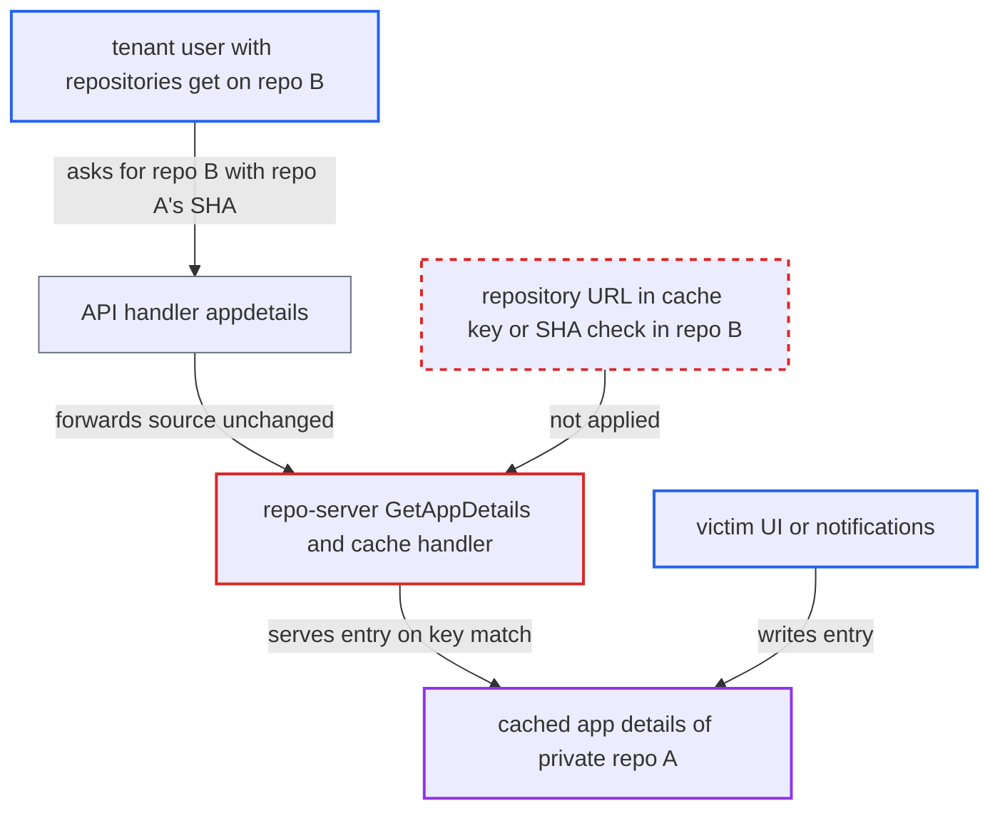

# App-details cache key omits repository URL, serving another repo's private details by SHA

| Field | Value |
|---|---|
| ID | `find_01UkC6v2RdxmKZkkMRvygACE` |
| Severity | **Medium** |
| Status | open |
| CWE | CWE-639 — Authorization bypass |
| Created | 2026-10-27T21:28:21.771393Z |
| Claude Security | https://claude.ai/security/findings/find_01UkC6v2RdxmKZkkMRvygACE |

## Description

A tenant user can read cached app details from another team's private repository that they cannot access. That includes the full `values.yaml` text and the resolved Helm parameters. The attacker needs `repositories, get` on some repo B and `applications, create` in their own project. They also need the victim's commit SHA and source fields. The cause is that the app-details cache key (`appDetailsCacheKey`) leaves out the repository URL, and a cache hit is served without checking that the SHA exists in the caller's repository.

1. **victim** causes app details from private repo A to be cached. Opening an app's parameters or history in the UI, or a notification template calling `repo.GetAppDetails`, stores the details under a key that ends in `label` because no `TrackingMethod` is set. ([`util/notification/argocd/service.go:106-113`](https://github.com/cx-benchmark/argo-cd/blob/b7bc418289a96130340ea79964c4491b416c14f2/util/notification/argocd/service.go#L106-L113))
2. **attacker** calls `POST /api/v1/repositories/{B}/appdetails` with `repoURL=B` and `targetRevision` set to the victim's SHA. The API handler checks only the named repo B and the attacker's own project. It forwards `q.Source` unchanged and leaves `TrackingMethod` unset. ([`server/repository/repository.go:333-409`](https://github.com/cx-benchmark/argo-cd/blob/b7bc418289a96130340ea79964c4491b416c14f2/server/repository/repository.go#L333-L409))
3. **repo-server `runRepoOperation`** resolves the revision and then consults the cache before any clone or checkout. `lsRemote` returns a 40-hex SHA unchanged without contacting the remote, so a SHA from repo A passes as valid for repo B. ([`util/git/client.go:1244-1247`](https://github.com/cx-benchmark/argo-cd/blob/b7bc418289a96130340ea79964c4491b416c14f2/util/git/client.go#L1244-L1247))
4. **cache key `appDetailsCacheKey`** builds a key that matches the victim's entry. `appSourceKeyJSON` blanks `RepoURL` and `TargetRevision` for non-Helm-chart sources, so the key is only the SHA, a hash of the source and the tracking method. ([`reposerver/cache/cache.go:133-146`](https://github.com/cx-benchmark/argo-cd/blob/b7bc418289a96130340ea79964c4491b416c14f2/reposerver/cache/cache.go#L133-L146))
5. **handler `createGetAppDetailsCacheHandler`** returns the stored `RepoAppDetailsResponse` to the attacker. It never checks that the revision exists in repo B, so repo A's `values.yaml` and resolved parameters are disclosed. ([`reposerver/repository/repository.go:2612-2627`](https://github.com/cx-benchmark/argo-cd/blob/b7bc418289a96130340ea79964c4491b416c14f2/reposerver/repository/repository.go#L2612-L2627))

## Assessment

The attacker is a tenant with `repositories, get` on a repo B they may use, and `applications, create` in their own project P2, and `isRepoPermittedInProject(B, P2)` must pass. They must know the victim app's commit SHA in private repo A and its `spec.source` fields. These can come from a shared app-of-apps repo, notifications or CI logs. The victim's details must have been cached within the last 24h (`repoCacheExpiration` default), by the UI (parameters or history) or by a notification template. Entries written by a hard refresh (`server/application/application.go:868`) use the configured tracking method (default `annotation`) and do not match. Helm chart sources keep `RepoURL` in the key and are not affected.

Impact: The attacker reads details cached from a private repository they have no access to. These include the verbatim `values.yaml` text (`Helm.Values`), all resolved Helm parameters, value-file names, Kustomize images and plugin parameters. These can hold credentials and internal endpoints. Only data in the victim's details response is exposed. There is no write or availability impact.

## Recommendation

The app-details cache key identifies content by commit SHA and source body alone, because `RepoURL` is dropped. A cache hit is served before anything confirms the SHA belongs to the repository the caller is authorized for.

Fix criteria: A cached app-details entry is served only to requests for the same repository it was generated from. Either the key includes the normalized repository URL, or the revision is verified present in the requested repository before a cached entry is returned. A test confirms that a `GetAppDetails` for repo B with a SHA that exists only in repo A, after A's details were cached, misses the cache and fails instead of returning A's `values.yaml` or parameters.

## Evidence

**https://github.com/cx-benchmark/argo-cd**

- [`reposerver/cache/cache.go:133-146`](https://github.com/cx-benchmark/argo-cd/blob/b7bc418289a96130340ea79964c4491b416c14f2/reposerver/cache/cache.go#L133-L146)
- [`reposerver/cache/cache.go:461-479`](https://github.com/cx-benchmark/argo-cd/blob/b7bc418289a96130340ea79964c4491b416c14f2/reposerver/cache/cache.go#L461-L479)
- [`reposerver/repository/repository.go:380-400`](https://github.com/cx-benchmark/argo-cd/blob/b7bc418289a96130340ea79964c4491b416c14f2/reposerver/repository/repository.go#L380-L400)
- [`util/git/client.go:1244-1247`](https://github.com/cx-benchmark/argo-cd/blob/b7bc418289a96130340ea79964c4491b416c14f2/util/git/client.go#L1244-L1247)
- [`reposerver/repository/repository.go:2612-2627`](https://github.com/cx-benchmark/argo-cd/blob/b7bc418289a96130340ea79964c4491b416c14f2/reposerver/repository/repository.go#L2612-L2627)
- [`server/repository/repository.go:333-409`](https://github.com/cx-benchmark/argo-cd/blob/b7bc418289a96130340ea79964c4491b416c14f2/server/repository/repository.go#L333-L409)
- [`reposerver/repository/repository.go:2721-2750`](https://github.com/cx-benchmark/argo-cd/blob/b7bc418289a96130340ea79964c4491b416c14f2/reposerver/repository/repository.go#L2721-L2750)
- [`util/notification/argocd/service.go:106-113`](https://github.com/cx-benchmark/argo-cd/blob/b7bc418289a96130340ea79964c4491b416c14f2/util/notification/argocd/service.go#L106-L113)

