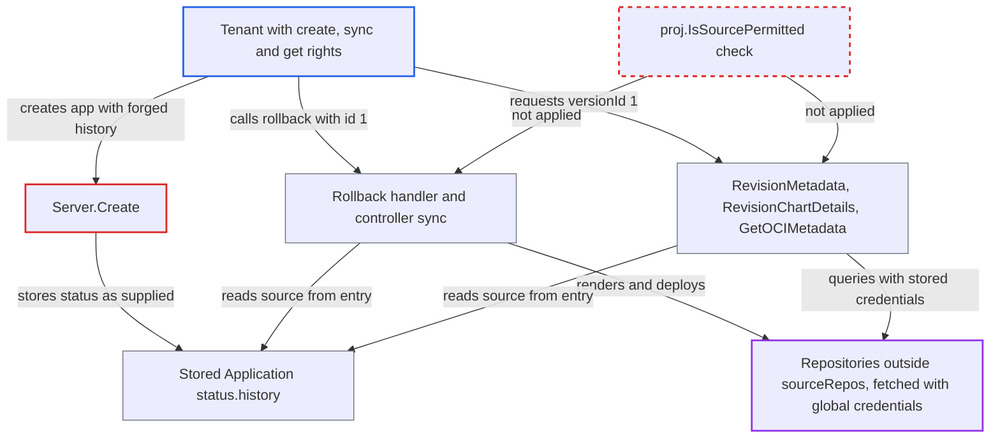

# Application Create persists caller-supplied status; forged history lets Rollback deploy from unpermitted repos

| Field | Value |
|---|---|
| ID | `find_01V78D2fpTo67fUEttcZVH8q` |
| Severity | **Medium** |
| Status | open |
| CWE | CWE-915 — Mass assignment |
| Created | 2026-10-27T21:21:22.457947Z |
| Claude Security | https://claude.ai/security/findings/find_01V78D2fpTo67fUEttcZVH8q |

## Description

A tenant with `applications, create` and `sync` rights in one project can deploy content from any repository, including ones the project's `sourceRepos` list forbids. With `get` rights they can also read commit and chart metadata from such repositories. `Server.Create` saves the caller-supplied `status`, including `status.history`, and `Rollback` and the revision-metadata handlers trust that history without checking the AppProject.

1. **Tenant API user** sends a create request with a forged `status.history`. The spec passes project validation and auto-sync is off. The body also carries `status.history` with an entry such as id 1, revision `main` and a `source.repoURL` pointing at any repository. ([`server/application/application.go:384-393`](https://github.com/cx-benchmark/argo-cd/blob/b7bc418289a96130340ea79964c4491b416c14f2/server/application/application.go#L384-L393))
2. **`Server.Create`** stores the whole caller-supplied Application. It validates only `spec` and clears only `operation`. The CRD declares `subresources: {}`, so the Kubernetes API keeps the supplied `status` as written. ([`manifests/crds/application-crd.yaml:7229`](https://github.com/cx-benchmark/argo-cd/blob/b7bc418289a96130340ea79964c4491b416c14f2/manifests/crds/application-crd.yaml#L7229))
3. **Tenant API user** calls `POST /api/v1/applications/{name}/rollback` with `id: 1`. `Rollback` copies the chosen history entry's `source`, `sources` and `revision(s)` into the sync operation. It never checks them against the AppProject. ([`server/application/application.go:2305-2343`](https://github.com/cx-benchmark/argo-cd/blob/b7bc418289a96130340ea79964c4491b416c14f2/server/application/application.go#L2305-L2343))
4. **the controller's `SyncAppState`** runs the operation using the planted source as given. The only gate, `InvalidSpecError`, is computed from `app.Spec` alone, so the planted history source is never examined. ([`controller/sync.go:137-214`](https://github.com/cx-benchmark/argo-cd/blob/b7bc418289a96130340ea79964c4491b416c14f2/controller/sync.go#L137-L214))
5. **`GetRepoObjs`** fetches credentials for the planted URL and has the repo-server render it. `db.GetRepository` falls back to any global repository secret or repo-creds template matching the URL. The repo-server uses `ProjectSourceRepos` only for a Helm-dependency error message. ([`controller/state.go:389-420`](https://github.com/cx-benchmark/argo-cd/blob/b7bc418289a96130340ea79964c4491b416c14f2/controller/state.go#L389-L420))
6. **the controller** applies the rendered objects to the app's destination. Per-resource kind and destination checks still apply, so objects stay within what the project already allows.
7. **Tenant API user with `get`** calls `RevisionMetadata`, `RevisionChartDetails` or `GetOCIMetadata` with `versionId=1`. These handlers take the repo URL or chart from the forged history and query the repo-server with stored credentials. `RevisionMetadata` needs a resolved commit SHA. ([`server/application/application.go:1680-1770`](https://github.com/cx-benchmark/argo-cd/blob/b7bc418289a96130340ea79964c4491b416c14f2/server/application/application.go#L1680-L1770))

## Assessment

The attacker is an API user with `applications, create` and `sync` in one project. They need no user interaction and no non-default settings. Rollback is checked against the `sync` permission unless `server.rbac.rollback.enforce.enable` is set. The attacker creates an app whose spec is valid for the project, with auto-sync off, and adds a forged `status.history` entry pointing at any repository. They then call rollback with that entry's id. As another route, a user with only `get` can call `RevisionChartDetails` or `RevisionMetadata` with `versionId=1` to query the planted repository.

Impact: The attacker bypasses the AppProject `sourceRepos` allowlist. They can deploy unreviewed content from any repository, including their own, and read commit and chart metadata of repositories outside their project. Destination and resource-kind checks still apply, so deployed objects stay within targets the project already allows. Stored credentials are used but not disclosed, and nothing is made unavailable.

Subsequent-system impact: Argo CD holds global credentials or repo-creds templates for Git, Helm and OCI hosts. Other teams' private repository content is fetched with those credentials and rendered. It is then deployed into the tenant's destination, where the tenant can read it through the resource APIs. Nothing is written to those hosts.

## Recommendation

(1) `Create` trusts the caller-supplied `status` block of the Application, although `status` is controller-owned and `Rollback` and the revision-metadata handlers treat it as trustworthy.

Fix criteria: No API caller can set any `status` field. An Application created through the API is stored with an empty status, or the CRD gains a status subresource and the server never writes caller status. To check, create an app with `status.history` set and confirm the stored object has no history.

(2) `Rollback` and the controller's sync path use a source taken from history or the operation without re-validating it against the AppProject. They assume it came from a validated spec.

Fix criteria: The chosen history entry's `source` and `sources` must pass `proj.IsSourcePermitted` before an operation is set. The controller must also refuse an operation whose sources the project does not permit. To check, roll back to an entry whose repo is outside `sourceRepos` and confirm it is rejected and no repo-server call is made.

(3) The revision metadata handlers resolve the repository from `status.history` via `versionId` and query it with stored credentials. They do not check project permission for that repository.

Fix criteria: Sources resolved from history for `RevisionMetadata`, `RevisionChartDetails` and `GetOCIMetadata` must pass `proj.IsSourcePermitted` before any `db.GetRepository` or repo-server call. To check, use a history entry with an unpermitted `repoURL` and confirm it yields a permission error.

## Evidence

**https://github.com/cx-benchmark/argo-cd**

- [`server/application/application.go:384-393`](https://github.com/cx-benchmark/argo-cd/blob/b7bc418289a96130340ea79964c4491b416c14f2/server/application/application.go#L384-L393)
- [`manifests/crds/application-crd.yaml:7229`](https://github.com/cx-benchmark/argo-cd/blob/b7bc418289a96130340ea79964c4491b416c14f2/manifests/crds/application-crd.yaml#L7229)
- [`server/application/application.go:2305-2343`](https://github.com/cx-benchmark/argo-cd/blob/b7bc418289a96130340ea79964c4491b416c14f2/server/application/application.go#L2305-L2343)
- [`controller/sync.go:137-214`](https://github.com/cx-benchmark/argo-cd/blob/b7bc418289a96130340ea79964c4491b416c14f2/controller/sync.go#L137-L214)
- [`controller/state.go:389-420`](https://github.com/cx-benchmark/argo-cd/blob/b7bc418289a96130340ea79964c4491b416c14f2/controller/state.go#L389-L420)
- [`controller/appcontroller.go:2528`](https://github.com/cx-benchmark/argo-cd/blob/b7bc418289a96130340ea79964c4491b416c14f2/controller/appcontroller.go#L2528)
- [`util/db/repository_secrets.go:568-603`](https://github.com/cx-benchmark/argo-cd/blob/b7bc418289a96130340ea79964c4491b416c14f2/util/db/repository_secrets.go#L568-L603)
- [`server/application/application.go:1680-1770`](https://github.com/cx-benchmark/argo-cd/blob/b7bc418289a96130340ea79964c4491b416c14f2/server/application/application.go#L1680-L1770)

