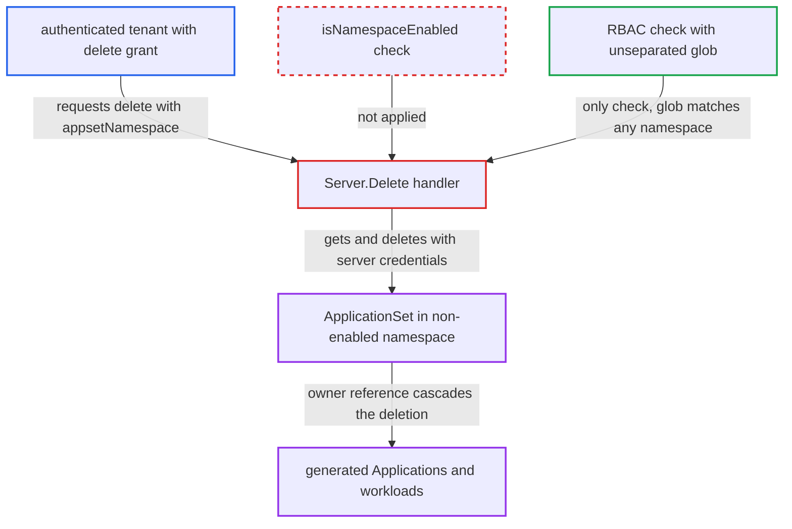

# ApplicationSet Delete skips enabled-namespace check, allowing deletion in any cluster namespace

| Field | Value |
|---|---|
| ID | `find_018Mj46Spj7SZB1cyFKacKho` |
| Severity | **Medium** |
| Status | open |
| CWE | CWE-863 — Improper Authorization |
| Created | 2026-10-27T21:24:41.770632Z |
| Claude Security | https://claude.ai/security/findings/find_018Mj46Spj7SZB1cyFKacKho |

## Description

An authenticated tenant can delete ApplicationSets in any namespace of the cluster, including namespaces this Argo CD instance is not set up to manage, such as those of a second Argo CD instance. The tenant needs an RBAC grant like `applicationsets, delete, P/*`, and the target's template project must be `P`. The cause is that `Server.Delete` never checks the caller-supplied namespace against the enabled namespaces.

1. **authenticated tenant** sends a delete request naming a foreign namespace. The request is `DELETE /api/v1/applicationsets/<name>?appsetNamespace=<ns>`, where `<ns>` is outside the enabled list and the ApplicationSet's template project is `P`. ([`server/applicationset/applicationset.go:425-446`](https://github.com/cx-benchmark/argo-cd/blob/b7bc418289a96130340ea79964c4491b416c14f2/server/applicationset/applicationset.go#L425-L446))
2. **the handler `Server.Delete`** fetches the ApplicationSet from the caller-chosen namespace without a namespace check. It uses the server's own Kubernetes clientset for a direct `Get`, not the informer lister that is filtered to enabled namespaces, and it never calls `isNamespaceEnabled`. ([`server/applicationset/applicationset.go:425-446`](https://github.com/cx-benchmark/argo-cd/blob/b7bc418289a96130340ea79964c4491b416c14f2/server/applicationset/applicationset.go#L425-L446))
3. **Kubernetes API** accepts the read and the later delete in any namespace. In the default cluster-scoped install, the argocd-server ClusterRole grants `get` and `delete` on all resources cluster-wide. ([`manifests/cluster-rbac/server/argocd-server-clusterrole.yaml:10-17`](https://github.com/cx-benchmark/argo-cd/blob/b7bc418289a96130340ea79964c4491b416c14f2/manifests/cluster-rbac/server/argocd-server-clusterrole.yaml#L10-L17))
4. **RBAC check** allows the delete because the glob matches across segments. Only `applicationsets, delete, <template project>/<ns>/<name>` is enforced, and the unseparated glob match lets a grant such as `P/*` match `P/<ns>/<name>`. ([`util/rbac/rbac.go:288-303`](https://github.com/cx-benchmark/argo-cd/blob/b7bc418289a96130340ea79964c4491b416c14f2/util/rbac/rbac.go#L288-L303))
5. **the handler `Server.Delete`** deletes the ApplicationSet. The delete runs with the server's cluster-wide credentials, so the foreign ApplicationSet is removed. ([`server/applicationset/applicationset.go:425-446`](https://github.com/cx-benchmark/argo-cd/blob/b7bc418289a96130340ea79964c4491b416c14f2/server/applicationset/applicationset.go#L425-L446))
6. **Kubernetes garbage collection** removes the generated Applications. Generated Applications have a controller owner reference to their ApplicationSet, and the controller that owns them prunes the workloads of those with the resources finalizer. ([`applicationset/controllers/applicationset_controller.go:820-826`](https://github.com/cx-benchmark/argo-cd/blob/b7bc418289a96130340ea79964c4491b416c14f2/applicationset/controllers/applicationset_controller.go#L820-L826))

## Assessment

The attacker is an authenticated tenant whose RBAC includes `applicationsets, delete, P/*`. They target an ApplicationSet whose template project is `P` and which sits in a namespace outside the enabled list, for example one belonging to another Argo CD instance in the cluster. Such an ApplicationSet must exist. The install must be cluster-scoped, which is the default. The report names no other way in.

Impact: The tenant can delete ApplicationSets in namespaces that argocd-server is configured not to manage. Inside the enabled namespaces they gain nothing beyond their existing delete grant. No data is disclosed, except that an ApplicationSet's existence leaks through `Get` error messages.

Subsequent-system impact: ApplicationSets owned by another Argo CD instance or by unmanaged namespaces are deleted. Kubernetes garbage collection removes their generated Applications through owner references. The owning controller prunes the deployed workloads of Applications with the resources finalizer, causing high integrity and availability loss for those deployments.

## Recommendation

`Delete` resolves and deletes an ApplicationSet in a namespace chosen by the caller. It never checks that the namespace is the control-plane namespace or in the server's enabled list, and its Kubernetes calls use cluster-wide server credentials.

Fix criteria: `Delete` returns `namespace '<ns>' is not permitted` for any namespace `isNamespaceEnabled` rejects, before any Kubernetes `Get` or `Delete` is issued. A delete request naming a non-enabled namespace leaves the ApplicationSet in place. Deletes in enabled namespaces still work with the existing RBAC check.

## Evidence

**https://github.com/cx-benchmark/argo-cd**

- [`server/applicationset/applicationset.go:425-446`](https://github.com/cx-benchmark/argo-cd/blob/b7bc418289a96130340ea79964c4491b416c14f2/server/applicationset/applicationset.go#L425-L446)
- [`server/applicationset/applicationset.go:629-654`](https://github.com/cx-benchmark/argo-cd/blob/b7bc418289a96130340ea79964c4491b416c14f2/server/applicationset/applicationset.go#L629-L654)
- [`server/server.go:1102-1125`](https://github.com/cx-benchmark/argo-cd/blob/b7bc418289a96130340ea79964c4491b416c14f2/server/server.go#L1102-L1125)
- [`util/rbac/rbac.go:288-303`](https://github.com/cx-benchmark/argo-cd/blob/b7bc418289a96130340ea79964c4491b416c14f2/util/rbac/rbac.go#L288-L303)
- [`manifests/cluster-rbac/server/argocd-server-clusterrole.yaml:10-17`](https://github.com/cx-benchmark/argo-cd/blob/b7bc418289a96130340ea79964c4491b416c14f2/manifests/cluster-rbac/server/argocd-server-clusterrole.yaml#L10-L17)
- [`server/application/application.go:272-286`](https://github.com/cx-benchmark/argo-cd/blob/b7bc418289a96130340ea79964c4491b416c14f2/server/application/application.go#L272-L286)
- [`applicationset/controllers/applicationset_controller.go:820-826`](https://github.com/cx-benchmark/argo-cd/blob/b7bc418289a96130340ea79964c4491b416c14f2/applicationset/controllers/applicationset_controller.go#L820-L826)

