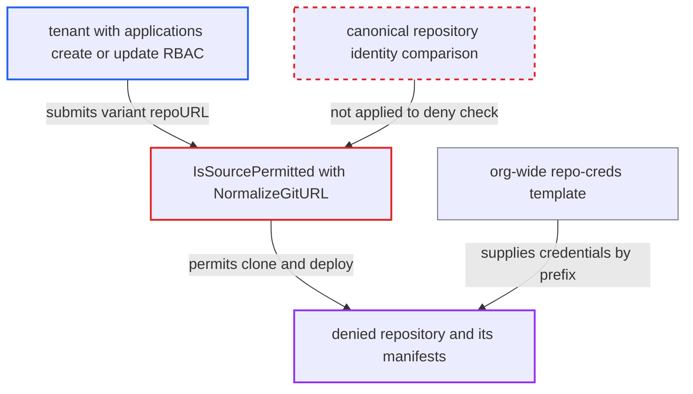

# AppProject sourceRepos deny patterns bypassed by non-canonical but equivalent repo URLs

| Field | Value |
|---|---|
| ID | `find_01NJW6pdDbF2WjrnCvD5vM7y` |
| Severity | **Medium** |
| Status | open |
| CWE | CWE-184 — Authorization bypass |
| Created | 2026-10-27T21:21:13.711302Z |
| Claude Security | https://claude.ai/security/findings/find_01NJW6pdDbF2WjrnCvD5vM7y |

## Description

A tenant who can create or update Applications can deploy from, and read manifests of, a repository that the AppProject explicitly denies. It needs a project whose `sourceRepos` combines an allow like `*` with a `!` deny entry. `IsSourcePermitted` compares the deny entry to a URL that `NormalizeGitURL` leaves non-canonical, so spellings with `:443`, `%65`-style encoding or a trailing slash escape the deny.

1. **tenant with `applications, create|update` RBAC** submits an Application whose `spec.source.repoURL` is a variant spelling of the denied repo. For example `https://github.com:443/org/secret`, `https://github.com/org/s%65cret` or `https://github.com/org/secret/`, which Git hosts treat as the same repository as the denied one.
2. **`NormalizeGitURL`** normalizes the URL but keeps the explicit port, percent-encoding and trailing slash. It only lowercases, trims whitespace, rewrites scp-style SSH, strips one `.git` and round-trips through `url.Parse`, so the variant stays different from the string in the deny pattern. ([`util/git/git.go:74-92`](https://github.com/cx-benchmark/argo-cd/blob/b7bc418289a96130340ea79964c4491b416c14f2/util/git/git.go#L74-L92))
3. **`IsSourcePermitted`** glob-matches the normalized URL against the project's `sourceRepos`. The variant does not match the `!` deny entry, so the deny does not reject it, and it matches the broad allow such as `*`. ([`pkg/apis/application/v1alpha1/app_project_types.go:458-480`](https://github.com/cx-benchmark/argo-cd/blob/b7bc418289a96130340ea79964c4491b416c14f2/pkg/apis/application/v1alpha1/app_project_types.go#L458-L480))
4. **`globMatch`** returns true for a deny pattern that does not match. It returns `!glob.Match(pattern[1:], val)`, and `IsSourcePermitted` counts that true as an allow. ([`pkg/apis/application/v1alpha1/app_project_types.go:446-455`](https://github.com/cx-benchmark/argo-cd/blob/b7bc418289a96130340ea79964c4491b416c14f2/pkg/apis/application/v1alpha1/app_project_types.go#L446-L455))
5. **`ValidatePermissions`** accepts the Application, in argocd-server and on every controller reconcile. It relies only on `IsSourcePermitted` for the source repo check, so the same wrong answer is given each time. ([`util/argo/argo.go:734-785`](https://github.com/cx-benchmark/argo-cd/blob/b7bc418289a96130340ea79964c4491b416c14f2/util/argo/argo.go#L734-L785))
6. **repo-server** clones the denied repository and renders its manifests. Repo-creds templates are chosen by `strings.HasPrefix` on the normalized URL, so an org-wide template such as `https://github.com/org` still supplies credentials for the percent-encoded and trailing-slash variants. ([`util/db/repository_secrets.go:619-635`](https://github.com/cx-benchmark/argo-cd/blob/b7bc418289a96130340ea79964c4491b416c14f2/util/db/repository_secrets.go#L619-L635))

## Assessment

The attacker is a tenant with Argo CD RBAC `applications, create|update` in a project whose `sourceRepos` has an allow such as `*` (or `https://github.com/org/*`) plus a deny like `!https://github.com/org/secret`. This is the documented pattern. They set `spec.source.repoURL` to an equivalent spelling of the denied repo: an explicit default port (`:443`, or `:22` for ssh), a percent-encoded unreserved path character, or a trailing slash. The same check is used by `GetPermittedRepos` and `GetPermittedReposCredentials`, which decide which Helm/OCI credentials go to the repo-server. The repo-server also uses it for multi-source `$ref` and values-file repos. An exact repository secret for the denied repo is not found for a variant, because `SameURL` compares normalized strings. An org-wide repo-creds template still authenticates the percent-encoded and trailing-slash variants. Public repos need no credentials.

Impact: The tenant deploys manifests from a repository the project explicitly denies, which defeats the AppProject source boundary. They can read that repository's contents through the Application's manifests and diff views. This includes private repos reachable through org-level credential templates. There is no availability impact.

## Recommendation

`IsSourcePermitted` compares deny patterns against a repository URL that is not canonical. An explicit default port, percent-encoded path characters and a trailing slash survive `NormalizeGitURL`, so equivalent spellings escape the deny while matching a broad allow.

Fix criteria: Deny evaluation works on a canonical repository identity. It strips default ports for the scheme, percent-decodes unreserved characters (rejecting or normalizing other encodings), removes trailing slashes and redundant `.git` suffixes, and applies the same canonicalization to both pattern and URL. A project containing `*` and `!https://github.com/org/secret` rejects `https://github.com:443/org/secret`, `https://github.com/org/s%65cret` and `https://github.com/org/secret/`. `GetPermittedRepos` and the repo-server ref checks use the same canonical form.

## Evidence

**https://github.com/cx-benchmark/argo-cd**

- [`pkg/apis/application/v1alpha1/app_project_types.go:458-480`](https://github.com/cx-benchmark/argo-cd/blob/b7bc418289a96130340ea79964c4491b416c14f2/pkg/apis/application/v1alpha1/app_project_types.go#L458-L480)
- [`util/git/git.go:74-92`](https://github.com/cx-benchmark/argo-cd/blob/b7bc418289a96130340ea79964c4491b416c14f2/util/git/git.go#L74-L92)
- [`pkg/apis/application/v1alpha1/app_project_types.go:446-455`](https://github.com/cx-benchmark/argo-cd/blob/b7bc418289a96130340ea79964c4491b416c14f2/pkg/apis/application/v1alpha1/app_project_types.go#L446-L455)
- [`util/argo/argo.go:734-785`](https://github.com/cx-benchmark/argo-cd/blob/b7bc418289a96130340ea79964c4491b416c14f2/util/argo/argo.go#L734-L785)
- [`util/db/repository_secrets.go:619-635`](https://github.com/cx-benchmark/argo-cd/blob/b7bc418289a96130340ea79964c4491b416c14f2/util/db/repository_secrets.go#L619-L635)
- [`docs/user-guide/projects.md:120-142`](https://github.com/cx-benchmark/argo-cd/blob/b7bc418289a96130340ea79964c4491b416c14f2/docs/user-guide/projects.md#L120-L142)

