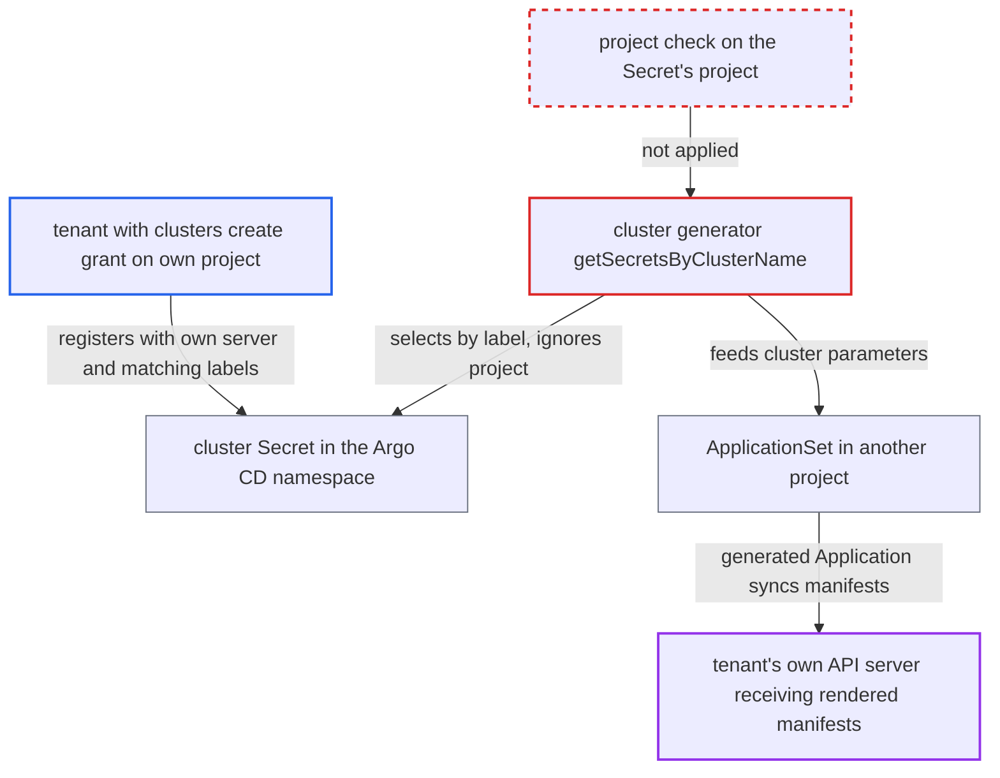

# Cluster generator feeds tenant-registered project-scoped clusters into other projects' ApplicationSets

| Field | Value |
|---|---|
| ID | `find_01ApLpsTBffhseuMUmQuT5z4` |
| Severity | **Medium** |
| Status | open |
| CWE | CWE-862 — Missing authorization |
| Created | 2026-10-27T21:30:39.342023Z |
| Claude Security | https://claude.ai/security/findings/find_01ApLpsTBffhseuMUmQuT5z4 |

## Description

A tenant with the self-service cluster grant can receive another project's fully rendered manifests on their own API server. That includes Secret data the API normally masks. The tenant needs a cluster-create grant on their own project, and an ApplicationSet elsewhere that they can match. The cluster generator in `getSecretsByClusterName` never checks the cluster Secret's `project`.

1. **tenant** registers a cluster through POST `/api/v1/clusters`. The request sets `project` to their own project, `server` to their own API server, and labels that match the target ApplicationSet's selector. The call needs only the grant `clusters, create, <proj>/*` and a `/version` answer from the server. ([`server/cluster/cluster.go:144-160`](https://github.com/cx-benchmark/argo-cd/blob/b7bc418289a96130340ea79964c4491b416c14f2/server/cluster/cluster.go#L144-L160))
2. **`clusterToSecret`** stores the tenant's fields in a cluster Secret. The `name`, `server`, `project`, labels and annotations are copied into the Secret unchanged. These are the fields the generator selects on and reads. ([`util/db/cluster.go:378-410`](https://github.com/cx-benchmark/argo-cd/blob/b7bc418289a96130340ea79964c4491b416c14f2/util/db/cluster.go#L378-L410))
3. **the cluster event handler** requeues every ApplicationSet that has a cluster generator. Any cluster Secret create or update triggers this, so the tenant's registration takes effect at once. ([`applicationset/controllers/clustereventhandler.go:52-122`](https://github.com/cx-benchmark/argo-cd/blob/b7bc418289a96130340ea79964c4491b416c14f2/applicationset/controllers/clustereventhandler.go#L52-L122))
4. **`getSecretsByClusterName`** selects the tenant's Secret for another project's ApplicationSet. Selection uses only the label selector and the cluster secret-type label. It never compares `data["project"]` with the ApplicationSet's project, and it keys entries by `data["name"]`. ([`applicationset/generators/cluster.go:191-213`](https://github.com/cx-benchmark/argo-cd/blob/b7bc418289a96130340ea79964c4491b416c14f2/applicationset/generators/cluster.go#L191-L213))
5. **`getClusterParameters`** turns the Secret into template parameters. The tenant's `name`, `server`, `project`, labels and annotations become parameters for Applications in the ApplicationSet's own project. ([`applicationset/generators/cluster.go:152-189`](https://github.com/cx-benchmark/argo-cd/blob/b7bc418289a96130340ea79964c4491b416c14f2/applicationset/generators/cluster.go#L152-L189))
6. **the ApplicationSet controller** creates an Application pointing at the tenant's server. `validateGeneratedApplications` checks only that the project exists and the destination resolves. ([`applicationset/controllers/applicationset_controller.go:608-643`](https://github.com/cx-benchmark/argo-cd/blob/b7bc418289a96130340ea79964c4491b416c14f2/applicationset/controllers/applicationset_controller.go#L608-L643))
7. **`IsDestinationPermitted`** allows the destination. It ignores the cluster's `project` unless `permitOnlyProjectScopedClusters` is set. It therefore passes when the project's destinations admit the server, for example `server: '*'`. ([`pkg/apis/application/v1alpha1/app_project_types.go:482-505`](https://github.com/cx-benchmark/argo-cd/blob/b7bc418289a96130340ea79964c4491b416c14f2/pkg/apis/application/v1alpha1/app_project_types.go#L482-L505))
8. **the application controller** syncs the rendered manifests to the tenant's server. It uses the tenant's own cluster credentials, so the tenant's server receives the other project's manifests, including Secret data. ([`controller/sync.go:244-258`](https://github.com/cx-benchmark/argo-cd/blob/b7bc418289a96130340ea79964c4491b416c14f2/controller/sync.go#L244-L258))

## Assessment

The attacker is a tenant holding the documented self-service grant `clusters, create, <proj>/*`. Another project must have an ApplicationSet with a cluster generator that the tenant can satisfy. That means `clusters: {}`, which needs no label, or labels the tenant can guess. That project's destinations must admit the tenant's server, for example `server: '*'`, and the template must sync automatically. The tenant sends a POST to `/api/v1/clusters` with `project: <proj>`, their own server and matching labels. They may also reuse an existing cluster's name. The labels they choose can also select which templated paths or values get rendered.

Impact: The tenant causes Applications to be created in a project they have no rights in. They receive that project's fully rendered manifests on their own API server, including Secret data the API masks. If they reuse a victim cluster's name, its generated Application may be re-pointed to the tenant's server or fail to resolve, so the victim stops receiving updates. The tenant cannot deploy to clusters they do not control through this path.

## Recommendation

(1) The cluster generator accepts every Secret that matches the selector, whatever its `project`. Clusters registered by one project's tenants therefore drive Applications in another project.

Fix criteria: A cluster Secret scoped to a project produces parameters only for ApplicationSets whose generated Applications belong to that same project. Global clusters are unaffected. Check this by registering a cluster with `clusters, create, tenant/*`. It must yield no Application for a `clusters: {}` ApplicationSet whose template project is another project.

(2) Generator output is keyed by the free-form cluster `name`. A tenant-chosen duplicate silently replaces an existing cluster's entry, depending on list order.

Fix criteria: Duplicate cluster names among selected Secrets are detected and reported, not resolved by list order. Check this by registering a project-scoped cluster with an existing cluster's name. It must never re-point that cluster's generated Application.

## Evidence

**https://github.com/cx-benchmark/argo-cd**

- [`applicationset/generators/cluster.go:191-213`](https://github.com/cx-benchmark/argo-cd/blob/b7bc418289a96130340ea79964c4491b416c14f2/applicationset/generators/cluster.go#L191-L213)
- [`applicationset/generators/cluster.go:152-189`](https://github.com/cx-benchmark/argo-cd/blob/b7bc418289a96130340ea79964c4491b416c14f2/applicationset/generators/cluster.go#L152-L189)
- [`server/cluster/cluster.go:144-160`](https://github.com/cx-benchmark/argo-cd/blob/b7bc418289a96130340ea79964c4491b416c14f2/server/cluster/cluster.go#L144-L160)
- [`util/db/cluster.go:378-410`](https://github.com/cx-benchmark/argo-cd/blob/b7bc418289a96130340ea79964c4491b416c14f2/util/db/cluster.go#L378-L410)
- [`applicationset/controllers/clustereventhandler.go:52-122`](https://github.com/cx-benchmark/argo-cd/blob/b7bc418289a96130340ea79964c4491b416c14f2/applicationset/controllers/clustereventhandler.go#L52-L122)
- [`applicationset/controllers/applicationset_controller.go:608-643`](https://github.com/cx-benchmark/argo-cd/blob/b7bc418289a96130340ea79964c4491b416c14f2/applicationset/controllers/applicationset_controller.go#L608-L643)
- [`pkg/apis/application/v1alpha1/app_project_types.go:482-505`](https://github.com/cx-benchmark/argo-cd/blob/b7bc418289a96130340ea79964c4491b416c14f2/pkg/apis/application/v1alpha1/app_project_types.go#L482-L505)
- [`controller/sync.go:244-258`](https://github.com/cx-benchmark/argo-cd/blob/b7bc418289a96130340ea79964c4491b416c14f2/controller/sync.go#L244-L258)
- [`docs/user-guide/projects.md:423-428`](https://github.com/cx-benchmark/argo-cd/blob/b7bc418289a96130340ea79964c4491b416c14f2/docs/user-guide/projects.md#L423-L428)
- [`util/argo/argo.go:868-878`](https://github.com/cx-benchmark/argo-cd/blob/b7bc418289a96130340ea79964c4491b416c14f2/util/argo/argo.go#L868-L878)

