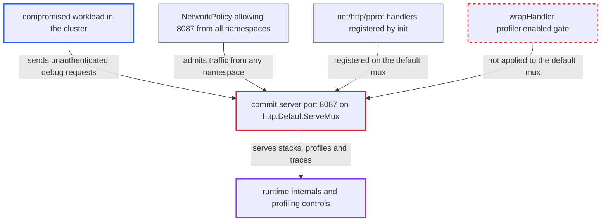

# Commit server metrics port serves ungated pprof via DefaultServeMux

| Field | Value |
|---|---|
| ID | `find_01PsAfiJYKJnVFGo1bxZUgjA` |
| Severity | **Medium** |
| Status | open |
| CWE | CWE-489 — Active debug code |
| Created | 2026-10-27T21:38:44.703146Z |
| Claude Security | https://claude.ai/security/findings/find_01PsAfiJYKJnVFGo1bxZUgjA |

## Description

A compromised workload anywhere in the cluster can read runtime debugging data from the Argo CD commit server, and can slow it by starting profiling. No Argo CD credentials are needed. The metrics listener on port 8087 serves `http.DefaultServeMux`, which carries the unguarded `net/http/pprof` handlers, so the `profiler.enabled` gate never applies. Push credentials and the GPG key are not exposed.

1. **the shared `argocd` binary** links `net/http/pprof` into the commit-server process. `cmd/main.go` imports every command package, and some of them import `util/profile`, which imports `net/http/pprof`. Its `init` registers the pprof handlers on `http.DefaultServeMux`. ([`cmd/main.go:13-23`](https://github.com/cx-benchmark/argo-cd/blob/b7bc418289a96130340ea79964c4491b416c14f2/cmd/main.go#L13-L23))
2. **the command in `argocd_commit_server.go`** serves `http.DefaultServeMux` on the metrics port. It registers `/metrics` with `http.Handle` and calls `http.ListenAndServe` with a `nil` handler. The default address is `0.0.0.0:8087`. ([`cmd/argocd-commit-server/commands/argocd_commit_server.go:59-61`](https://github.com/cx-benchmark/argo-cd/blob/b7bc418289a96130340ea79964c4491b416c14f2/cmd/argocd-commit-server/commands/argocd_commit_server.go#L59-L61))
3. **the shipped NetworkPolicy** lets any pod in any namespace reach port 8087. It allows 8087 from `namespaceSelector: {}`, and the `argocd-commit-server` Service publishes that port. ([`manifests/base/commit-server/argocd-commit-server-network-policy.yaml:15-26`](https://github.com/cx-benchmark/argo-cd/blob/b7bc418289a96130340ea79964c4491b416c14f2/manifests/base/commit-server/argocd-commit-server-network-policy.yaml#L15-L26))
4. **attacker in a compromised workload** sends a GET request to `/debug/pprof/goroutine?debug=2` on `argocd-commit-server.argocd:8087`. The request needs no authentication. It can also target `heap`, `profile?seconds=N` or `trace?seconds=N`.
5. **stdlib pprof handler** answers without consulting `wrapHandler`. `wrapHandler` is applied only by `RegisterProfiler` to a dedicated mux, and the commit server does not use it. ([`util/profile/profile.go:3-30`](https://github.com/cx-benchmark/argo-cd/blob/b7bc418289a96130340ea79964c4491b416c14f2/util/profile/profile.go#L3-L30))

## Assessment

The attacker is a compromised workload in the cluster that can reach internal services. It needs no Argo CD credentials. It requests a debug path such as `/debug/pprof/goroutine?debug=2`, `heap`, `profile?seconds=N` or `trace?seconds=N` on `http://argocd-commit-server.argocd:8087`. The shipped NetworkPolicy admits port 8087 from all namespaces. The component ships in every `*-with-hydrator` install variant. The docs say profiling is off by default, but this port ignores that setting.

Impact: The attacker reads goroutine stacks that show in-flight hydration and push work, allocation sites and MemStats. The attacker can also start CPU profiling or execution tracing of unbounded length, one at a time, and force garbage collection, which adds overhead. pprof returns no memory contents, and `cmdline` returns only `/usr/local/bin/argocd-commit-server`, so push credentials and the GPG signing key are not disclosed. Nothing is written.

## Recommendation

The commit-server metrics and health listener (`argocd_commit_server.go` lines 60-61 and 91) serves the process-global `http.DefaultServeMux`. It therefore exposes the `net/http/pprof` handlers that the shared binary registers there, bypassing the `profiler.enabled` gate.

Fix criteria: The metrics port serves a dedicated mux that contains only `/metrics` and `/healthz`, plus pprof routes gated by `wrapHandler` if profiling is wanted. Nothing on that port falls back to `http.DefaultServeMux`. To verify, remove any `profiler.enabled` file and send GET requests to port 8087 for `/debug/pprof/`, `/cmdline`, `/heap`, `/goroutine`, `/profile` and `/trace`. Each must return 401 or 404. `/metrics` and `/healthz` must still work.

## Evidence

**https://github.com/cx-benchmark/argo-cd**

- [`cmd/argocd-commit-server/commands/argocd_commit_server.go:59-61`](https://github.com/cx-benchmark/argo-cd/blob/b7bc418289a96130340ea79964c4491b416c14f2/cmd/argocd-commit-server/commands/argocd_commit_server.go#L59-L61)
- [`cmd/argocd-commit-server/commands/argocd_commit_server.go:91`](https://github.com/cx-benchmark/argo-cd/blob/b7bc418289a96130340ea79964c4491b416c14f2/cmd/argocd-commit-server/commands/argocd_commit_server.go#L91)
- [`util/profile/profile.go:3-30`](https://github.com/cx-benchmark/argo-cd/blob/b7bc418289a96130340ea79964c4491b416c14f2/util/profile/profile.go#L3-L30)
- [`cmd/main.go:13-23`](https://github.com/cx-benchmark/argo-cd/blob/b7bc418289a96130340ea79964c4491b416c14f2/cmd/main.go#L13-L23)
- [`Dockerfile:156-167`](https://github.com/cx-benchmark/argo-cd/blob/b7bc418289a96130340ea79964c4491b416c14f2/Dockerfile#L156-L167)
- [`common/common.go:81-92`](https://github.com/cx-benchmark/argo-cd/blob/b7bc418289a96130340ea79964c4491b416c14f2/common/common.go#L81-L92)
- [`manifests/base/commit-server/argocd-commit-server-network-policy.yaml:15-26`](https://github.com/cx-benchmark/argo-cd/blob/b7bc418289a96130340ea79964c4491b416c14f2/manifests/base/commit-server/argocd-commit-server-network-policy.yaml#L15-L26)
- [`manifests/base/commit-server/argocd-commit-server-deployment.yaml:75-91`](https://github.com/cx-benchmark/argo-cd/blob/b7bc418289a96130340ea79964c4491b416c14f2/manifests/base/commit-server/argocd-commit-server-deployment.yaml#L75-L91)
- [`manifests/base/commit-server/argocd-commit-server-service.yaml:10-19`](https://github.com/cx-benchmark/argo-cd/blob/b7bc418289a96130340ea79964c4491b416c14f2/manifests/base/commit-server/argocd-commit-server-service.yaml#L10-L19)
- [`docs/operator-manual/high_availability.md:753-761`](https://github.com/cx-benchmark/argo-cd/blob/b7bc418289a96130340ea79964c4491b416c14f2/docs/operator-manual/high_availability.md#L753-L761)

