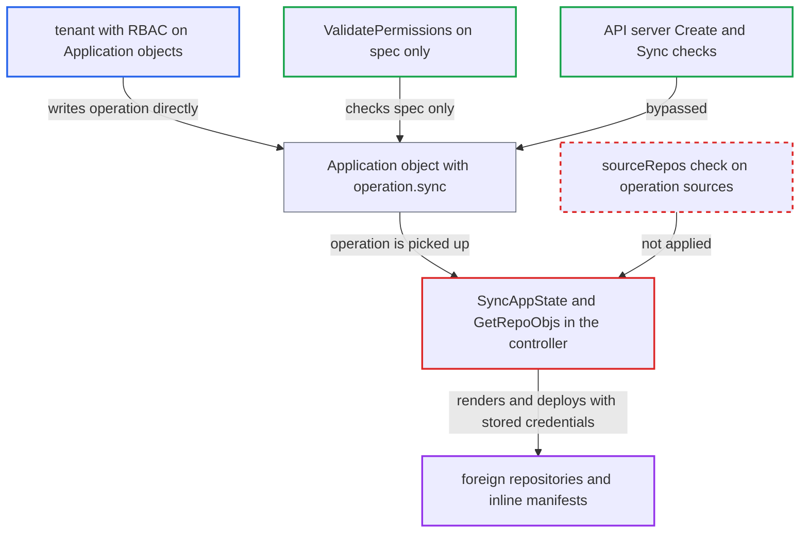

# Controller syncs operation-supplied sources and local manifests without AppProject sourceRepos check

| Field | Value |
|---|---|
| ID | `find_018QN3xtbKgVB385GfN3AqqW` |
| Severity | **Medium** |
| Status | open |
| CWE | CWE-862 — Missing Authorization |
| Created | 2026-10-27T21:23:16.530448Z |
| Claude Security | https://claude.ai/security/findings/find_018QN3xtbKgVB385GfN3AqqW |

## Description

A tenant who can write Application objects directly through the Kubernetes API can make Argo CD deploy content from any repository its stored credentials reach, or inline manifests. This bypasses the AppProject `sourceRepos` limit. It needs apps-in-any-namespace enabled and the tenant's namespace listed in the project's `sourceNamespaces`. The controller's `SyncAppState` never checks the operation's sources against `sourceRepos`.

1. **tenant** creates or updates an Application with a permitted `spec.source`. The tenant uses Kubernetes RBAC in a namespace enabled through `--application-namespaces`, so the Argo CD API server is not involved and its checks do not run. ([`manifests/crds/application-crd.yaml:7229`](https://github.com/cx-benchmark/argo-cd/blob/b7bc418289a96130340ea79964c4491b416c14f2/manifests/crds/application-crd.yaml#L7229))
2. **tenant** sets `.operation.sync.source.repoURL` to a foreign repository, or `.operation.sync.manifests` to inline YAML. The CRD has `subresources: {}`, so whoever can update an Application can write `.operation` directly. ([`server/application/application.go:385-391`](https://github.com/cx-benchmark/argo-cd/blob/b7bc418289a96130340ea79964c4491b416c14f2/server/application/application.go#L385-L391))
3. **the controller's `newSyncOperationResult`** copies the operation's sources and revisions into the sync result. It takes `operation.sync.source`, `operation.sync.sources` and `operation.sync.revision(s)` as given and never compares them with `sourceRepos`. ([`controller/sync.go:137-160`](https://github.com/cx-benchmark/argo-cd/blob/b7bc418289a96130340ea79964c4491b416c14f2/controller/sync.go#L137-L160))
4. **the controller's `SyncAppState`** passes the operation sources and `syncOp.Manifests` to `CompareAppState` and relies only on stored conditions. The `InvalidSpecError` condition is computed from `app.Spec` alone, so an operation pointing at a foreign repository never produces it. ([`controller/sync.go:205-241`](https://github.com/cx-benchmark/argo-cd/blob/b7bc418289a96130340ea79964c4491b416c14f2/controller/sync.go#L205-L241))
5. **the controller's `refreshAppConditions`** validates only `app.Spec` with `argo.ValidatePermissions`. The operation's `sync.source`, `sync.sources` and `sync.manifests` are never validated. ([`controller/appcontroller.go:2522-2541`](https://github.com/cx-benchmark/argo-cd/blob/b7bc418289a96130340ea79964c4491b416c14f2/controller/appcontroller.go#L2522-L2541))
6. **the controller's `GetRepoObjs`** fetches repository credentials for the foreign URL and asks the repo-server to render it. `db.GetRepository` attaches any global repository secret or repo-creds template matching the URL, and `ProjectSourceRepos` is used only for Helm dependency error messages. ([`controller/state.go:389-420`](https://github.com/cx-benchmark/argo-cd/blob/b7bc418289a96130340ea79964c4491b416c14f2/controller/state.go#L389-L420))
7. **the controller** applies the rendered content and records the foreign source in `status.history`. Content is applied into the destinations and kinds the project allows, and `persistRevisionHistory` writes the history entry.

## Assessment

The attacker is a tenant with Kubernetes RBAC to create or update `Application` objects in a namespace enabled through `--application-namespaces` and listed in their AppProject's `sourceNamespaces`. Apps-in-any-namespace must be enabled. The tenant writes an Application with a permitted `spec.source` and sets `.operation.sync.source.repoURL` to another repository. The other route is setting `.operation.sync.manifests` to inline YAML. The informer `UpdateFunc` enqueues the operation, and `processRequestedAppOperation` then calls `SyncAppState`. No victim action is needed.

Impact: The tenant can deploy content that never came from a project-permitted repository, and defeat the review and branch-protection controls that `sourceRepos` stood for. Content from private repositories reachable through global repo-creds, such as ConfigMaps from another team's repository, can land in the tenant's namespace where it can be read. Kinds and namespaces stay limited by the project's destination and kind allowlists.

## Recommendation

(1) `SyncAppState` treats the `operation.sync.source`, `sources` and `manifests` fields as authoritative and never checks them against the AppProject. Applications not created through the API server therefore escape the project source boundary.

Fix criteria: Before manifests are generated, every source used for the sync is checked with `proj.IsSourcePermitted`. This covers operation-supplied sources, spec-derived sources and ref sources. `operation.sync.manifests` is refused unless an explicit, admin-controlled policy allows local manifests for declaratively-managed Applications. An Application in a tenant namespace with `.operation.sync.source.repoURL` outside `sourceRepos`, or with inline manifests, ends in `OperationError` without any repo-server call or apply.

(2) Sync-time authorization relies on a persisted `InvalidSpecError` condition that the refresh path computes from the spec alone. The effective source is not re-validated when the sync runs.

Fix criteria: `SyncAppState` calls `argo.ValidatePermissions` (or an equivalent) on the effective spec and operation at the start of each operation, instead of reading `app.Status.Conditions`. A sync fails closed when validation cannot be completed.

## Evidence

**https://github.com/cx-benchmark/argo-cd**

- [`controller/sync.go:137-160`](https://github.com/cx-benchmark/argo-cd/blob/b7bc418289a96130340ea79964c4491b416c14f2/controller/sync.go#L137-L160)
- [`controller/sync.go:205-241`](https://github.com/cx-benchmark/argo-cd/blob/b7bc418289a96130340ea79964c4491b416c14f2/controller/sync.go#L205-L241)
- [`controller/state.go:389-420`](https://github.com/cx-benchmark/argo-cd/blob/b7bc418289a96130340ea79964c4491b416c14f2/controller/state.go#L389-L420)
- [`controller/appcontroller.go:2522-2541`](https://github.com/cx-benchmark/argo-cd/blob/b7bc418289a96130340ea79964c4491b416c14f2/controller/appcontroller.go#L2522-L2541)
- [`server/application/application.go:385-391`](https://github.com/cx-benchmark/argo-cd/blob/b7bc418289a96130340ea79964c4491b416c14f2/server/application/application.go#L385-L391)
- [`manifests/crds/application-crd.yaml:7229`](https://github.com/cx-benchmark/argo-cd/blob/b7bc418289a96130340ea79964c4491b416c14f2/manifests/crds/application-crd.yaml#L7229)

