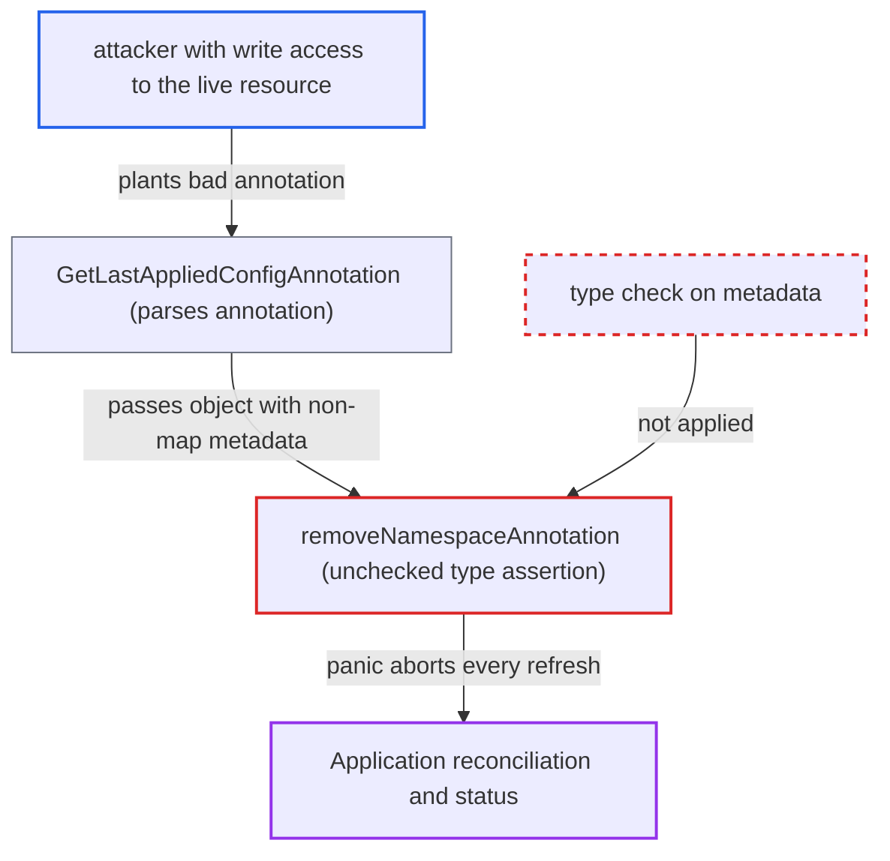

# Crafted last-applied-configuration annotation panics diff and freezes app reconciliation

| Field | Value |
|---|---|
| ID | `find_01TPrkTZkKJinQECPf49csUy` |
| Severity | **Medium** |
| Status | open |
| CWE | CWE-704 — Incorrect Type Conversion |
| Created | 2026-10-27T21:26:00.508771Z |
| Claude Security | https://claude.ai/security/findings/find_01TPrkTZkKJinQECPf49csUy |

## Description

Someone who can edit a live resource in an Argo CD Application can stop that Application from being reconciled. They do it by writing a malformed `kubectl.kubernetes.io/last-applied-configuration` annotation. The UI keeps showing stale Synced/Healthy state, and drift is never reverted. The cause is `removeNamespaceAnnotation`, which uses an unchecked type assertion on `metadata` and panics.

1. **attacker** sets a malformed last-applied annotation on a live resource. The annotation holds JSON such as `{"kind":"Deployment","apiVersion":"apps/v1","metadata":"x"}`, where `metadata` is a string, or `null`.
2. **`GetLastAppliedConfigAnnotation`** parses the annotation into an `unstructured.Unstructured`. It only requires a non-empty `kind`, so `metadata` of any JSON type is accepted. ([`gitops-engine/pkg/diff/diff.go:705-720`](https://github.com/cx-benchmark/argo-cd/blob/b7bc418289a96130340ea79964c4491b416c14f2/gitops-engine/pkg/diff/diff.go#L705-L720))
3. **`Diff`** passes the parsed object `orig` on to `ThreeWayDiff`. `Normalize(orig)` tolerates a non-map `metadata`, so nothing sanitises `orig` before `ThreeWayDiff` calls `removeNamespaceAnnotation(orig)`. This is the default client-side diff path. ([`gitops-engine/pkg/diff/diff.go:129-137`](https://github.com/cx-benchmark/argo-cd/blob/b7bc418289a96130340ea79964c4491b416c14f2/gitops-engine/pkg/diff/diff.go#L129-L137))
4. **`removeNamespaceAnnotation`** panics on the type assertion of `metadata`. `metadataIf.(map[string]any)` is written without the two-value form, so a string or null `metadata` causes an interface-conversion runtime error. ([`gitops-engine/pkg/diff/diff.go:613-633`](https://github.com/cx-benchmark/argo-cd/blob/b7bc418289a96130340ea79964c4491b416c14f2/gitops-engine/pkg/diff/diff.go#L613-L633))
5. **`CompareAppState`** hits the panic on every refresh of the Application. It calls `argodiff.StateDiffs` on each live/target pair during every refresh, so the bad annotation is reached each time. ([`controller/state.go:969-977`](https://github.com/cx-benchmark/argo-cd/blob/b7bc418289a96130340ea79964c4491b416c14f2/controller/state.go#L969-L977))
6. **`processAppRefreshQueueItem`** recovers from the panic and only logs it. The refresh ends before any status, health, sync-status, managed-resource or auto-sync result is saved, so the Application stays unreconciled. ([`controller/appcontroller.go:2134-2139`](https://github.com/cx-benchmark/argo-cd/blob/b7bc418289a96130340ea79964c4491b416c14f2/controller/appcontroller.go#L2134-L2139))

## Assessment

The attacker needs write (update or patch) access to a resource managed by an Argo CD Application. That can be Kubernetes RBAC in the namespace, a workload's own service account, or an Argo CD user with `applications, update` calling the `PatchResource` API. Another way in is git, for resources synced with `ServerSideApply=true` or `Replace=true`, because those paths do not rewrite the annotation. It works on the default configuration, with the client-side three-way diff used whenever server-side diff is not enabled for the app. No user interaction is needed.

Impact: The targeted Application stops being reconciled. Drift the attacker introduces is never reported as OutOfSync, `selfHeal` and automated sync never revert it, and operators see stale Synced/Healthy state. The loss is limited to that one Application. The controller process and other apps keep running because the panic is recovered, and no data is disclosed.

## Recommendation

`removeNamespaceAnnotation`, and the callers that give it an object decoded from the writable `last-applied-configuration` annotation, assume `metadata` is a JSON object. The unchecked type assertion turns malformed metadata into a panic that aborts the whole Application refresh.

Fix criteria: A live resource whose `last-applied-configuration` annotation has `metadata` of any JSON type (string, null, number, array) causes no panic. The diff either ignores the malformed annotation and falls back to the two-way diff, as it already does for invalid JSON, or reports a per-resource error. The refresh completes and saves status for all other resources. To verify, diff a live object carrying `{"kind":"X","metadata":"x"}` in that annotation. Confirm that no panic is logged and that sync status and health are still updated.

## Evidence

**https://github.com/cx-benchmark/argo-cd**

- [`gitops-engine/pkg/diff/diff.go:613-633`](https://github.com/cx-benchmark/argo-cd/blob/b7bc418289a96130340ea79964c4491b416c14f2/gitops-engine/pkg/diff/diff.go#L613-L633)
- [`gitops-engine/pkg/diff/diff.go:705-720`](https://github.com/cx-benchmark/argo-cd/blob/b7bc418289a96130340ea79964c4491b416c14f2/gitops-engine/pkg/diff/diff.go#L705-L720)
- [`gitops-engine/pkg/diff/diff.go:129-137`](https://github.com/cx-benchmark/argo-cd/blob/b7bc418289a96130340ea79964c4491b416c14f2/gitops-engine/pkg/diff/diff.go#L129-L137)
- [`controller/state.go:969-977`](https://github.com/cx-benchmark/argo-cd/blob/b7bc418289a96130340ea79964c4491b416c14f2/controller/state.go#L969-L977)
- [`controller/appcontroller.go:2134-2139`](https://github.com/cx-benchmark/argo-cd/blob/b7bc418289a96130340ea79964c4491b416c14f2/controller/appcontroller.go#L2134-L2139)

