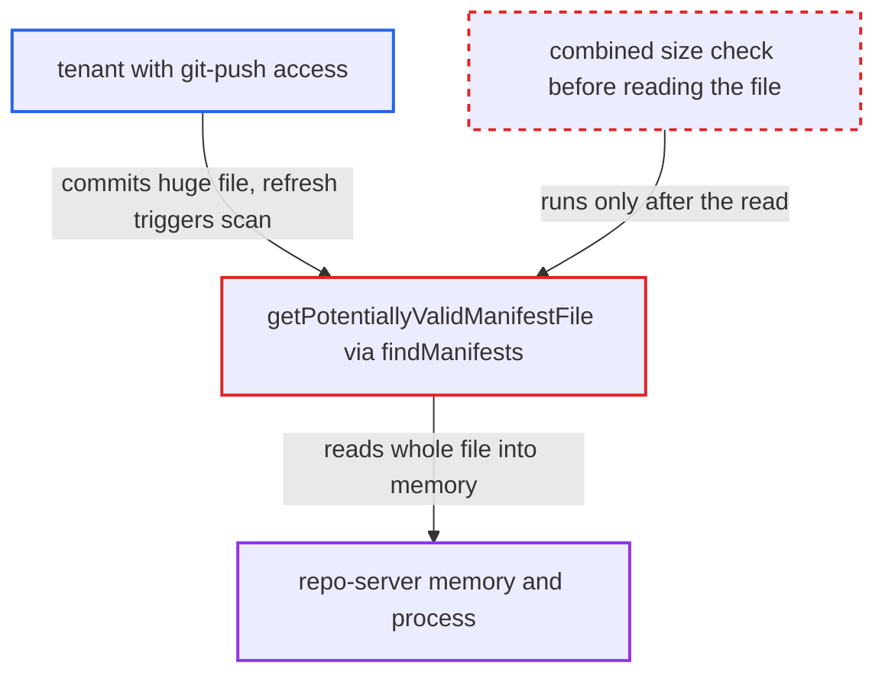

# Directory-app combined manifest size limit bypassed: each file read whole before size check

| Field | Value |
|---|---|
| ID | `find_01PtC9kwnvFwTMAjndDMiFMf` |
| Severity | **Medium** |
| Status | open |
| CWE | CWE-770 — Uncontrolled resource consumption |
| Created | 2026-10-27T21:24:03.478581Z |
| Claude Security | https://claude.ai/security/findings/find_01PtC9kwnvFwTMAjndDMiFMf |

## Description

A tenant who can push to a git repository used by a directory-type Application can crash the Argo CD repo-server with one very large manifest file. That stalls manifest generation for every Application it serves. The cause is `getPotentiallyValidManifestFile`, which reads each whole candidate file into memory to look for the skip marker before the combined-size limit `reposerver.max.combined.directory.manifests.size` is checked.

1. **attacker with git-push access** commits a multi-gigabyte `big.yaml` under the app path. Repetitive content compresses well in git packs, so push-size limits do not stop it, but the git host must accept a large blob.
2. **repo-server** starts manifest generation on the next refresh. A periodic refresh, a webhook or a manual refresh all work, and directory-type sources reach `findManifests` with the configured limit during `GenerateManifests`. ([`reposerver/repository/repository.go:1830-1837`](https://github.com/cx-benchmark/argo-cd/blob/b7bc418289a96130340ea79964c4491b416c14f2/reposerver/repository/repository.go#L1830-L1837))
3. **the function `findManifests`** calls `getPotentiallyValidManifestFile` for each candidate file before any size accounting. The pre-validation walk is meant to save memory, and the function's own comment says it tests everything without actually reading the file. ([`reposerver/repository/repository.go:2165-2175`](https://github.com/cx-benchmark/argo-cd/blob/b7bc418289a96130340ea79964c4491b416c14f2/reposerver/repository/repository.go#L2165-L2175))
4. **the function `getPotentiallyValidManifestFile`** reads the whole file into memory with `utfutil.ReadFile`. It does this only to search for the `+argocd:skip-file-rendering` marker, after the extension, symlink, regular-file and include/exclude checks have passed. ([`reposerver/repository/repository.go:2232-2241`](https://github.com/cx-benchmark/argo-cd/blob/b7bc418289a96130340ea79964c4491b416c14f2/reposerver/repository/repository.go#L2232-L2241))
5. **the size check in the directory walk** adds `realFileInfo.Size()` to the running total and compares it with the limit. This happens only after `getPotentiallyValidManifestFile` has returned, so the file has already been buffered and the rejection comes too late. ([`reposerver/repository/repository.go:2283-2294`](https://github.com/cx-benchmark/argo-cd/blob/b7bc418289a96130340ea79964c4491b416c14f2/reposerver/repository/repository.go#L2283-L2294))
6. **repo-server process** runs out of memory and dies. A Go out-of-memory error is fatal, and the shipped Deployment sets no memory limit. The failure is not cached, so every reconcile retries and the server crash-loops while the commit is the tracked revision.

## Assessment

The attacker is a tenant with git-push access to a repository behind a directory-type Application. Directory is the default type when no Helm, Kustomize or plugin markers exist. They commit one `*.yaml`, `*.yml` or `*.json` file larger than the repo-server's available memory under the app path. Any file works when `disableExtensionFilter` is set. The limit is on by default at `10M`, and the oversized file defeats it whatever value is configured. The attack starts on the next refresh, whether periodic, webhook or manual. Only the largest single file matters, because the walk stops at the first file that pushes the total past the limit. The report assumes `utfutil.ReadFile` in `github.com/TomOnTime/utfutil v1.0.0` returns `io.ReadAll` of a BOM-decoding reader, so peak allocation is about 1-2x the file size. The module source was not in the checkout.

Impact: The repo-server hits a fatal out-of-memory error or is OOM-killed, and it keeps crash-looping while the commit is the tracked revision. Manifest generation stalls for every Application the repo-server serves. The report finds no confidentiality or integrity impact.

## Recommendation

The skip-marker scan reads each candidate manifest completely before the combined-size limit is checked. The documented memory bound therefore does not bound the memory actually used.

Fix criteria: No candidate file is read, fully or beyond a small bounded prefix, before its `Size()` has been added to the running total and compared against `MaxCombinedDirectoryManifestsSize`. A file that would exceed the limit is rejected without being opened. A directory app containing a file larger than the configured limit fails with `ErrExceededMaxCombinedManifestFileSize`. During that failure the repo-server's memory stays bounded by the limit.

## Evidence

**https://github.com/cx-benchmark/argo-cd**

- [`reposerver/repository/repository.go:2232-2241`](https://github.com/cx-benchmark/argo-cd/blob/b7bc418289a96130340ea79964c4491b416c14f2/reposerver/repository/repository.go#L2232-L2241)
- [`reposerver/repository/repository.go:2283-2294`](https://github.com/cx-benchmark/argo-cd/blob/b7bc418289a96130340ea79964c4491b416c14f2/reposerver/repository/repository.go#L2283-L2294)
- [`reposerver/repository/repository.go:2165-2175`](https://github.com/cx-benchmark/argo-cd/blob/b7bc418289a96130340ea79964c4491b416c14f2/reposerver/repository/repository.go#L2165-L2175)
- [`reposerver/repository/repository.go:1830-1837`](https://github.com/cx-benchmark/argo-cd/blob/b7bc418289a96130340ea79964c4491b416c14f2/reposerver/repository/repository.go#L1830-L1837)
- [`cmd/argocd-repo-server/commands/argocd_repo_server.go:266`](https://github.com/cx-benchmark/argo-cd/blob/b7bc418289a96130340ea79964c4491b416c14f2/cmd/argocd-repo-server/commands/argocd_repo_server.go#L266)
- [`docs/operator-manual/security.md:360-368`](https://github.com/cx-benchmark/argo-cd/blob/b7bc418289a96130340ea79964c4491b416c14f2/docs/operator-manual/security.md#L360-L368)

