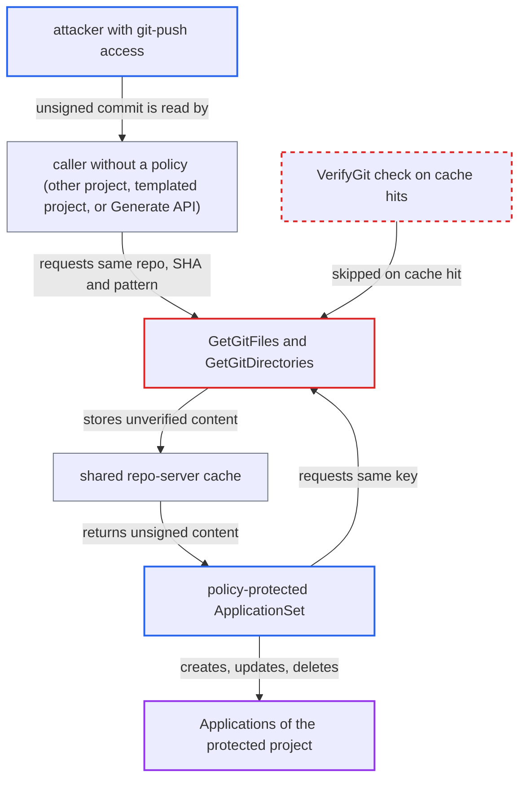

# Git generator RPCs serve cached files before source-integrity verification, bypassing GPG policy

| Field | Value |
|---|---|
| ID | `find_01TbJmycQqUq78Pm2Ko2LEJa` |
| Severity | **Medium** |
| Status | open |
| CWE | CWE-347 — Improper signature verification |
| Created | 2026-10-27T21:22:46.261019Z |
| Claude Security | https://claude.ai/security/findings/find_01TbJmycQqUq78Pm2Ko2LEJa |

## Description

Someone with git-push access to a repo can get unsigned commits accepted as input by a GPG-protected ApplicationSet git generator. Another caller with no policy must first read the same repo URL, SHA and pattern. The cause is that `GetGitFiles` and `GetGitDirectories` return cache hits before `sourceintegrity.VerifyGit` runs, and the cache keys leave out the policy.

1. **attacker** pushes an unsigned commit to a repo. A policy-protected git-generator ApplicationSet reads this repo, and the attacker needs git-push access to it.
2. **caller without a policy** requests the same repo URL, SHA and pattern. This caller can be an ApplicationSet in a project with no policy for the repo, an ApplicationSet in a templated project, or the attacker's own call to `ApplicationSetService.Generate`. A nil policy makes `VerifyGit` return nil. ([`applicationset/generators/git.go:91-111`](https://github.com/cx-benchmark/argo-cd/blob/b7bc418289a96130340ea79964c4491b416c14f2/applicationset/generators/git.go#L91-L111))
3. **the dry-run API `Generate`** runs the git generator on demand without saving anything. Any caller holding `applicationsets/create` in some project can use it to warm the cache for a repo, revision and pattern they choose. ([`server/applicationset/applicationset.go:459-495`](https://github.com/cx-benchmark/argo-cd/blob/b7bc418289a96130340ea79964c4491b416c14f2/server/applicationset/applicationset.go#L459-L495))
4. **the handlers `GetGitFiles` and `GetGitDirectories`** cache the unverified files and directories. The cache keys are `gitfiles|<repoURL>|<sha>|<pattern>` and `gitdirs|<repoURL>|<sha>`. They record neither the policy nor the verification result. ([`reposerver/repository/repository.go:3379-3411`](https://github.com/cx-benchmark/argo-cd/blob/b7bc418289a96130340ea79964c4491b416c14f2/reposerver/repository/repository.go#L3379-L3411))
5. **the handler `GetGitFiles`** returns the cached content to the protected ApplicationSet. On a cache hit the handler returns before checkout and before `VerifyGit`, and it never reads the request's `SourceIntegrity`. `GetGitDirectories` does the same. ([`reposerver/repository/repository.go:3359-3365`](https://github.com/cx-benchmark/argo-cd/blob/b7bc418289a96130340ea79964c4491b416c14f2/reposerver/repository/repository.go#L3359-L3365))
6. **the protected ApplicationSet** creates, updates or deletes Applications from the unsigned content. The generator relies on the repo-server to enforce the policy, so the files and directories are templated into Applications with no further verification. ([`applicationset/services/repo_service.go:77-122`](https://github.com/cx-benchmark/argo-cd/blob/b7bc418289a96130340ea79964c4491b416c14f2/applicationset/services/repo_service.go#L77-L122))

## Assessment

The attacker needs git-push access to a repo that a policy-protected git-generator ApplicationSet reads. They push an unsigned commit. A caller without a policy must then read the same repo URL, SHA and pattern. That caller can be another project's ApplicationSet, a templated-project ApplicationSet, or the attacker's own `Generate` call in a project where they hold `applicationsets/create`. The protected ApplicationSet then gets the cached files on its next reconcile. The entry stays cached for `repoCacheExpiration`.

Impact: Unsigned, attacker-written generator input decides which Applications the protected ApplicationSet creates, updates or deletes. It also decides the values templated into them, such as paths, Helm parameters/values and destinations, within project bounds. The default `sync` policy lets removed entries delete Applications. This defeats the project's GPG policy. Disclosure is limited and depends on what the template exposes.

## Recommendation

Cache lookups in `GetGitFiles` and `GetGitDirectories` return before source-integrity verification. The cache keys do not tell verified content from unverified content, and do not record the policy it was produced under.

Fix criteria: Content returned to a caller that supplies a `SourceIntegrity` policy has passed that policy for the exact resolved revision. Either the policy is part of the cache key, as in the manifest cache key, and entries are written only after verification passes, or verification also runs on cache hits. Test: populate the cache with a policy-less request for an unsigned revision, then repeat the request with a GPG policy. It must fail verification and must not return the cached files or directories.

## Evidence

**https://github.com/cx-benchmark/argo-cd**

- [`reposerver/repository/repository.go:3359-3365`](https://github.com/cx-benchmark/argo-cd/blob/b7bc418289a96130340ea79964c4491b416c14f2/reposerver/repository/repository.go#L3359-L3365)
- [`reposerver/repository/repository.go:3431-3437`](https://github.com/cx-benchmark/argo-cd/blob/b7bc418289a96130340ea79964c4491b416c14f2/reposerver/repository/repository.go#L3431-L3437)
- [`reposerver/repository/repository.go:3379-3411`](https://github.com/cx-benchmark/argo-cd/blob/b7bc418289a96130340ea79964c4491b416c14f2/reposerver/repository/repository.go#L3379-L3411)
- [`reposerver/cache/cache.go:530-562`](https://github.com/cx-benchmark/argo-cd/blob/b7bc418289a96130340ea79964c4491b416c14f2/reposerver/cache/cache.go#L530-L562)
- [`applicationset/generators/git.go:91-111`](https://github.com/cx-benchmark/argo-cd/blob/b7bc418289a96130340ea79964c4491b416c14f2/applicationset/generators/git.go#L91-L111)
- [`applicationset/services/repo_service.go:77-122`](https://github.com/cx-benchmark/argo-cd/blob/b7bc418289a96130340ea79964c4491b416c14f2/applicationset/services/repo_service.go#L77-L122)
- [`server/applicationset/applicationset.go:459-495`](https://github.com/cx-benchmark/argo-cd/blob/b7bc418289a96130340ea79964c4491b416c14f2/server/applicationset/applicationset.go#L459-L495)

