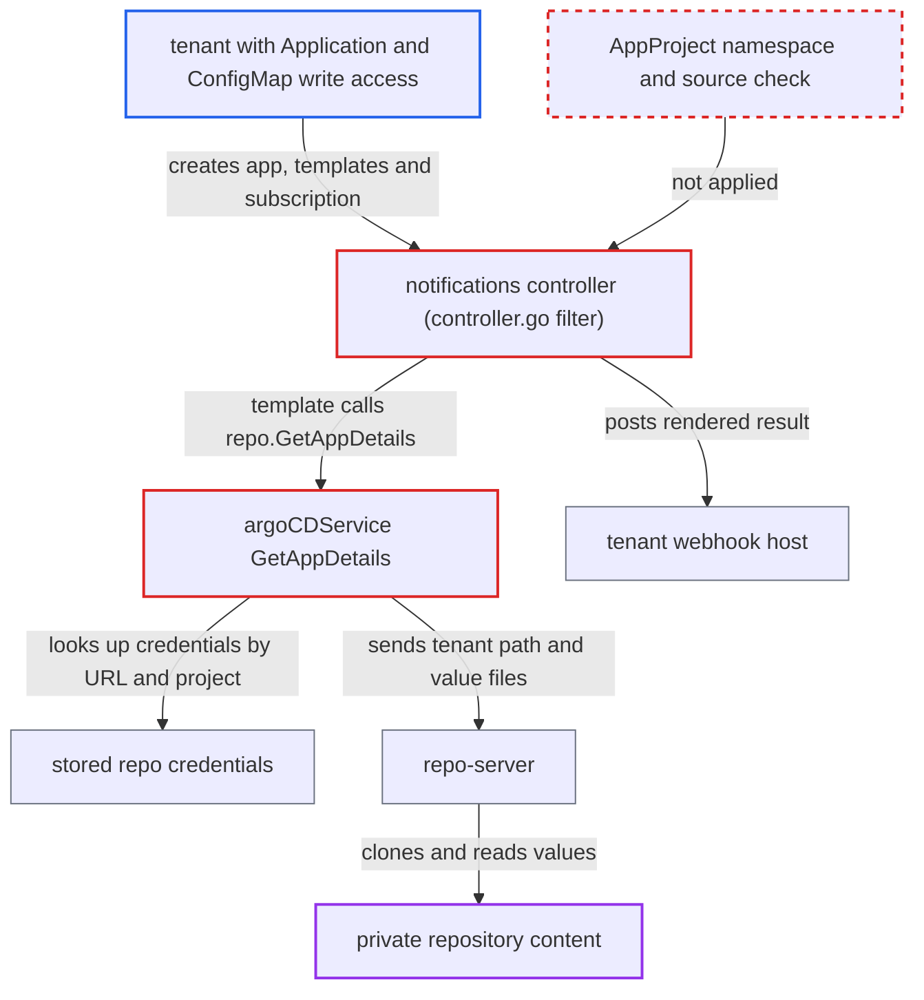

# Notification controller fetches repo content with stored credentials for apps their AppProject forbids

| Field | Value |
|---|---|
| ID | `find_01L3mpnhJSKHp117LrTSEomU` |
| Severity | **Medium** |
| Status | open |
| CWE | CWE-862 — Missing Authorization |
| Created | 2026-10-27T21:17:25.881616Z |
| Claude Security | https://claude.ai/security/findings/find_01L3mpnhJSKHp117LrTSEomU |

## Description

A tenant who can write Applications and ConfigMaps in an Argo CD application namespace can read private repository content through Argo CD's stored credentials. This works even when their AppProject does not allow that repo, and it needs self-service notifications (`--self-service-notification-enabled`). The notifications controller never checks the AppProject in `spec.project` before `GetAppDetails` and `GetCommitMetadata` fetch with those credentials. Credentials themselves are not returned.

1. **Tenant** writes an `argocd-notifications-cm` in their own namespace. It holds a webhook service pointing at the tenant's host, a trigger with `when: true`, and a template that renders `(call .repo.GetAppDetails).Helm.Values` and `.Parameters`. ([`util/notification/settings/settings.go:65-86`](https://github.com/cx-benchmark/argo-cd/blob/b7bc418289a96130340ea79964c4491b416c14f2/util/notification/settings/settings.go#L65-L86))
2. **Tenant** creates an Application that points at a victim repo. It sets `spec.project` to any project, `repoURL` to the victim repo, `path` to a chart directory and `helm.valueFiles` to any YAML file in the repo, and adds a subscription annotation.
3. **the notifications controller** accepts the Application for trigger and template evaluation. Its only filter is the namespace list and a sync-status freshness check, so it never asks whether the named AppProject admits the app's namespace or source. ([`notification_controller/controller/controller.go:111-120`](https://github.com/cx-benchmark/argo-cd/blob/b7bc418289a96130340ea79964c4491b416c14f2/notification_controller/controller/controller.go#L111-L120))
4. **the template** calls `repo.GetAppDetails`. `expression.Spawn` gives the `repo.*` functions to every template, including tenant-written ones, and `appProject` stays available as well. ([`util/notification/expression/repo/repo.go:96-117`](https://github.com/cx-benchmark/argo-cd/blob/b7bc418289a96130340ea79964c4491b416c14f2/util/notification/expression/repo/repo.go#L96-L117))
5. **`argoCDService.GetAppDetails`** looks up stored credentials for the tenant's repo and project. It takes `spec.source[0]` and `spec.project` as written and calls `db.GetRepository`, which can return a project-scoped secret, a global secret or a URL-prefix `repoCreds` template. ([`util/notification/argocd/service.go:86-136`](https://github.com/cx-benchmark/argo-cd/blob/b7bc418289a96130340ea79964c4491b416c14f2/util/notification/argocd/service.go#L86-L136))
6. **the repo-server** clones the repo with those credentials and returns file contents. It returns the raw chart `values.yaml` and the flattened contents of every named value file, because it trusts its caller. ([`reposerver/repository/repository.go:2720-2742`](https://github.com/cx-benchmark/argo-cd/blob/b7bc418289a96130340ea79964c4491b416c14f2/reposerver/repository/repository.go#L2720-L2742))
7. **the notifications controller** sends the rendered template to the tenant's webhook. The tenant chose the service, so the fetched data goes to the tenant's host.

## Assessment

The attacker is a tenant with Kubernetes write access to Applications and ConfigMaps in a namespace listed in `application.namespaces`. Self-service notifications must be enabled, so the controller loads `argocd-notifications-cm` and its secret from the app's namespace. Both are documented multi-tenant features. The `spec.project` can name any project. Without self-service, the controller still merges the subscriptions of whatever project the app names through `alterDestinations`, and admin templates run for an app no project admits.

Impact: The attacker reads private repositories through Argo CD's stored credentials: exact-URL secrets, URL-prefix `repoCreds` and other projects' scoped secrets. They get raw chart `values.yaml`, any YAML file in the repo as flattened parameters, commit metadata for a resolved SHA, and the full spec of any AppProject. The values route needs a Helm chart directory at `path`. Notifications for an unadmitted app can also reach another project's subscribers through admin services.

## Recommendation

(1) The notification controller resolves repository credentials and AppProject data from `spec.project` and `spec.source`, which the Application's own writer controls. It never checks that the named AppProject permits the app's namespace and source. The application-controller and the API server both do this check.

Fix criteria: Before `GetAppDetails`, `GetCommitMetadata` or the `appProject` lookup run, or before the app is processed at all, the resolved project must admit the app's namespace (`IsAppNamespacePermitted`) and its source (`IsSourcePermitted`). Otherwise the evaluation fails. Verify with an Application in an allowed namespace that names a project not listing that namespace, or a repo outside `sourceRepos`. It must cause no repo-server call and get no project-subscription notifications.

(2) Tenant-written self-service templates get the credential-bearing `repo.*` functions and an unrestricted AppProject lookup. The code already treats these templates as untrusted, since it withholds `secrets` from them.

Fix criteria: In self-service evaluation, functions that use central credentials or read objects outside the tenant's namespace are unavailable, or limited to the app's permitted project and sources. Verify that a tenant template calling `repo.GetAppDetails` for a repo outside its project's `sourceRepos` renders an error and contacts no repository.

## Evidence

**https://github.com/cx-benchmark/argo-cd**

- [`util/notification/argocd/service.go:86-136`](https://github.com/cx-benchmark/argo-cd/blob/b7bc418289a96130340ea79964c4491b416c14f2/util/notification/argocd/service.go#L86-L136)
- [`util/notification/argocd/service.go:65-84`](https://github.com/cx-benchmark/argo-cd/blob/b7bc418289a96130340ea79964c4491b416c14f2/util/notification/argocd/service.go#L65-L84)
- [`notification_controller/controller/controller.go:111-120`](https://github.com/cx-benchmark/argo-cd/blob/b7bc418289a96130340ea79964c4491b416c14f2/notification_controller/controller/controller.go#L111-L120)
- [`util/notification/expression/repo/repo.go:96-117`](https://github.com/cx-benchmark/argo-cd/blob/b7bc418289a96130340ea79964c4491b416c14f2/util/notification/expression/repo/repo.go#L96-L117)
- [`util/notification/settings/settings.go:65-86`](https://github.com/cx-benchmark/argo-cd/blob/b7bc418289a96130340ea79964c4491b416c14f2/util/notification/settings/settings.go#L65-L86)
- [`util/notification/settings/settings.go:116-143`](https://github.com/cx-benchmark/argo-cd/blob/b7bc418289a96130340ea79964c4491b416c14f2/util/notification/settings/settings.go#L116-L143)
- [`util/db/repository_secrets.go:568-603`](https://github.com/cx-benchmark/argo-cd/blob/b7bc418289a96130340ea79964c4491b416c14f2/util/db/repository_secrets.go#L568-L603)
- [`reposerver/repository/repository.go:2720-2742`](https://github.com/cx-benchmark/argo-cd/blob/b7bc418289a96130340ea79964c4491b416c14f2/reposerver/repository/repository.go#L2720-L2742)
- [`controller/appcontroller.go:404-406`](https://github.com/cx-benchmark/argo-cd/blob/b7bc418289a96130340ea79964c4491b416c14f2/controller/appcontroller.go#L404-L406)
- [`server/repository/repository.go:333-371`](https://github.com/cx-benchmark/argo-cd/blob/b7bc418289a96130340ea79964c4491b416c14f2/server/repository/repository.go#L333-L371)
- [`notification_controller/controller/controller.go:143-154`](https://github.com/cx-benchmark/argo-cd/blob/b7bc418289a96130340ea79964c4491b416c14f2/notification_controller/controller/controller.go#L143-L154)

