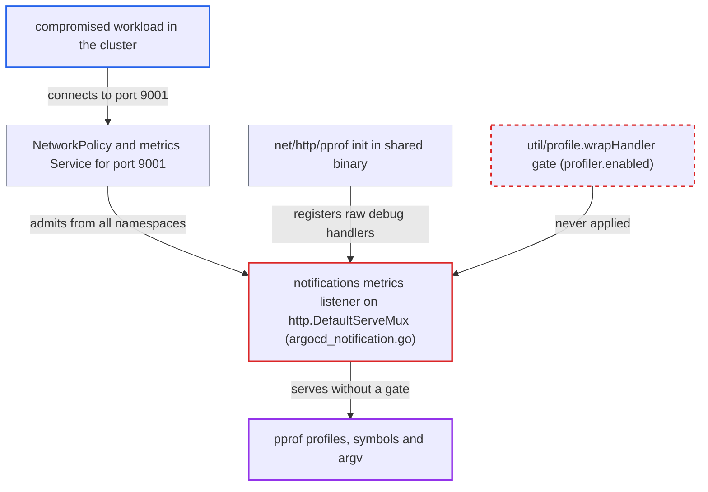

# Notifications controller metrics port serves ungated pprof via DefaultServeMux

| Field | Value |
|---|---|
| ID | `find_01WbjrG72TYva6ZAG7drt5cN` |
| Severity | **Medium** |
| Status | open |
| CWE | CWE-489 — Active debug code |
| Created | 2026-10-27T21:37:09.128598Z |
| Claude Security | https://claude.ai/security/findings/find_01WbjrG72TYva6ZAG7drt5cN |

## Description

A compromised workload anywhere in the cluster can read Go profiling data from the notifications controller, with no credentials. It can also start long CPU profiling or tracing runs. This works because the metrics listener in `cmd/argocd-notification/commands/argocd_notification.go` serves `http.DefaultServeMux`, which carries the raw `net/http/pprof` handlers. The `profiler.enabled` gate is never applied to them.

1. **the shared Argo CD binary** registers raw pprof handlers on the default mux at startup. The `init` of `net/http/pprof`, imported by `util/profile`, adds `/debug/pprof/` and its sub-routes to `http.DefaultServeMux`. The `wrapHandler` gate is not involved. ([`util/profile/profile.go:5-30`](https://github.com/cx-benchmark/argo-cd/blob/b7bc418289a96130340ea79964c4491b416c14f2/util/profile/profile.go#L5-L30))
2. **the notifications controller** serves `http.DefaultServeMux` on the metrics port. It registers `/metrics` with `http.Handle` and calls `http.ListenAndServe` on `0.0.0.0` with `http.DefaultServeMux`, on default port `9001`. The pprof routes are served along with `/metrics`. ([`cmd/argocd-notification/commands/argocd_notification.go:147-150`](https://github.com/cx-benchmark/argo-cd/blob/b7bc418289a96130340ea79964c4491b416c14f2/cmd/argocd-notification/commands/argocd_notification.go#L147-L150))
3. **the shipped manifests** make port 9001 reachable from any namespace. The NetworkPolicy admits port `9001` from `namespaceSelector: {}`, and the `argocd-notifications-controller-metrics` Service publishes it. ([`manifests/base/notification/argocd-notifications-controller-network-policy.yaml:14-19`](https://github.com/cx-benchmark/argo-cd/blob/b7bc418289a96130340ea79964c4491b416c14f2/manifests/base/notification/argocd-notifications-controller-network-policy.yaml#L14-L19))
4. **the attacker's compromised workload** sends plain HTTP GET requests to the pprof paths. Examples are `/debug/pprof/heap`, `goroutine?debug=2`, `cmdline` and `profile?seconds=3600`, sent to `argocd-notifications-controller-metrics.argocd:9001`. No Argo CD credentials are needed.
5. **the stdlib pprof handler** answers directly with profile data. `util/profile.wrapHandler` is only applied to routes added by `RegisterProfiler` on a mux the caller creates. It is never consulted here, so a missing `profiler.enabled` file changes nothing. ([`util/profile/profile.go:5-30`](https://github.com/cx-benchmark/argo-cd/blob/b7bc418289a96130340ea79964c4491b416c14f2/util/profile/profile.go#L5-L30))

## Assessment

The attacker is a compromised workload in the cluster that can reach internal services. It needs no Argo CD credentials. It sends plain HTTP requests to the `argocd-notifications-controller-metrics` Service on port `9001`. The shipped NetworkPolicy allows this from every namespace. Every install variant ships the component, because it is in `manifests/base/kustomization.yaml`. An operator cannot turn profiling off. The notifications controller has no `notificationscontroller.profile.enabled` key and no `profiler.enabled` volume. This contradicts `docs/operator-manual/high_availability.md`, which says the profiling endpoint is disabled by default.

Impact: The attacker can read goroutine dumps, heap and allocation profiles, symbols and the process argv. These show function names, file and line positions, dependency module versions and in-flight activity. The attacker can also run CPU profiling and execution tracing for any duration, force a GC on each request with `heap?gc=1`, and trigger stop-the-world goroutine dumps. This adds bounded overhead. Pprof profiles are samples, not memory dumps, so repository credentials and notification secrets are not disclosed. The shipped argv is only `/usr/local/bin/argocd-notifications`. There is no write path.

## Recommendation

The notifications metrics listener serves `http.DefaultServeMux`. The `net/http/pprof` `init()` has put unwrapped debug handlers on that mux, so the `profiler.enabled` gate in `util/profile.wrapHandler` is bypassed.

Fix criteria: The notifications metrics port serves only `/metrics` (and any health endpoint). If profiling is wanted, it also serves pprof handlers wrapped by `util/profile.wrapHandler`. Nothing on that port falls back to `http.DefaultServeMux`. With no `profiler.enabled` file, `GET /debug/pprof/heap`, `/cmdline`, `/goroutine`, `/profile` and `/trace` on port 9001 return 401 or 404 instead of profile data.

## Evidence

**https://github.com/cx-benchmark/argo-cd**

- [`cmd/argocd-notification/commands/argocd_notification.go:147-150`](https://github.com/cx-benchmark/argo-cd/blob/b7bc418289a96130340ea79964c4491b416c14f2/cmd/argocd-notification/commands/argocd_notification.go#L147-L150)
- [`util/profile/profile.go:5-30`](https://github.com/cx-benchmark/argo-cd/blob/b7bc418289a96130340ea79964c4491b416c14f2/util/profile/profile.go#L5-L30)
- [`cmd/main.go:13-23`](https://github.com/cx-benchmark/argo-cd/blob/b7bc418289a96130340ea79964c4491b416c14f2/cmd/main.go#L13-L23)
- [`cmd/argocd-repo-server/commands/argocd_repo_server.go:37`](https://github.com/cx-benchmark/argo-cd/blob/b7bc418289a96130340ea79964c4491b416c14f2/cmd/argocd-repo-server/commands/argocd_repo_server.go#L37)
- [`manifests/base/notification/argocd-notifications-controller-network-policy.yaml:14-19`](https://github.com/cx-benchmark/argo-cd/blob/b7bc418289a96130340ea79964c4491b416c14f2/manifests/base/notification/argocd-notifications-controller-network-policy.yaml#L14-L19)
- [`manifests/base/notification/argocd-notifications-controller-metrics-service.yaml:10-16`](https://github.com/cx-benchmark/argo-cd/blob/b7bc418289a96130340ea79964c4491b416c14f2/manifests/base/notification/argocd-notifications-controller-metrics-service.yaml#L10-L16)
- [`docs/operator-manual/high_availability.md:754-761`](https://github.com/cx-benchmark/argo-cd/blob/b7bc418289a96130340ea79964c4491b416c14f2/docs/operator-manual/high_availability.md#L754-L761)

