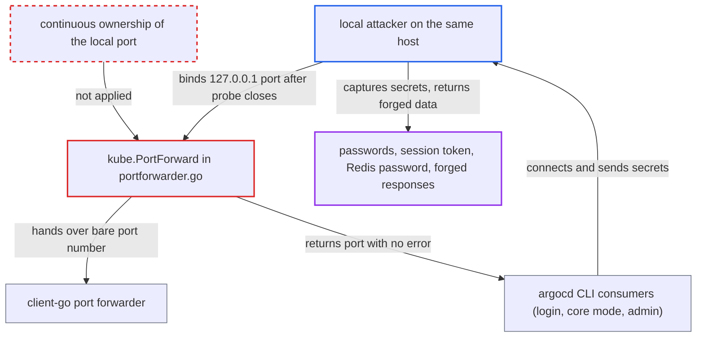

# Port-forward helper releases probed local port before rebinding, letting local users hijack CLI tunnels

| Field | Value |
|---|---|
| ID | `find_012uWCoWsv1hWzaJYWkcQpqi` |
| Severity | **Medium** |
| Status | open |
| CWE | CWE-367 — Time-of-check Time-of-use Race Condition |
| Created | 2026-10-27T21:12:45.058857Z |
| Claude Security | https://claude.ai/security/findings/find_012uWCoWsv1hWzaJYWkcQpqi |

## Description

A local user on the same machine can capture the Argo CD username, password, session token and Redis password that the `argocd` CLI sends through a port-forward. They can also return forged cache or manifest data. The attacker must be an unprivileged user on a shared host, such as a CI runner or bastion, and must win a timing race. IPv6 loopback must also be available. The cause is `kube.PortForward()`, which frees its probe port before the real forwarder binds it.

1. **`kube.PortForward()`** picks a local port by listening on `localhost:0`. Go binds `127.0.0.1`, and the function reads the port the kernel assigned. ([`util/kube/portforwarder.go:99-105`](https://github.com/cx-benchmark/argo-cd/blob/b7bc418289a96130340ea79964c4491b416c14f2/util/kube/portforwarder.go#L99-L105))
2. **`kube.PortForward()`** closes the probe listener and passes only the port number to `portforward.NewOnAddresses`. From this close until client-go binds the port again, no process owns it. ([`util/kube/portforwarder.go:99-105`](https://github.com/cx-benchmark/argo-cd/blob/b7bc418289a96130340ea79964c4491b416c14f2/util/kube/portforwarder.go#L99-L105))
3. **local attacker** binds `127.0.0.1:<port>` inside that window. The window is a full network round trip, because client-go (`v0.37.0`, assumed behaviour) dials the Kubernetes API server before it listens. ([`util/kube/portforwarder.go:110-124`](https://github.com/cx-benchmark/argo-cd/blob/b7bc418289a96130340ea79964c4491b416c14f2/util/kube/portforwarder.go#L110-L124))
4. **client-go forwarder** binds only `[::1]:<port>` and reports ready. `localhost` expands to `127.0.0.1` and `::1` with failure mode "all", so one successful bind counts as success. Nothing is written to `errOut`, and `PortForward()` returns `port` without an error. ([`util/kube/portforwarder.go:110-124`](https://github.com/cx-benchmark/argo-cd/blob/b7bc418289a96130340ea79964c4491b416c14f2/util/kube/portforwarder.go#L110-L124))
5. **the CLI** connects to `127.0.0.1:<port>` with certificate checks off. `pkg/apiclient/apiclient.go` sets the server to `127.0.0.1:<port>` and forces `Insecure`, so the attacker's listener is accepted with any certificate. ([`pkg/apiclient/apiclient.go:264-275`](https://github.com/cx-benchmark/argo-cd/blob/b7bc418289a96130340ea79964c4491b416c14f2/pkg/apiclient/apiclient.go#L264-L275))
6. **the CLI** sends the username and password, then the session token, to the attacker. `argocd login --port-forward` sends a `SessionCreateRequest`, and every later call carries the session token as `token` metadata. ([`cmd/argocd/commands/login.go:545-556`](https://github.com/cx-benchmark/argo-cd/blob/b7bc418289a96130340ea79964c4491b416c14f2/cmd/argocd/commands/login.go#L545-L556))
7. **core-mode and `argocd admin` commands** dial `localhost:<port>` for Redis and repo-server forwards. The attacker can take whichever loopback family the client tries first, receive the Redis password or repo-server requests, and return cache or manifest data of their choosing. ([`cmd/argocd/commands/headless/headless.go:63-71`](https://github.com/cx-benchmark/argo-cd/blob/b7bc418289a96130340ea79964c4491b416c14f2/cmd/argocd/commands/headless/headless.go#L63-L71))

## Assessment

The attacker is an unprivileged user on a shared host, such as a CI runner or bastion. An operator on that host must run `argocd --port-forward`, `argocd login --port-forward`, core mode or `argocd admin` commands. The attacker narrows or watches which port `bind(localhost:0)` returns, for example by occupying other loopback ports. They then bind `127.0.0.1:<port>` after the probe closes (`portforwarder.go:104`) and before client-go listens. IPv6 loopback must be available, and the attacker must win the race. Without IPv6 loopback both binds fail, and the race only makes the command fail. The report notes its threat model does not name a co-resident local user as an actor.

Impact: The attacker captures the Argo CD username and password at login, or the session or API token on every call. In core and admin modes they also get the Redis password and the repo-server requests. They can return forged API, cache or manifest responses. With the credentials they can act on the Argo CD API as the victim, within the victim's RBAC. Availability is not directly affected.

## Recommendation

`kube.PortForward()` in `util/kube/portforwarder.go` (lines 99-105) finds the local port with a throwaway listener and closes it before the port forwarder binds it. Another local process can take the loopback address the CLI later dials. client-go's partial-bind success hides the failure.

Fix criteria: The local port is held continuously from allocation to use. The address the consumer dials is one the forwarder is known to have bound. No instant exists between allocation and readiness at which `127.0.0.1:<port>` (or the address consumers dial) is unbound. A concurrent process that tries to bind it always gets EADDRINUSE. Alternatively, `PortForward` returns an error rather than a port the forwarder does not hold.

## Evidence

**https://github.com/cx-benchmark/argo-cd**

- [`util/kube/portforwarder.go:99-105`](https://github.com/cx-benchmark/argo-cd/blob/b7bc418289a96130340ea79964c4491b416c14f2/util/kube/portforwarder.go#L99-L105)
- [`util/kube/portforwarder.go:110-124`](https://github.com/cx-benchmark/argo-cd/blob/b7bc418289a96130340ea79964c4491b416c14f2/util/kube/portforwarder.go#L110-L124)
- [`pkg/apiclient/apiclient.go:264-275`](https://github.com/cx-benchmark/argo-cd/blob/b7bc418289a96130340ea79964c4491b416c14f2/pkg/apiclient/apiclient.go#L264-L275)
- [`cmd/argocd/commands/login.go:545-556`](https://github.com/cx-benchmark/argo-cd/blob/b7bc418289a96130340ea79964c4491b416c14f2/cmd/argocd/commands/login.go#L545-L556)
- [`pkg/apiclient/apiclient.go:616-620`](https://github.com/cx-benchmark/argo-cd/blob/b7bc418289a96130340ea79964c4491b416c14f2/pkg/apiclient/apiclient.go#L616-L620)
- [`cmd/argocd/commands/headless/headless.go:63-71`](https://github.com/cx-benchmark/argo-cd/blob/b7bc418289a96130340ea79964c4491b416c14f2/cmd/argocd/commands/headless/headless.go#L63-L71)
- [`cmd/argocd/commands/headless/headless.go:143-150`](https://github.com/cx-benchmark/argo-cd/blob/b7bc418289a96130340ea79964c4491b416c14f2/cmd/argocd/commands/headless/headless.go#L143-L150)
- [`cmd/argocd/commands/admin/cluster.go:116-126`](https://github.com/cx-benchmark/argo-cd/blob/b7bc418289a96130340ea79964c4491b416c14f2/cmd/argocd/commands/admin/cluster.go#L116-L126)

