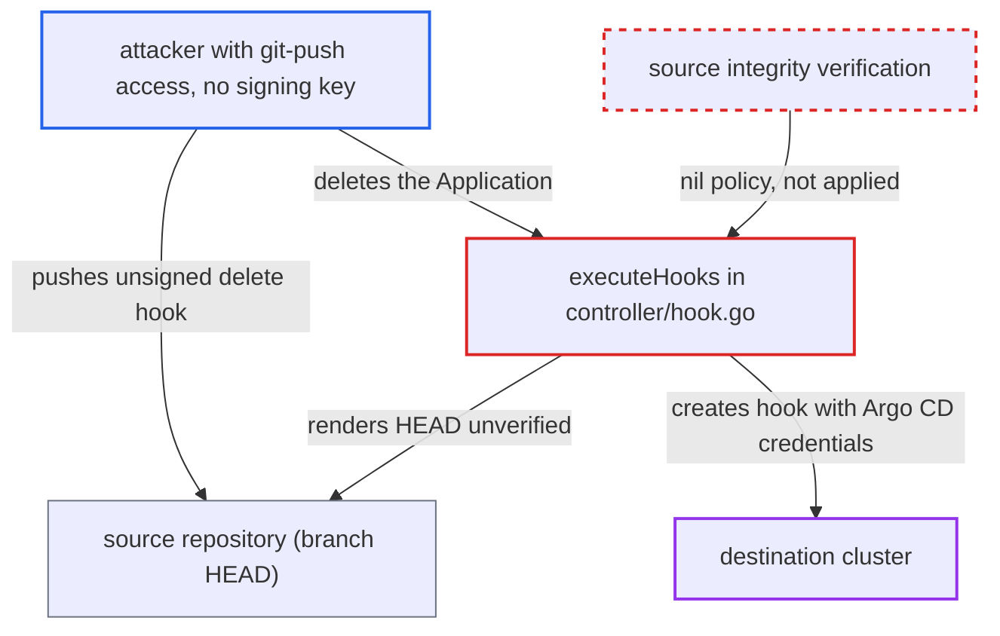

# PreDelete/PostDelete hooks rendered without source integrity (signature) verification

| Field | Value |
|---|---|
| ID | `find_019uFozNGBuM3Xsbsv2wkrQq` |
| Severity | **Medium** |
| Status | open |
| CWE | CWE-347 — Improper Signature Verification |
| Created | 2026-10-27T21:24:42.000558Z |
| Claude Security | https://claude.ai/security/findings/find_019uFozNGBuM3Xsbsv2wkrQq |

## Description

Someone who can push unsigned commits to an application's source repository can get their own manifest created in the destination cluster, even though the project requires signed commits. The hook runs with Argo CD's credentials when the Application is deleted. This only applies where source integrity is configured. The cause is `executeHooks`, which passes a `nil` source-integrity policy, and the finalizers are armed even when verification failed.

1. **attacker with git-push access** pushes an unsigned commit that adds a manifest annotated `argocd.argoproj.io/hook: PreDelete`. The attacker has no trusted signing key. `PostDelete` or the Helm equivalents work the same way.
2. **the refresh path in `processAppRefreshQueueItem`** adds the PreDelete/PostDelete finalizers to the Application. The repo-server still returns manifests when verification fails and only attaches a failing result. `hasPreDeleteHooks` and `hasPostDeleteHooks` are computed from the rendered objects, so the sync is blocked but the finalizer is set. ([`controller/appcontroller.go:2338-2366`](https://github.com/cx-benchmark/argo-cd/blob/b7bc418289a96130340ea79964c4491b416c14f2/controller/appcontroller.go#L2338-L2366))
3. **attacker or another user** deletes the Application. Deleting is a routine tenant action through the API (`applications, delete`) or Kubernetes. The attacker can also wait for someone else to do it.
4. **the handler `executeHooks`** requests the hook manifests with `sourceIntegrity` set to `nil`. The revisions are the raw `targetRevision` values, so the render uses whatever is at branch HEAD at deletion time, not the last verified revision. ([`controller/hook.go:117-125`](https://github.com/cx-benchmark/argo-cd/blob/b7bc418289a96130340ea79964c4491b416c14f2/controller/hook.go#L117-L125))
5. **`GetRepoObjs`** sends `SourceIntegrity: nil` and `VerifySignature: false` to the repo-server. The repo-server skips verification because `sourceintegrity.VerifyGit` returns immediately for a nil policy. The sync path instead passes `project.EffectiveSourceIntegrity()` and refuses to proceed on failure. ([`controller/state.go:395-420`](https://github.com/cx-benchmark/argo-cd/blob/b7bc418289a96130340ea79964c4491b416c14f2/controller/state.go#L395-L420))
6. **the controller** creates the unsigned hook objects in the destination cluster with `ctrl.kubectl.CreateResource`. It uses the controller's (or impersonated) credentials. Only the project's kind and namespace allowlists limit what is created. ([`controller/hook.go:166-196`](https://github.com/cx-benchmark/argo-cd/blob/b7bc418289a96130340ea79964c4491b416c14f2/controller/hook.go#L166-L196))

## Assessment

The attacker has git-push access to one application's source repository but no trusted signing key. The project must have source integrity configured (`AppProject.spec.sourceIntegrity` or legacy `signatureKeys`), because that is the control being bypassed. The attacker pushes an unsigned commit with a PreDelete or PostDelete hook, such as a Job, and waits for the next refresh to add the finalizer. They then delete the Application themselves, or wait for someone else to.

Impact: Unsigned, attacker-written manifests are created in the destination cluster with Argo CD's deploy credentials, which defeats the signature policy. Any kind the project permits can be created, such as Jobs, Pods or RoleBindings. The project's kind and namespace allowlists still apply, and the hook runs only when the Application is deleted.

## Recommendation

(1) `executeHooks` requests manifests with a `nil` source-integrity policy, so delete hooks skip the commit-signature verification that syncs enforce.

Fix criteria: Delete-hook rendering applies the same `project.EffectiveSourceIntegrity()` policy as the sync path. No hook is created when verification fails or cannot be performed. Preferably it renders from the last verified and synced revision instead of branch HEAD. Test: with a signature policy configured, an unsigned commit that adds a PreDelete hook does not get that hook created when the Application is deleted.

(2) The PreDelete/PostDelete finalizers are armed from rendered manifests even when their signature verification failed.

Fix criteria: Finalizers for delete hooks are set only when the comparison that found the hooks passed source integrity verification. An unsigned commit can then no longer change the application's deletion behaviour.

## Evidence

**https://github.com/cx-benchmark/argo-cd**

- [`controller/hook.go:117-125`](https://github.com/cx-benchmark/argo-cd/blob/b7bc418289a96130340ea79964c4491b416c14f2/controller/hook.go#L117-L125)
- [`controller/state.go:395-420`](https://github.com/cx-benchmark/argo-cd/blob/b7bc418289a96130340ea79964c4491b416c14f2/controller/state.go#L395-L420)
- [`controller/state.go:747-748`](https://github.com/cx-benchmark/argo-cd/blob/b7bc418289a96130340ea79964c4491b416c14f2/controller/state.go#L747-L748)
- [`controller/appcontroller.go:2338-2366`](https://github.com/cx-benchmark/argo-cd/blob/b7bc418289a96130340ea79964c4491b416c14f2/controller/appcontroller.go#L2338-L2366)
- [`controller/hook.go:166-196`](https://github.com/cx-benchmark/argo-cd/blob/b7bc418289a96130340ea79964c4491b416c14f2/controller/hook.go#L166-L196)

