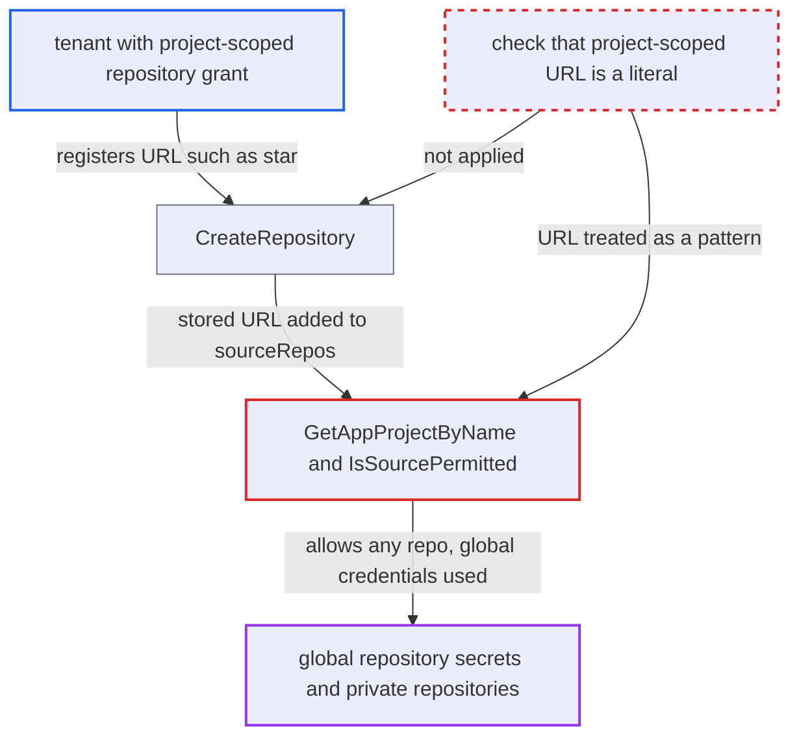

# Project-scoped repository URL used as sourceRepos glob, bypassing project source allowlist

| Field | Value |
|---|---|
| ID | `find_01NXAkLGKdD36AJ3okQzEShv` |
| Severity | **Medium** |
| Status | open |
| CWE | CWE-155 — Wildcard injection |
| Created | 2026-10-27T21:22:11.410396Z |
| Claude Security | https://claude.ai/security/findings/find_01NXAkLGKdD36AJ3okQzEShv |

## Description

A tenant with a project-scoped repository grant can widen their project's allowed source repositories. They can then deploy and read other teams' private repositories that are registered globally, using the global credentials. They can also block every Application in the project. `GetAppProjectByName` appends each project-scoped repository URL to `sourceRepos`, and `IsSourcePermitted` treats it as a glob or deny pattern.

1. **tenant** registers a project-scoped repository whose URL is a pattern such as `*`. The tenant needs the grant `repositories, create, my-project/*`, and the Casbin glob matches the literal object `my-project/*`. `CreateRepository` skips the connectivity test for project-scoped repositories and stores any string. ([`server/repository/repository.go:436-470`](https://github.com/cx-benchmark/argo-cd/blob/b7bc418289a96130340ea79964c4491b416c14f2/server/repository/repository.go#L436-L470))
2. **`GetAppProjectByName`** appends the stored `repo.Repo` string to `project.Spec.SourceRepos`. The string is added unescaped, and the controller and the API server both use the resulting project for source permission checks. ([`util/argo/argo.go:855-869`](https://github.com/cx-benchmark/argo-cd/blob/b7bc418289a96130340ea79964c4491b416c14f2/util/argo/argo.go#L855-L869))
3. **`IsSourcePermitted`** evaluates the tenant's URL as a glob or deny pattern. `*` matches everything, `**` and `?` are wildcards, and a leading `!` denies every source it does not match. ([`pkg/apis/application/v1alpha1/app_project_types.go:446-480`](https://github.com/cx-benchmark/argo-cd/blob/b7bc418289a96130340ea79964c4491b416c14f2/pkg/apis/application/v1alpha1/app_project_types.go#L446-L480))
4. **tenant** creates an Application in `my-project` whose `repoURL` is another team's private repository. Source validation now passes because of the injected pattern. A global repository secret must exist for the target.
5. **`getRepositorySecret`** finds no project-scoped secret match and falls back to the global repository secret. It compares URLs literally with `git.SameURL`, so a glob-shaped entry never matches a concrete URL, and `GetRepository` returns the global credentials. ([`util/db/repository_secrets.go:568-603`](https://github.com/cx-benchmark/argo-cd/blob/b7bc418289a96130340ea79964c4491b416c14f2/util/db/repository_secrets.go#L568-L603))
6. **controller and repo-server** clone and render the private repository with the global credentials. The controller calls `m.db.GetRepository(ctx, source.RepoURL, proj.Name)` and hands the result to the repo-server for the tenant's app. ([`controller/state.go:385-392`](https://github.com/cx-benchmark/argo-cd/blob/b7bc418289a96130340ea79964c4491b416c14f2/controller/state.go#L385-L392))

## Assessment

The attacker is a tenant with the documented self-service grant `repositories, create, my-project/*` and permission to create or update Applications in `my-project`. A global repository secret must exist for the target repository. The same mechanism also lets the tenant register `!*` to deny every source, so all Applications in the shared project fail source validation.

Impact: The tenant escapes the project's `sourceRepos` boundary. They can use globally registered credentials to read other teams' private repositories (rendered manifests, diffs, Helm values through ref sources) and deploy them. Integrity gain is limited, because the tenant could already deploy their own content to the project's destinations. The `!*` entry can make every Application in the project fail source validation.

## Recommendation

(1) `GetAppProjectByName` puts tenant-supplied project-scoped repository URLs into `sourceRepos`, where `IsSourcePermitted` evaluates them as glob and deny patterns. They are meant to allow exactly one repository.

Fix criteria: A project-scoped repository allows only the exact repository it names, compared by canonical URL equality. It never acts as a wildcard or deny rule. Project-scoped repos with URLs `*`, `https://host/**`, `https://host/org/repo?` or `!*` neither allow any other repository nor deny other applications' sources.

(2) `CreateRepository` and `UpdateRepository` accept arbitrary strings as project-scoped repository URLs, so glob metacharacters and a leading `!` are stored.

Fix criteria: Project-scoped repository URLs are checked as well-formed literal repository URLs, and glob metacharacters and a leading `!` are rejected. Creating a project-scoped repository with URL `*` or `!*` is refused.

## Evidence

**https://github.com/cx-benchmark/argo-cd**

- [`util/argo/argo.go:855-869`](https://github.com/cx-benchmark/argo-cd/blob/b7bc418289a96130340ea79964c4491b416c14f2/util/argo/argo.go#L855-L869)
- [`pkg/apis/application/v1alpha1/app_project_types.go:446-480`](https://github.com/cx-benchmark/argo-cd/blob/b7bc418289a96130340ea79964c4491b416c14f2/pkg/apis/application/v1alpha1/app_project_types.go#L446-L480)
- [`server/repository/repository.go:436-470`](https://github.com/cx-benchmark/argo-cd/blob/b7bc418289a96130340ea79964c4491b416c14f2/server/repository/repository.go#L436-L470)
- [`util/db/repository_secrets.go:568-603`](https://github.com/cx-benchmark/argo-cd/blob/b7bc418289a96130340ea79964c4491b416c14f2/util/db/repository_secrets.go#L568-L603)
- [`controller/state.go:385-392`](https://github.com/cx-benchmark/argo-cd/blob/b7bc418289a96130340ea79964c4491b416c14f2/controller/state.go#L385-L392)
- [`docs/user-guide/projects.md:376-403`](https://github.com/cx-benchmark/argo-cd/blob/b7bc418289a96130340ea79964c4491b416c14f2/docs/user-guide/projects.md#L376-L403)

