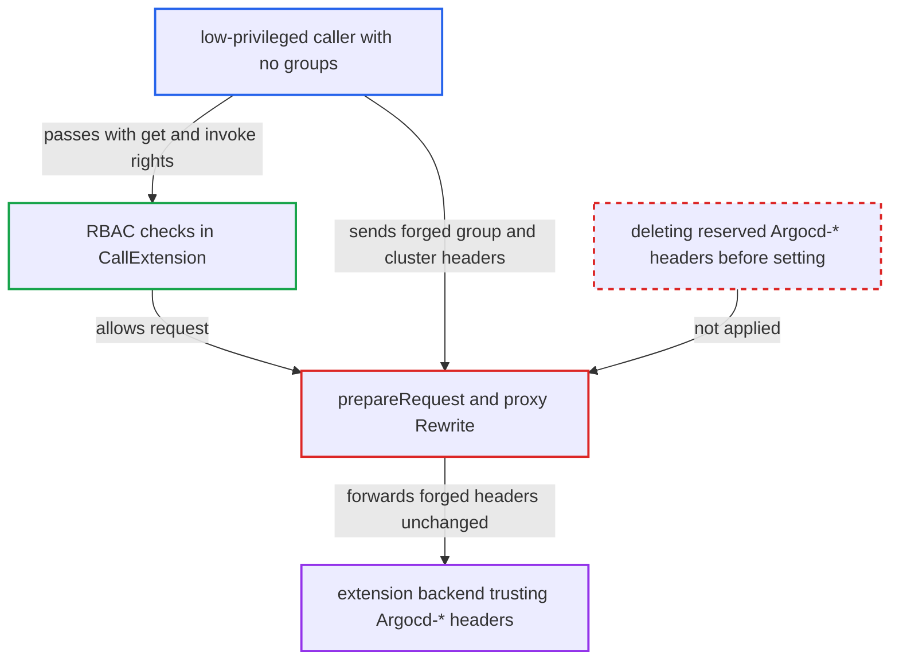

# Proxy extension forwards client-supplied Argocd-User-Groups and cluster identity headers when authoritative value is empty

| Field | Value |
|---|---|
| ID | `find_01UWAkUga4H2AJkxd3sEGS2X` |
| Severity | **Medium** |
| Status | open |
| CWE | CWE-290 — Authentication bypass by spoofing |
| Created | 2026-10-27T21:15:53.296017Z |
| Claude Security | https://claude.ai/security/findings/find_01UWAkUga4H2AJkxd3sEGS2X |

## Description

A low-privileged Argo CD user can make an extension backend believe they belong to any groups and target any cluster. This needs `applications, get` on one app and `extensions, invoke` on the extension, plus a token with no groups, and proxy extensions must be enabled. The cause is `prepareRequest` in `server/extension/extension.go`, which never removes client-sent `Argocd-*` identity headers.

1. **attacker** sends a request to the extension with forged headers. The request is `GET /extensions/<ext>/...` with the mandatory `Argocd-Application-Name` and `Argocd-Project-Name` headers. It also carries `Argocd-User-Groups: <privileged-group>` and/or `Argocd-Target-Cluster-Name: <other-cluster>`.
2. **`CallExtension`** authenticates the caller and checks RBAC. The attacker legitimately holds `applications, get` on one app and `extensions, invoke` on the extension, so the request is authorized.
3. **`prepareRequest`** sets the identity headers only when the server-side value is non-empty. It never deletes a client-supplied header of the same name. When the real value is empty, the forged one stays. ([`server/extension/extension.go:819-838`](https://github.com/cx-benchmark/argo-cd/blob/b7bc418289a96130340ea79964c4491b416c14f2/server/extension/extension.go#L819-L838))
4. **the proxy `Rewrite` in `NewProxy`** strips only `Authorization` and `Cookie`. Every other inbound header, including the forged `Argocd-*` ones, is copied to the outgoing request. ([`server/extension/extension.go:511-530`](https://github.com/cx-benchmark/argo-cd/blob/b7bc418289a96130340ea79964c4491b416c14f2/server/extension/extension.go#L511-L530))
5. **`GetGroups`** returns no groups for the caller. This holds for local accounts, project-role tokens (`sub: proj:<project>:<role>`) and SSO users whose IdP sends no groups claim, so the forged `Argocd-User-Groups` value is not overwritten. ([`server/extension/extension.go:327-330`](https://github.com/cx-benchmark/argo-cd/blob/b7bc418289a96130340ea79964c4491b416c14f2/server/extension/extension.go#L327-L330))
6. **extension backend** trusts the forged headers as identity asserted by Argo CD. The documented contract tells backends to treat `Argocd-User-Groups` and the cluster headers as authenticated context, so the backend grants what the forged groups are entitled to. ([`server/extension/extension.go:57-86`](https://github.com/cx-benchmark/argo-cd/blob/b7bc418289a96130340ea79964c4491b416c14f2/server/extension/extension.go#L57-L86))

## Assessment

The attacker is an authenticated Argo CD user or project-role token holder with `applications, get` on at least one application and `extensions, invoke` on a configured extension. Their token must carry no groups claim, as with a local account, a project token or a group-less SSO user. Proxy extensions must be enabled (`server.enable.proxy.extension`). For the cluster headers, `Argocd-Target-Cluster-Name` passes through when the Application destination uses `server:` instead of `name:`. In the opposite case `Argocd-Target-Cluster-URL` passes through.

Impact: On argocd-server the attacker gains nothing beyond what RBAC already allowed, since the request still goes only to the backend for their own extension and app. But the proxy vouches for group memberships and cluster identity that the user does not have, so the identity assertion Argo CD makes is wrong.

Subsequent-system impact: A backend that follows the documented contract treats the forged `Argocd-User-Groups` and cluster headers as authenticated. The attacker can then do whatever the backend grants to those groups, such as approving elevated access or acting against another cluster. Data exposure is limited to what the backend reveals to the forged groups.

## Recommendation

`prepareRequest` in `server/extension/extension.go` sets the proxy-owned `Argocd-*` identity and context headers only conditionally and never removes client-supplied values. The backend therefore cannot tell an Argo CD-asserted header from a forged one.

Fix criteria: Every header the proxy owns (`Argocd-Namespace`, `Argocd-Target-Cluster-Name`, `Argocd-Target-Cluster-URL`, `Argocd-User-Id`, `Argocd-Username`, `Argocd-User-Groups`) reaches the backend only with the value Argo CD derived, or is absent, whatever the client sent. The headers are deleted before being conditionally set. To verify, send `Argocd-User-Groups: admins` from a group-less local account, and send `Argocd-Target-Cluster-Name: other` for an app with a `server:` destination. Confirm the backend receives neither value.

## Evidence

**https://github.com/cx-benchmark/argo-cd**

- [`server/extension/extension.go:819-838`](https://github.com/cx-benchmark/argo-cd/blob/b7bc418289a96130340ea79964c4491b416c14f2/server/extension/extension.go#L819-L838)
- [`server/extension/extension.go:511-530`](https://github.com/cx-benchmark/argo-cd/blob/b7bc418289a96130340ea79964c4491b416c14f2/server/extension/extension.go#L511-L530)
- [`server/extension/extension.go:57-86`](https://github.com/cx-benchmark/argo-cd/blob/b7bc418289a96130340ea79964c4491b416c14f2/server/extension/extension.go#L57-L86)
- [`server/extension/extension.go:327-330`](https://github.com/cx-benchmark/argo-cd/blob/b7bc418289a96130340ea79964c4491b416c14f2/server/extension/extension.go#L327-L330)
- [`docs/developer-guide/extensions/proxy-extensions.md:294-325`](https://github.com/cx-benchmark/argo-cd/blob/b7bc418289a96130340ea79964c4491b416c14f2/docs/developer-guide/extensions/proxy-extensions.md#L294-L325)

