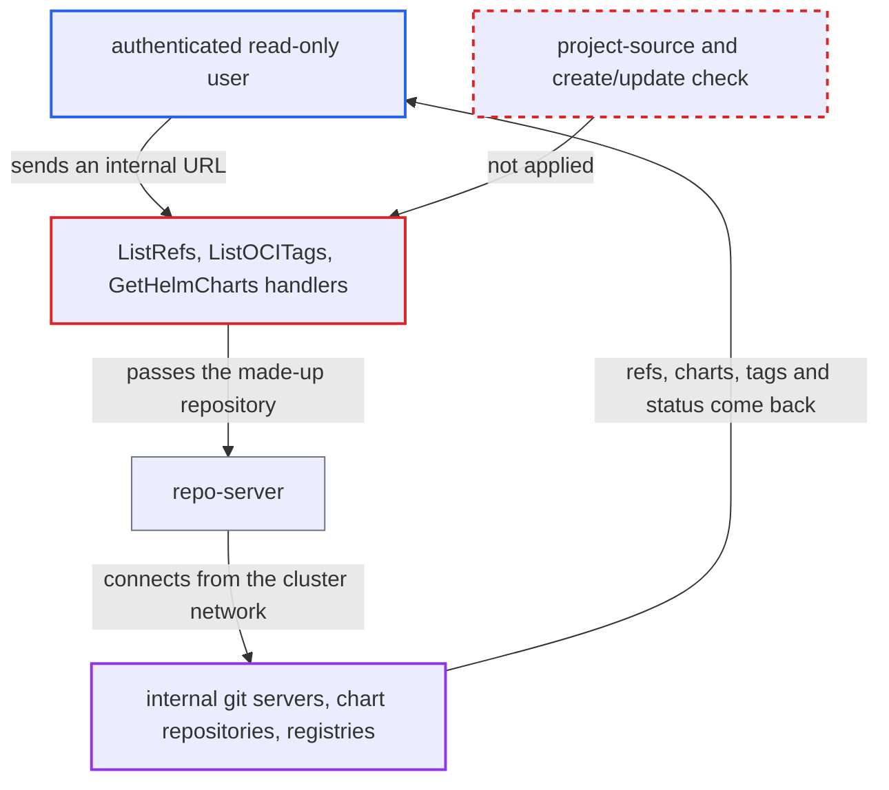

# Read-only repository permission lets users make repo-server connect to arbitrary unregistered URLs

| Field | Value |
|---|---|
| ID | `find_01MyJDmda16uYUJRpwdiBq5S` |
| Severity | **Medium** |
| Status | open |
| CWE | CWE-918 — Server-Side Request Forgery |
| Created | 2026-10-27T21:31:41.010226Z |
| Claude Security | https://claude.ai/security/findings/find_01MyJDmda16uYUJRpwdiBq5S |

## Description

A logged-in user with only read access to repositories, such as the built-in `role:readonly`, can make Argo CD's repo-server send requests to internal hosts and ports the user cannot reach directly. Some of the responses come back to the user: ref names, chart index entries, tags, HTTP status and errors. The cause is that `ListRefs`, `ListOCITags` and `GetHelmCharts` in `server/repository/repository.go` check only `repositories, get` on the bare caller-supplied URL.

1. **authenticated user** calls `/api/v1/repositories/{url}/refs`, `/helmcharts` or `/oci-tags` with an internal address. The user needs only `repositories, get` on `*`, which `role:readonly` has, and no application or repository create right. ([`assets/builtin-policy.csv:13`](https://github.com/cx-benchmark/argo-cd/blob/b7bc418289a96130340ea79964c4491b416c14f2/assets/builtin-policy.csv#L13))
2. **the handlers `ListRefs`, `ListOCITags` and `GetHelmCharts`** resolve the URL with `s.getRepo` and check only the read permission. They have no application create/update check and no project-source check, unlike `ListApps`. ([`server/repository/repository.go:262-279`](https://github.com/cx-benchmark/argo-cd/blob/b7bc418289a96130340ea79964c4491b416c14f2/server/repository/repository.go#L262-L279))
3. **`db.getRepository`** returns a made-up repository for the unregistered URL. The made-up `&v1alpha1.Repository{Repo: repoURL}` has an empty project, so the permission check is run against the bare URL and the wildcard grant satisfies it. ([`util/db/repository.go:151-164`](https://github.com/cx-benchmark/argo-cd/blob/b7bc418289a96130340ea79964c4491b416c14f2/util/db/repository.go#L151-L164))
4. **repo-server `ListRefs`** accepts the URL and runs a git ls-remote against it. It only checks that `git.NormalizeGitURL` returns a non-empty result, then connects from the cluster network and returns branch and tag names. ([`reposerver/repository/repository.go:239-266`](https://github.com/cx-benchmark/argo-cd/blob/b7bc418289a96130340ea79964c4491b416c14f2/reposerver/repository/repository.go#L239-L266))
5. **repo-server** fetches `<url>/index.yaml` for `GetHelmCharts`, or queries tags for `ListOCITags`. The Helm fetch uses an `http.Client` that follows redirects and reflects the HTTP status in the error `failed to get index: <status>`. ([`util/helm/client.go:387-430`](https://github.com/cx-benchmark/argo-cd/blob/b7bc418289a96130340ea79964c4491b416c14f2/util/helm/client.go#L387-L430))
6. **authenticated user** reads the returned refs, chart names and versions, tags, status codes and errors. This shows which internal hosts and ports respond and exposes whatever they serve anonymously. ([`reposerver/repository/repository.go:3240-3253`](https://github.com/cx-benchmark/argo-cd/blob/b7bc418289a96130340ea79964c4491b416c14f2/reposerver/repository/repository.go#L3240-L3253))

## Assessment

The attacker is any authenticated user granted `repositories, get` on `*`, for example through the built-in `role:readonly`. They need no application or repository create right and no victim has to act. They call the refs, Helm charts or OCI tags endpoints with a URL such as `http://10.0.0.5:8080/`, a cluster service or a cloud metadata address. The URL must not be a registered repository. The shipped NetworkPolicy for repo-server restricts only ingress, so egress is not limited. http and https use Argo CD's HTTP client, which does not follow redirects. Other schemes go through go-git's default transports, which the report assumes (go-git v5.19.2) cover ssh, git and file.

Impact: The user can use repo-server as a proxy into its network position. They learn whether internal hosts and ports are reachable, along with HTTP status and transport errors. They can also read git refs, Helm index entries and registry tags that those services serve anonymously. Local `file` paths are of limited use because repo-server cache directories are random UUIDs. Argo CD's own data is not modified.

Subsequent-system impact: Internal services that repo-server can reach but the attacker cannot receive GET, git and registry requests. The attacker learns that they exist and what status they return. The report demonstrates no writes.

## Recommendation

`ListRefs`, `ListOCITags` and `GetHelmCharts` authorize a made-up repository for an unregistered URL with only the read permission on the bare URL. A read-only user can therefore make repo-server connect to any host.

Fix criteria: Contacting a URL that is not a registered repository requires a right that already allows such contact. Examples are `repositories, create` on that URL, or application create/update in a project whose source repos permit the URL, as `ListApps` does. A `role:readonly` user who requests refs, Helm charts or OCI tags for an unregistered internal URL gets permission denied, and repo-server makes no connection. Registered repositories still work.

## Evidence

**https://github.com/cx-benchmark/argo-cd**

- [`server/repository/repository.go:262-279`](https://github.com/cx-benchmark/argo-cd/blob/b7bc418289a96130340ea79964c4491b416c14f2/server/repository/repository.go#L262-L279)
- [`server/repository/repository.go:412-426`](https://github.com/cx-benchmark/argo-cd/blob/b7bc418289a96130340ea79964c4491b416c14f2/server/repository/repository.go#L412-L426)
- [`server/repository/repository.go:241-259`](https://github.com/cx-benchmark/argo-cd/blob/b7bc418289a96130340ea79964c4491b416c14f2/server/repository/repository.go#L241-L259)
- [`util/db/repository.go:151-164`](https://github.com/cx-benchmark/argo-cd/blob/b7bc418289a96130340ea79964c4491b416c14f2/util/db/repository.go#L151-L164)
- [`assets/builtin-policy.csv:13`](https://github.com/cx-benchmark/argo-cd/blob/b7bc418289a96130340ea79964c4491b416c14f2/assets/builtin-policy.csv#L13)
- [`server/repository/repository.go:295-307`](https://github.com/cx-benchmark/argo-cd/blob/b7bc418289a96130340ea79964c4491b416c14f2/server/repository/repository.go#L295-L307)
- [`reposerver/repository/repository.go:239-266`](https://github.com/cx-benchmark/argo-cd/blob/b7bc418289a96130340ea79964c4491b416c14f2/reposerver/repository/repository.go#L239-L266)
- [`util/git/workaround.go:30-61`](https://github.com/cx-benchmark/argo-cd/blob/b7bc418289a96130340ea79964c4491b416c14f2/util/git/workaround.go#L30-L61)
- [`util/helm/client.go:387-430`](https://github.com/cx-benchmark/argo-cd/blob/b7bc418289a96130340ea79964c4491b416c14f2/util/helm/client.go#L387-L430)
- [`reposerver/repository/repository.go:3240-3253`](https://github.com/cx-benchmark/argo-cd/blob/b7bc418289a96130340ea79964c4491b416c14f2/reposerver/repository/repository.go#L3240-L3253)

