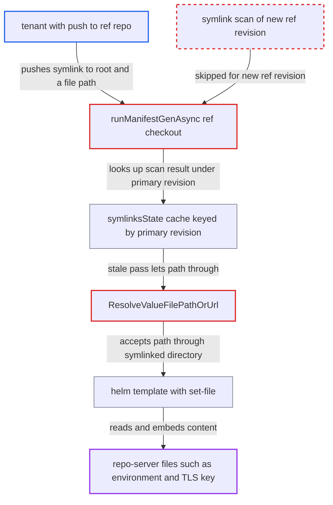

# Ref-source symlink scan cached under primary revision skips scanning new ref commits

| Field | Value |
|---|---|
| ID | `find_01Fvh57hrwBbeHKT6Sy7ijZL` |
| Severity | **Medium** |
| Status | open |
| CWE | CWE-61 — Symlink following |
| Created | 2026-10-27T21:21:13.776102Z |
| Claude Security | https://claude.ai/security/findings/find_01Fvh57hrwBbeHKT6Sy7ijZL |

## Description

A tenant who can push to a git repository used as a `ref` source in a multi-source Helm app can read files from the repo-server's filesystem, such as its environment and TLS key. The files come back in the rendered manifests. This needs push access to that repo and `applications, update` on the app, and it works only until a hard refresh or cache expiry. The scan that rejects escaping symlinks is cached under the primary source's revision, so new ref revisions are never scanned.

1. **attacker** gets a benign render cached for the current primary revision. Any normal render, or a benign push that forces one, makes the symlink scan pass and stores that result for the primary revision. ([`reposerver/repository/repository.go:966-971`](https://github.com/cx-benchmark/argo-cd/blob/b7bc418289a96130340ea79964c4491b416c14f2/reposerver/repository/repository.go#L966-L971))
2. **repo server** checks out each referenced repository at its own `referencedCommitSHA`. The checkout goes into the fixed per-URL directory returned by `gitClient.Root()`, so the correct revision to key the scan on was available. ([`reposerver/repository/repository.go:928-954`](https://github.com/cx-benchmark/argo-cd/blob/b7bc418289a96130340ea79964c4491b416c14f2/reposerver/repository/repository.go#L928-L954))
3. **attacker** pushes a symlink `x -> /` to the ref repo and sets `fileParameters` with path `$values/x/proc/self/environ`. The new ref SHA changes the manifest cache key, so the next normal refresh does a real re-render of the new content. ([`reposerver/repository/repository.go:391-397`](https://github.com/cx-benchmark/argo-cd/blob/b7bc418289a96130340ea79964c4491b416c14f2/reposerver/repository/repository.go#L391-L397))
4. **the function `runManifestGenAsync`** scans the ref checkout using the primary source's `commitSHA` as the version. The key is therefore the primary revision, not the revision of the referenced repository that was just checked out. ([`reposerver/repository/repository.go:966-971`](https://github.com/cx-benchmark/argo-cd/blob/b7bc418289a96130340ea79964c4491b416c14f2/reposerver/repository/repository.go#L966-L971))
5. **the function `checkOutOfBoundsSymlinks`** returns the cached `nil` without walking the new checkout. The entry under `rootPath/version/.git` already exists and `NoCache` is false, so the new symlink is never seen. ([`reposerver/repository/repository.go:646-661`](https://github.com/cx-benchmark/argo-cd/blob/b7bc418289a96130340ea79964c4491b416c14f2/reposerver/repository/repository.go#L646-L661))
6. **the function `getResolvedRefValueFile`** accepts the path through the symlinked directory. `ResolveValueFilePathOrUrl` only reads the link of the final path component, so the repository-root prefix check passes while the real target lies outside the checkout. ([`util/io/path/resolved.go:25-48`](https://github.com/cx-benchmark/argo-cd/blob/b7bc418289a96130340ea79964c4491b416c14f2/util/io/path/resolved.go#L25-L48))
7. **helm** reads the outside file through `--set-file` and embeds its content in the manifests. Helm follows the symlink and puts the file content verbatim into `.Values`, which comes back in the rendered output. ([`util/helm/cmd.go:450-455`](https://github.com/cx-benchmark/argo-cd/blob/b7bc418289a96130340ea79964c4491b416c14f2/util/helm/cmd.go#L450-L455))

## Assessment

The attacker is a tenant with push access to a git repo used as a `ref` source of a multi-source Helm app, and with `applications, update` on that app. Pushing to the primary repo for `.argocd-source.yaml` is another way to get the same control. A benign render under the current primary revision must already have seeded the scan cache, or the attacker forces one with a benign push. The cache entry must still be live in memory on the serving replica. No hard refresh (`NoCache`) may happen, and the entry lasts up to 12 hours. The window ends when the primary revision changes.

Impact: The attacker can read any file the repo-server process can read at a known path, and the content is returned in the rendered manifests. Examples are the process environment (`REDIS_PASSWORD`), the repo-server TLS private key, mounted GPG/TLS material and system files. Other tenants' checkouts stay out of reach unless their random path is known, because `/tmp/_argocd-repo` is mode `0300`. There is no write or crash primitive.

## Recommendation

(1) The cached out-of-bounds symlink scan for a referenced source is keyed by the primary source's revision. A new ref revision checked out into the same directory reuses the old verdict and is never walked.

Fix criteria: Each referenced repository's scan is keyed by the revision of that repository that was checked out, or runs uncached after each checkout. Any ref revision with an absolute or escaping symlink is rejected before helm reads from it. To verify, render a multi-source app once, push `x -> /` to the ref repo, and confirm that the next normal (not hard) refresh fails with the out-of-bounds symlink error.

(2) `ResolveValueFilePathOrUrl` resolves a symlink only in the final path component. Value-file and file-parameter paths through a symlinked directory pass the repository-root prefix check, so confinement depends entirely on the tree scan running.

Fix criteria: Value-file and file-parameter paths are checked against the repository root only after every symlink in the full path is resolved, as `verifyGlobMatchesWithinRoot` already does for glob matches. To verify, confirm that `$values/x/etc/hostname`, with `x` resolving outside the checkout, is rejected even when the tree scan is skipped.

## Evidence

**https://github.com/cx-benchmark/argo-cd**

- [`reposerver/repository/repository.go:966-971`](https://github.com/cx-benchmark/argo-cd/blob/b7bc418289a96130340ea79964c4491b416c14f2/reposerver/repository/repository.go#L966-L971)
- [`reposerver/repository/repository.go:646-661`](https://github.com/cx-benchmark/argo-cd/blob/b7bc418289a96130340ea79964c4491b416c14f2/reposerver/repository/repository.go#L646-L661)
- [`reposerver/repository/repository.go:177`](https://github.com/cx-benchmark/argo-cd/blob/b7bc418289a96130340ea79964c4491b416c14f2/reposerver/repository/repository.go#L177)
- [`reposerver/repository/repository.go:928-954`](https://github.com/cx-benchmark/argo-cd/blob/b7bc418289a96130340ea79964c4491b416c14f2/reposerver/repository/repository.go#L928-L954)
- [`reposerver/repository/repository.go:391-397`](https://github.com/cx-benchmark/argo-cd/blob/b7bc418289a96130340ea79964c4491b416c14f2/reposerver/repository/repository.go#L391-L397)
- [`util/app/path/path.go:88-91`](https://github.com/cx-benchmark/argo-cd/blob/b7bc418289a96130340ea79964c4491b416c14f2/util/app/path/path.go#L88-L91)
- [`reposerver/repository/repository.go:1609-1630`](https://github.com/cx-benchmark/argo-cd/blob/b7bc418289a96130340ea79964c4491b416c14f2/reposerver/repository/repository.go#L1609-L1630)
- [`util/io/path/resolved.go:25-48`](https://github.com/cx-benchmark/argo-cd/blob/b7bc418289a96130340ea79964c4491b416c14f2/util/io/path/resolved.go#L25-L48)
- [`reposerver/repository/repository.go:1387-1402`](https://github.com/cx-benchmark/argo-cd/blob/b7bc418289a96130340ea79964c4491b416c14f2/reposerver/repository/repository.go#L1387-L1402)
- [`util/helm/cmd.go:450-455`](https://github.com/cx-benchmark/argo-cd/blob/b7bc418289a96130340ea79964c4491b416c14f2/util/helm/cmd.go#L450-L455)
- [`manifests/base/repo-server/argocd-repo-server-deployment.yaml:26-31`](https://github.com/cx-benchmark/argo-cd/blob/b7bc418289a96130340ea79964c4491b416c14f2/manifests/base/repo-server/argocd-repo-server-deployment.yaml#L26-L31)

