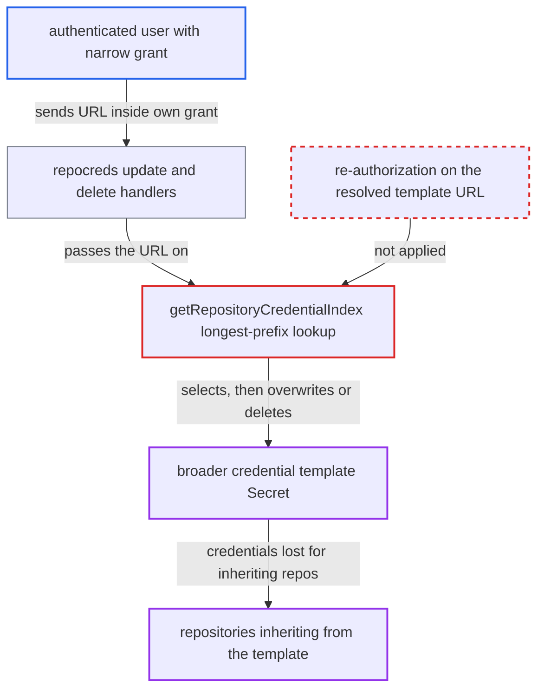

# Repo-creds Update/Delete act on longest-prefix template, bypassing per-URL RBAC

| Field | Value |
|---|---|
| ID | `find_01XAcwyawsgyw2xBEmT5iwgu` |
| Severity | **Medium** |
| Status | open |
| CWE | CWE-863 — Incorrect Authorization |
| Created | 2026-10-27T21:28:59.860391Z |
| Claude Security | https://claude.ai/security/findings/find_01XAcwyawsgyw2xBEmT5iwgu |

## Description

An authenticated Argo CD user can delete, or overwrite and narrow, a repository credential template outside their RBAC grant. Repositories of other teams that inherit from it then lose their credentials. It needs a grant on a narrower URL pattern, or `allow *` with a `deny` on the template URL, plus a broader template. The cause is that the repo-creds update and delete functions authorize the caller's exact URL but act on the longest-prefix template.

1. **attacker** sends a delete or update request for a URL that matches their RBAC grant. Example: `DELETE /api/v1/repocreds/<url-encoded https://github.com/org/team-a-x>`, or a `PUT` with arbitrary credentials, where the grant is `https://github.com/org/team-a-*`.
2. **the handlers in `server/repocreds/repocreds.go`** check RBAC against the exact URL the caller supplied. The checks use `q.Creds.URL` or `q.Url` with `repositories` or `write-repositories` and `update` or `delete`, so they pass; nothing checks the URL of the Secret that is later resolved. ([`server/repocreds/repocreds.go:158-200`](https://github.com/cx-benchmark/argo-cd/blob/b7bc418289a96130340ea79964c4491b416c14f2/server/repocreds/repocreds.go#L158-L200))
3. **the db functions in `util/db/repository.go`** check that the credentials exist using `RepoCredsExists`. That check is prefix-based, so a URL with no template of its own still passes when a broader template exists. ([`util/db/repository.go:364-416`](https://github.com/cx-benchmark/argo-cd/blob/b7bc418289a96130340ea79964c4491b416c14f2/util/db/repository.go#L364-L416))
4. **`getRepositoryCredentialIndex`** selects the broader template such as `https://github.com/org`. It returns the longest normalized (lowercased) prefix match, which is meant for credential inheritance and is not an exact lookup. ([`util/db/repository_secrets.go:605-634`](https://github.com/cx-benchmark/argo-cd/blob/b7bc418289a96130340ea79964c4491b416c14f2/util/db/repository_secrets.go#L605-L634))
5. **`UpdateRepoCreds` or `DeleteRepoCreds`** modifies or deletes the Secret that was selected. Both choose their target with `getRepoCredsSecret(url)`, so they act on the broader template instead of one matching the authorized URL. ([`util/db/repository_secrets.go:231-266`](https://github.com/cx-benchmark/argo-cd/blob/b7bc418289a96130340ea79964c4491b416c14f2/util/db/repository_secrets.go#L231-L266))
6. **`repoCredsToSecret`** on update, rewrites the template's `url` and all credential fields. The `url` becomes the caller's URL and omitted fields that were present are set to empty by `updateSecretString`, which destroys the stored credentials. ([`util/db/repository_secrets.go:533-565`](https://github.com/cx-benchmark/argo-cd/blob/b7bc418289a96130340ea79964c4491b416c14f2/util/db/repository_secrets.go#L533-L565))
7. **`deleteSecret`** on delete, removes the template. An Argo CD-managed Secret is deleted outright. A declaratively managed one loses its `secret-type` label, so the template disappears from Argo CD either way. ([`util/db/secrets.go:99-112`](https://github.com/cx-benchmark/argo-cd/blob/b7bc418289a96130340ea79964c4491b416c14f2/util/db/secrets.go#L99-L112))

## Assessment

The attacker is an authenticated Argo CD user. Their `repositories` (or `write-repositories`) `update` or `delete` grant covers only a URL pattern narrower than an existing template. Alternatively, they have `allow *` with a `deny` on the template URL. In the deny case, any longer URL under that prefix works, and so does a case variant, because the lookup lowercases and RBAC glob matching does not. A broader template must already exist. No victim interaction is needed. `CreateRepositoryCredentials` is not affected, because `CreateRepoCreds` names the Secret by hashing the exact URL.

Impact: The attacker can delete, or overwrite and narrow, a credential template outside their grant, and its stored credentials are destroyed. Every repository that inherited from it, potentially every repo on a host for a bare-host template, can no longer authenticate. Those applications cannot refresh or sync until an admin restores the template, and the attack can be repeated. No secret is disclosed. The rewritten `url` must still match the attacker's own glob, so they cannot make other teams' repositories inherit credentials they choose.

## Recommendation

The mutating repo-creds operations `UpdateRepoCreds`, `DeleteRepoCreds` and the `RepoCredsExists` check before them find their target with the inheritance-oriented longest-prefix lookup. The Secret they act on can differ from the URL that RBAC authorized.

Fix criteria: Update and delete act only on a template whose stored URL equals the requested URL, or they re-authorize against the resolved template's stored URL before writing. To verify, take a setup with only a template for `https://host/org`. An update or delete of `https://host/org/sub` returns not-found or permission-denied and leaves the template unchanged. The same holds for a case variant of `https://host/org` when that URL is denied. Check both the read and the write credential variants.

## Evidence

**https://github.com/cx-benchmark/argo-cd**

- [`util/db/repository_secrets.go:231-266`](https://github.com/cx-benchmark/argo-cd/blob/b7bc418289a96130340ea79964c4491b416c14f2/util/db/repository_secrets.go#L231-L266)
- [`util/db/repository_secrets.go:605-634`](https://github.com/cx-benchmark/argo-cd/blob/b7bc418289a96130340ea79964c4491b416c14f2/util/db/repository_secrets.go#L605-L634)
- [`server/repocreds/repocreds.go:158-200`](https://github.com/cx-benchmark/argo-cd/blob/b7bc418289a96130340ea79964c4491b416c14f2/server/repocreds/repocreds.go#L158-L200)
- [`util/db/repository.go:364-416`](https://github.com/cx-benchmark/argo-cd/blob/b7bc418289a96130340ea79964c4491b416c14f2/util/db/repository.go#L364-L416)
- [`util/db/repository_secrets.go:533-565`](https://github.com/cx-benchmark/argo-cd/blob/b7bc418289a96130340ea79964c4491b416c14f2/util/db/repository_secrets.go#L533-L565)
- [`util/db/secrets.go:99-112`](https://github.com/cx-benchmark/argo-cd/blob/b7bc418289a96130340ea79964c4491b416c14f2/util/db/secrets.go#L99-L112)

