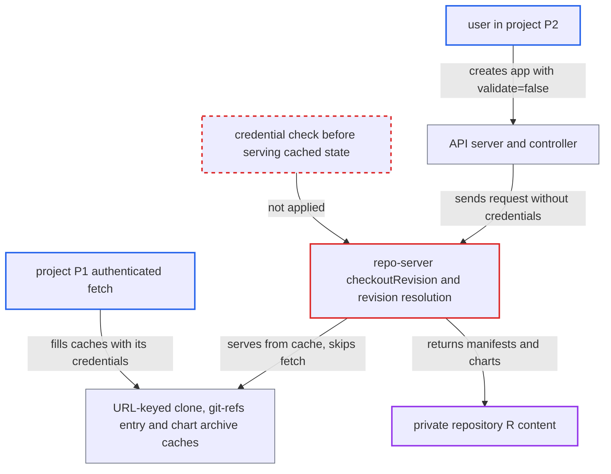

# Repo-server serves URL-keyed cached clones and charts to requests without the repository's credentials

| Field | Value |
|---|---|
| ID | `find_01GXFeKqjFJxxVyEtrnEmTwf` |
| Severity | **Medium** |
| Status | open |
| CWE | CWE-524 — Sensitive cache exposure |
| Created | 2026-10-27T21:26:17.198439Z |
| Claude Security | https://claude.ai/security/findings/find_01GXFeKqjFJxxVyEtrnEmTwf |

## Description

A user in one project can read private repository content that only another project has credentials for. This includes rendered manifests, app details, Helm values and private Helm charts. It needs permission to create applications in a project whose `sourceRepos` admits the repository URL, and the repository must already be fetched by an authorized project on the same repo-server. The cause is that the repo-server serves clones, refs and chart archives from caches keyed only by URL, such as the one `checkoutRevision` uses, without checking the caller's credentials.

1. **Project P1** fetches its private repository R with its project-scoped credential. The clone directory is derived from `git.NormalizeGitURL(repo.Repo)` alone, so the fetched commits land in one on-disk clone shared by every request for that URL. ([`reposerver/repository/repository.go:3024-3049`](https://github.com/cx-benchmark/argo-cd/blob/b7bc418289a96130340ea79964c4491b416c14f2/reposerver/repository/repository.go#L3024-L3049))
2. **Attacker in project P2** creates an application with `validate=false`, `repoURL` set to R, any `path`, and `targetRevision` set to a branch, `HEAD` or a SHA. `Create` skips `ValidateRepo`, the only check that tests access with the caller's own credentials, so only the `sourceRepos` glob is checked. ([`server/application/application.go:1387-1397`](https://github.com/cx-benchmark/argo-cd/blob/b7bc418289a96130340ea79964c4491b416c14f2/server/application/application.go#L1387-L1397))
3. **Controller and API server** forward a credential-less `Repository` to the repo-server. `getRepository` returns `Repository{Repo: repoURL}` with no secret because the only secret for R is scoped to P1. ([`util/db/repository.go:151-164`](https://github.com/cx-benchmark/argo-cd/blob/b7bc418289a96130340ea79964c4491b416c14f2/util/db/repository.go#L151-L164))
4. **Revision resolution in `lsRemote` and `getRefs`** resolves the revision without the remote's authentication. A 40-hex SHA is returned unchanged without contacting the remote. Branch, tag and `HEAD` names come from the `git-refs|<repoURL>` cache entry that P1's authenticated work refreshed, which has a 3-minute TTL. ([`util/git/client.go:1244-1247`](https://github.com/cx-benchmark/argo-cd/blob/b7bc418289a96130340ea79964c4491b416c14f2/util/git/client.go#L1244-L1247))
5. **the function `checkoutRevision`** finds the commit already in the shared clone and skips `git fetch`. `IsRevisionPresent` is a local check, and the fetch is the only step that uses the caller's credentials, so it is never attempted. ([`reposerver/repository/repository.go:3194-3238`](https://github.com/cx-benchmark/argo-cd/blob/b7bc418289a96130340ea79964c4491b416c14f2/reposerver/repository/repository.go#L3194-L3238))
6. **Attacker in project P2** reads the rendered manifests of R. The repo-server returns content from P1's clone, for example via `argocd app manifests`, even though P2 holds no credential for R.

## Assessment

The attacker needs a user with `applications, create` in a project P2 whose `sourceRepos` admits the private repository R's URL. The shipped `default` project has `sourceRepos: ["*"]`, so it admits any URL. R's only credential must be scoped to another project P1, and P1 must already have fetched R on the same repo-server. The attacker creates an app with `validate=false` and a `targetRevision` that is a branch, `HEAD` or a SHA. Helm charts are exposed the same way. `newHelmClientResolveRevision` returns an exact version with no network call, and `ExtractChart` skips `helm pull`/`helm fetch` when the archive cached under `{url, chart, version}` is present and unexpired. The repo-server RPCs `GenerateManifest`, `GetAppDetails`, `ListApps`, `GetRevisionMetadata`, `GetGitFiles`, `GetGitDirectories` and `UpdateRevisionForPaths` are all affected. OCI artifacts are not affected, because `resolveDigest` always calls the remote.

Impact: The attacker reads another project's private repository content without holding its credentials. This covers rendered manifests from any path, app details, Helm values and private Helm charts. The exposure is limited to repositories and charts already fetched and cached by an authorized project on the serving repo-server. Nothing in Argo CD is modified and service is not degraded.

## Recommendation

(1) The repo-server treats a commit's presence in the URL-keyed shared clone, and the URL-keyed refs and Helm chart caches, as proof that the current request may read it. A request with no credentials, or different ones, skips the credentialed fetch.

Fix criteria: Cached repository state (clone directory, refs cache, chart archive and index caches, and derived caches) is served only to a request whose credential identity or project scope matches the one that filled it. Otherwise the repo-server makes a credentialed remote check before serving a locally present revision. Verify with R's credentials scoped to P1 and P2 `sourceRepos: ['*']`. A P2 app or `appdetails` request for R at a branch or a SHA already in the clone must fail with an authentication error instead of returning content.

(2) For a URL whose only credential is scoped to another project, `db.getRepository` silently returns an anonymous repository. Creating an app with `validate=false` skips the only access test. Nothing upstream stops the request from reaching the cached state.

Fix criteria: Requests from a project with no usable credential for a URL that has project-scoped credentials elsewhere are not satisfied from cache. They are either refused, or always forced through a remote access check with the request's own credentials. Verify that the controller reports a repository-access error for such an app rather than rendering manifests.

## Evidence

**https://github.com/cx-benchmark/argo-cd**

- [`reposerver/repository/repository.go:3194-3238`](https://github.com/cx-benchmark/argo-cd/blob/b7bc418289a96130340ea79964c4491b416c14f2/reposerver/repository/repository.go#L3194-L3238)
- [`reposerver/repository/repository.go:3024-3049`](https://github.com/cx-benchmark/argo-cd/blob/b7bc418289a96130340ea79964c4491b416c14f2/reposerver/repository/repository.go#L3024-L3049)
- [`util/git/client.go:1244-1247`](https://github.com/cx-benchmark/argo-cd/blob/b7bc418289a96130340ea79964c4491b416c14f2/util/git/client.go#L1244-L1247)
- [`util/git/client.go:854-867`](https://github.com/cx-benchmark/argo-cd/blob/b7bc418289a96130340ea79964c4491b416c14f2/util/git/client.go#L854-L867)
- [`reposerver/cache/cache.go:225-236`](https://github.com/cx-benchmark/argo-cd/blob/b7bc418289a96130340ea79964c4491b416c14f2/reposerver/cache/cache.go#L225-L236)
- [`util/helm/client.go:211-249`](https://github.com/cx-benchmark/argo-cd/blob/b7bc418289a96130340ea79964c4491b416c14f2/util/helm/client.go#L211-L249)
- [`util/db/repository.go:151-164`](https://github.com/cx-benchmark/argo-cd/blob/b7bc418289a96130340ea79964c4491b416c14f2/util/db/repository.go#L151-L164)
- [`util/db/repository_secrets.go:568-603`](https://github.com/cx-benchmark/argo-cd/blob/b7bc418289a96130340ea79964c4491b416c14f2/util/db/repository_secrets.go#L568-L603)
- [`server/application/application.go:1387-1397`](https://github.com/cx-benchmark/argo-cd/blob/b7bc418289a96130340ea79964c4491b416c14f2/server/application/application.go#L1387-L1397)
- [`server/server.go:307`](https://github.com/cx-benchmark/argo-cd/blob/b7bc418289a96130340ea79964c4491b416c14f2/server/server.go#L307)
- [`docs/operator-manual/upgrading/2.11-2.12.md:3-10`](https://github.com/cx-benchmark/argo-cd/blob/b7bc418289a96130340ea79964c4491b416c14f2/docs/operator-manual/upgrading/2.11-2.12.md#L3-L10)

