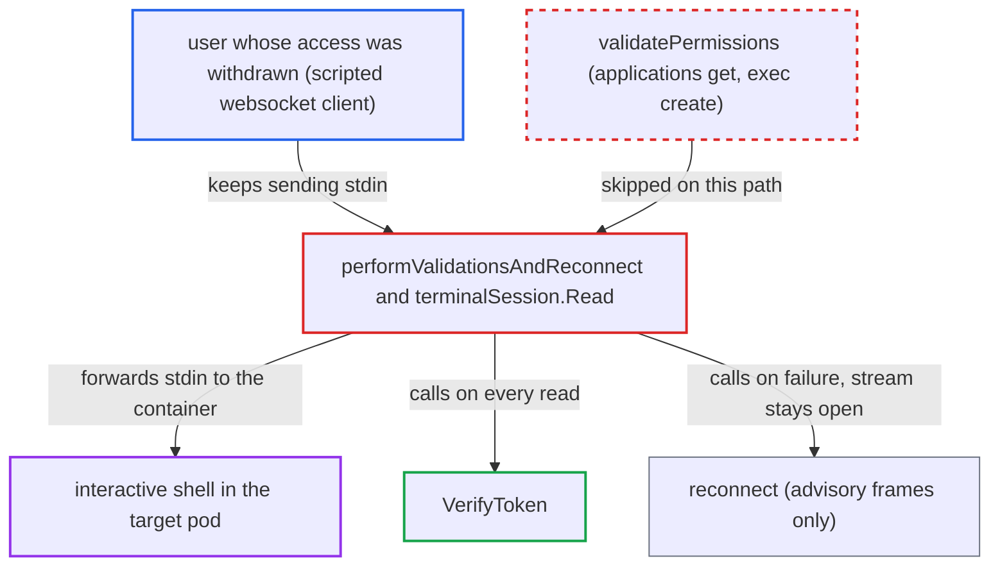

# Terminal session keeps forwarding stdin after token revocation or expiry, skipping RBAC re-check

| Field | Value |
|---|---|
| ID | `find_01QJa2KR8HC6ym7bYz2DPnvv` |
| Severity | **Medium** |
| Status | open |
| CWE | CWE-613 — Insufficient session expiration |
| Created | 2026-10-27T21:46:29.784242Z |
| Claude Security | https://claude.ai/security/findings/find_01QJa2KR8HC6ym7bYz2DPnvv |

## Description

A user whose access has been withdrawn can keep an interactive shell in a pod through a terminal they already opened. This covers expired or revoked sessions, disabled accounts, and removed `exec, create` rights. It needs a scripted websocket client that ignores the server's reconnect frames. The cause is `performValidationsAndReconnect`, which only advises a reconnect when `VerifyToken` fails and never ends the stream or runs `validatePermissions`.

1. **user** opens a pod terminal while allowed to. `ServeHTTP` checks `applications, get` and `exec, create` only once, at websocket upgrade, and then streams the process with the websocket session as stdin and output. ([`server/application/terminal.go:237-267`](https://github.com/cx-benchmark/argo-cd/blob/b7bc418289a96130340ea79964c4491b416c14f2/server/application/terminal.go#L237-L267))
2. **administrator or the session itself** ends the user's access. The token stops verifying because the session expired, the `jti` was revoked, the account was disabled, the password changed, or the project-role token was deleted. Removing `exec` from the user's role also ends their access. ([`util/session/sessionmanager.go:288-328`](https://github.com/cx-benchmark/argo-cd/blob/b7bc418289a96130340ea79964c4491b416c14f2/util/session/sessionmanager.go#L288-L328))
3. **attacker's scripted websocket client** keeps sending stdin frames and ignores the reconnect frames. The browser UI would reopen the socket with a fresh cookie, but a script can simply discard the two advisory frames.
4. **`performValidationsAndReconnect`** calls `t.reconnect()` and returns success when `VerifyToken` fails or returns a refreshed token. `reconnect` only writes a stdout message and a `TerminalCommand{Code: 1}` frame, then returns `(0, nil)`. It does not close the connection, cancel the exec context or return an error. ([`server/application/websocket.go:180-200`](https://github.com/cx-benchmark/argo-cd/blob/b7bc418289a96130340ea79964c4491b416c14f2/server/application/websocket.go#L180-L200))
5. **`terminalSession.Read`** forwards the stdin bytes to the container. `validatePermissions` is never reached, so the per-read `applications, get` and `exec, create` check is skipped. `Read` treats `(0, nil)` as success and goes on to `ReadMessage`. ([`server/application/websocket.go:202-234`](https://github.com/cx-benchmark/argo-cd/blob/b7bc418289a96130340ea79964c4491b416c14f2/server/application/websocket.go#L202-L234))

## Assessment

The attacker is a user who legitimately opened a terminal. `exec.enabled` must be set by the admin, and the user needed `exec, create` on the app. Their access is then withdrawn, for example a departing or compromised employee. The withdrawal can be session expiry, logout or revocation, a disabled account, a changed password, a deleted project token, or `exec` removed from their role. The attacker uses a scripted websocket client that ignores `TerminalCommand{Code:1}` frames. No further action by anyone is needed. The same early return also happens while a login token is in its auto-refresh window. From then on, such a client is never RBAC-checked again, even if `exec, create` is withdrawn.

Impact: The attacker keeps an authenticated exec channel on argocd-server after revocation. Revocation and the per-read RBAC check are defeated for that connection. This is limited to terminals already open at revocation time. No new sessions can be opened, and the dead token reaches no other API. The session lasts until the remote process ends. As a side effect, `reconnect` leaves `writeLock` held on its error paths, which only wedges the session.

Subsequent-system impact: The shell runs inside a container on the destination cluster with the controller's cluster credentials (`RawRestConfig`, no impersonation). The attacker can read and write that container's filesystem, environment (including secrets) and mounted volumes. They can also read its service-account token for as long as the process lives. This is bounded to pods the user was authorized for when the terminal was opened.

## Recommendation

`performValidationsAndReconnect` treats a failed `VerifyToken` and a refreshed token the same way. Both only call `reconnect` and return success without running `validatePermissions`. An invalid token or withdrawn `exec` right therefore does not end the stream, and the server leaves the reconnect to the client.

Fix criteria: A read on a terminal whose token fails `VerifyToken` ends the exec stream. It returns `EndOfTransmission` and an error, or closes the websocket, instead of only advising the client. A refreshed but valid token still goes through the `applications, get` and `exec, create` checks before any stdin is forwarded. The server enforces the reconnect by closing after the advisory and does not trust the client to do it. Test with a websocket client that ignores `Code:1` frames. After its token is revoked or expired, or `exec, create` is removed, further stdin must not reach the container.

## Evidence

**https://github.com/cx-benchmark/argo-cd**

- [`server/application/websocket.go:180-200`](https://github.com/cx-benchmark/argo-cd/blob/b7bc418289a96130340ea79964c4491b416c14f2/server/application/websocket.go#L180-L200)
- [`server/application/websocket.go:202-234`](https://github.com/cx-benchmark/argo-cd/blob/b7bc418289a96130340ea79964c4491b416c14f2/server/application/websocket.go#L202-L234)
- [`server/application/websocket.go:134-155`](https://github.com/cx-benchmark/argo-cd/blob/b7bc418289a96130340ea79964c4491b416c14f2/server/application/websocket.go#L134-L155)
- [`server/application/terminal.go:237-267`](https://github.com/cx-benchmark/argo-cd/blob/b7bc418289a96130340ea79964c4491b416c14f2/server/application/terminal.go#L237-L267)
- [`util/session/sessionmanager.go:288-328`](https://github.com/cx-benchmark/argo-cd/blob/b7bc418289a96130340ea79964c4491b416c14f2/util/session/sessionmanager.go#L288-L328)

