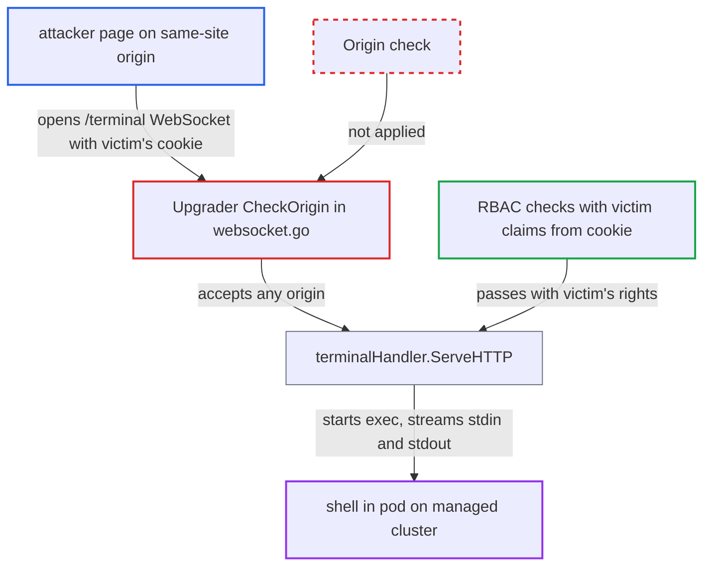

# Web terminal WebSocket skips Origin check, letting same-site pages hijack users' pod exec

| Field | Value |
|---|---|
| ID | `find_01NAbt6yj9aRiqB4va7sNPpb` |
| Severity | **Medium** |
| Status | open |
| CWE | CWE-1385 — Cross-Site WebSocket Hijacking |
| Created | 2026-10-27T21:20:12.588386Z |
| Claude Security | https://claude.ai/security/findings/find_01NAbt6yj9aRiqB4va7sNPpb |

## Description

A page on another origin of the same site, such as a sibling subdomain or another port on the same host, can open an interactive shell in pods through a logged-in Argo CD user's session. The shell runs with that user's exec rights. It needs `exec.enabled: "true"` (off by default), a victim with `exec/create`, and a known pod name. The `/terminal` upgrader's `CheckOrigin` always returns `true`, so the cookie-only login is accepted from any origin.

1. **attacker** serves a script from an origin on the same site as Argo CD. This can be a sibling subdomain or another port on the same host, for example through user content or XSS there; no Argo CD account is needed.
2. **logged-in Argo CD user** visits the attacker's page. The user needs `exec/create` rights, and the page's script opens a WebSocket to `/terminal` with `pod`, `container`, `appName`, `projectName` and `namespace`.
3. **browser** sends the `argocd.token` cookie with the handshake. The cookie is `SameSite=lax`, which blocks cross-site requests but not same-site, cross-origin ones, and the cookie is the only credential on this path. ([`util/http/http.go:283-299`](https://github.com/cx-benchmark/argo-cd/blob/b7bc418289a96130340ea79964c4491b416c14f2/util/http/http.go#L283-L299))
4. **the upgrader in `websocket.go`** accepts the handshake from any origin. `CheckOrigin` returns `true` unconditionally, and the code reads the token from the cookie with no other Origin or CSRF check. ([`server/application/websocket.go:28-35`](https://github.com/cx-benchmark/argo-cd/blob/b7bc418289a96130340ea79964c4491b416c14f2/server/application/websocket.go#L28-L35))
5. **the middleware `util_session.WithAuthMiddleware`** builds the claims from the cookie alone. The claims are the victim's, and they are stored in the request context. ([`util/session/sessionmanager.go:546-582`](https://github.com/cx-benchmark/argo-cd/blob/b7bc418289a96130340ea79964c4491b416c14f2/util/session/sessionmanager.go#L546-L582))
6. **the handler `terminalHandler.ServeHTTP`** runs the `applications/get` and `exec/create` checks with the victim's claims. The checks pass because the victim is allowed to exec, and the handler never asks who started the request. ([`server/application/terminal.go:166-175`](https://github.com/cx-benchmark/argo-cd/blob/b7bc418289a96130340ea79964c4491b416c14f2/server/application/terminal.go#L166-L175))
7. **the handler `terminalHandler.ServeHTTP`** upgrades the socket and starts an interactive TTY exec in the container. The exec stream is streamed to whoever holds the WebSocket, which is the attacker's script. ([`server/application/terminal.go:237-258`](https://github.com/cx-benchmark/argo-cd/blob/b7bc418289a96130340ea79964c4491b416c14f2/server/application/terminal.go#L237-L258))
8. **attacker's script** reads `stdout` frames and sends `stdin` frames. The per-read token re-check uses the same cookie token, so it does not stop this.

## Assessment

The attacker needs no Argo CD account. They must serve a page from an origin that is same-site with the Argo CD UI, such as a sibling subdomain or another port on the host. A logged-in user with `exec/create` must visit that page. The operator must have set `exec.enabled: "true"` in `argocd-cm`, which is off by default. Otherwise the endpoint returns 404. The attacker must also name a pod that is in the app's resource tree. Pod names are predictable for StatefulSet and bare pods, or known to anyone with read access. Deployment pod names carry random suffixes.

Impact: The attacker gets an interactive shell in a container, with the victim's exec rights. For an admin victim, the built-in `role:admin` holds `exec, create, */*`, so that means any application's pods. Argo CD's own data is not exposed through the socket: the session token is httpOnly and never echoed, and settings and secrets are not exposed. Argo CD's availability is unaffected.

Subsequent-system impact: The shell runs inside workload containers on the managed clusters, with the victim's reach. The attacker can read mounted secrets, service-account tokens and environment variables. They can change files and running processes, and kill the container's processes.

## Recommendation

(1) The `Upgrader` in `server/application/websocket.go` sets `CheckOrigin` to always return `true`, while the endpoint trusts an ambient cookie. A cross-origin page can therefore ride the victim's session into pod exec.

Fix criteria: A WebSocket handshake whose `Origin` header does not match the Argo CD server's own origin is rejected before any exec starts. The own origin is the request `Host` or the configured external URL, honoring `baseHref`. Handshakes with no Origin from non-browser clients may still be allowed. A handshake with `Origin: https://evil.<same-site-domain>` and a valid cookie gets a 403, and no exec request reaches the cluster. The UI's own origin still connects.

(2) The `/terminal` endpoint accepts browser-ambient cookie credentials on a channel that has no CORS preflight or content-type gate, so the cookie alone opens a terminal.

Fix criteria: As defense in depth, the terminal handshake needs an explicit, non-ambient credential or CSRF token supplied by the UI, for example a short-lived token obtained through the JSON API. A handshake carrying only the cookie is refused.

## Evidence

**https://github.com/cx-benchmark/argo-cd**

- [`server/application/websocket.go:28-35`](https://github.com/cx-benchmark/argo-cd/blob/b7bc418289a96130340ea79964c4491b416c14f2/server/application/websocket.go#L28-L35)
- [`server/application/websocket.go:56-87`](https://github.com/cx-benchmark/argo-cd/blob/b7bc418289a96130340ea79964c4491b416c14f2/server/application/websocket.go#L56-L87)
- [`util/session/sessionmanager.go:546-582`](https://github.com/cx-benchmark/argo-cd/blob/b7bc418289a96130340ea79964c4491b416c14f2/util/session/sessionmanager.go#L546-L582)
- [`server/application/terminal.go:166-175`](https://github.com/cx-benchmark/argo-cd/blob/b7bc418289a96130340ea79964c4491b416c14f2/server/application/terminal.go#L166-L175)
- [`server/application/terminal.go:237-258`](https://github.com/cx-benchmark/argo-cd/blob/b7bc418289a96130340ea79964c4491b416c14f2/server/application/terminal.go#L237-L258)
- [`util/http/http.go:283-299`](https://github.com/cx-benchmark/argo-cd/blob/b7bc418289a96130340ea79964c4491b416c14f2/util/http/http.go#L283-L299)
- [`server/server.go:1283-1301`](https://github.com/cx-benchmark/argo-cd/blob/b7bc418289a96130340ea79964c4491b416c14f2/server/server.go#L1283-L1301)
- [`server/application/terminal.go:94-108`](https://github.com/cx-benchmark/argo-cd/blob/b7bc418289a96130340ea79964c4491b416c14f2/server/application/terminal.go#L94-L108)
- [`assets/builtin-policy.csv:51`](https://github.com/cx-benchmark/argo-cd/blob/b7bc418289a96130340ea79964c4491b416c14f2/assets/builtin-policy.csv#L51)

