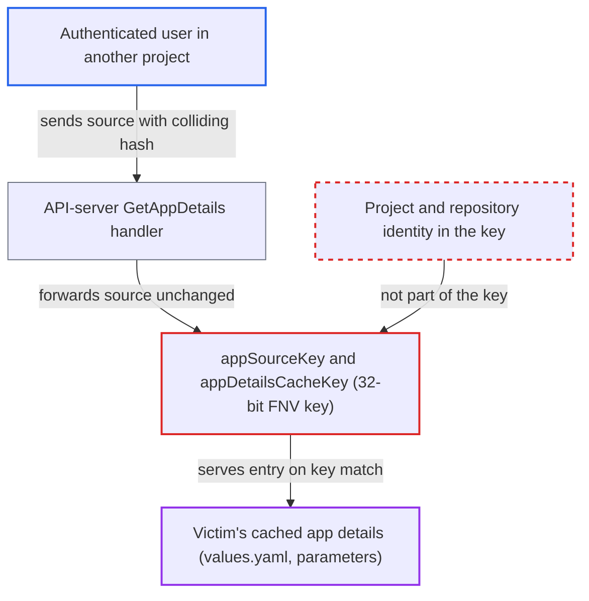

# 32-bit FNV app-details cache key lets a tenant read another project's Helm chart details

| Field | Value |
|---|---|
| ID | `find_017kovvhXkGrhfsBfXQZAhyY` |
| Severity | **Low** |
| Status | open |
| CWE | CWE-328 — Weak hash |
| Created | 2026-10-27T21:24:41.709071Z |
| Claude Security | https://claude.ai/security/findings/find_017kovvhXkGrhfsBfXQZAhyY |

## Description

An authenticated user in one project can read another project's Helm chart details: the full `values.yaml` text, resolved parameters and the value-file list. They can also plant content that the victim's parameter view then shows. The attacker needs `repositories, get` on a Helm repository permitted in their own project, and `applications, get/create` in that project. They also need to know the victim app's exact source. The cause is `appSourceKey`, which reduces the source to a 32-bit FNV-1a hash, and that hash is the only thing separating sources in the `appDetailsCacheKey` cache key.

1. **Attacker** learns the victim app's exact source spec. The report gives an app-of-apps or ApplicationSet repository as an example of where the spec can be found.
2. **Attacker** searches offline for a source of their own whose hash equals the victim's. FNV-1a can be inverted byte by byte, so varying a few free bytes, such as a dummy `helm.parameters[].value`, finds a matching source JSON in well under a second. ([`util/hash/hash.go:13-17`](https://github.com/cx-benchmark/argo-cd/blob/b7bc418289a96130340ea79964c4491b416c14f2/util/hash/hash.go#L13-L17))
3. **Attacker** posts an `appdetails` request for their own repository with the victim's chart version and a new app name. A semver `targetRevision` is used as the revision as-is without contacting the repository, so the chart does not need to exist in the attacker's repository. ([`reposerver/repository/repository.go:3074-3076`](https://github.com/cx-benchmark/argo-cd/blob/b7bc418289a96130340ea79964c4491b416c14f2/reposerver/repository/repository.go#L3074-L3076))
4. **API-server handler for `GetAppDetails`** authorizes the request and forwards the source unchanged. It checks only `repositories, get` on the caller's repo, `applications, get/create` for the new app name, and `isRepoPermittedInProject`. It sets no `TrackingMethod`, so the key ends in `label`, as it does for the victim's own UI requests. ([`server/repository/repository.go:333-409`](https://github.com/cx-benchmark/argo-cd/blob/b7bc418289a96130340ea79964c4491b416c14f2/server/repository/repository.go#L333-L409))
5. **`appDetailsCacheKey`** builds the same key the victim's entry sits under. The key is `appdetails|<revision>|<appSourceKey>|<trackingMethod>` and has no project, app, credential or full-source part. ([`reposerver/cache/cache.go:461-475`](https://github.com/cx-benchmark/argo-cd/blob/b7bc418289a96130340ea79964c4491b416c14f2/reposerver/cache/cache.go#L461-L475))
6. **`runRepoOperation`** checks the cache and returns on a hit. This happens before any chart is fetched or extracted from the attacker's repository. ([`reposerver/repository/repository.go:386-399`](https://github.com/cx-benchmark/argo-cd/blob/b7bc418289a96130340ea79964c4491b416c14f2/reposerver/repository/repository.go#L386-L399))
7. **`createGetAppDetailsCacheHandler`** returns the victim's cached `RepoAppDetailsResponse` to the attacker. It serves any entry under the key without checking which project or credentials produced it, and the entry holds the chart's `values.yaml` text and resolved parameters. ([`reposerver/repository/repository.go:2612-2626`](https://github.com/cx-benchmark/argo-cd/blob/b7bc418289a96130340ea79964c4491b416c14f2/reposerver/repository/repository.go#L2612-L2626))

## Assessment

The attacker is an authenticated tenant in project B. They need `repositories, get` on a Helm repository permitted in project B, and `applications, create/get` in project B. They must know the victim app's exact source spec. The victim's entry must already be cached, which the report says happens when the victim's UI requests it, and the entry is valid for about 24 hours. The attack can also run the other way. The attacker writes the colliding key while it is empty, and the victim's parameter view then shows content the attacker chose. For git sources `RepoURL` is dropped from the hash, so an exact match needs no collision at all. That omission is a separate issue. The manifest cache uses the same `appSourceKey`, but its sink and entry point are different.

Impact: The attacker reads another project's app details from a chart repository and value files they cannot reach. That means the full `values.yaml`, the resolved parameters (including `$ref` value files from other repositories) and the value-file list. This is limited to what that response holds and to entries that already exist. Pre-seeding an empty key lets the attacker change what the victim's parameter view shows. The report finds no availability impact.

## Recommendation

(1) `appSourceKey` reduces the source and ref-source JSON to a 32-bit non-cryptographic hash, so a different source chosen by an attacker can share the app-details (and manifest) cache key.

Fix criteria: No two distinct source or ref-source inputs can share a cache key under attacker-chosen input. The key uses a collision-resistant digest of the canonical JSON, or the JSON itself. A test with a constructed FNV-32 collision pair gets different `appdetails` keys, and the attacker's request is a cache miss.

(2) App-details cache entries are not tied to the project or repository credentials that produced them, so any caller who can present the key is served the content.

Fix criteria: A `GetAppDetails` request authorized in project B is never answered from an entry produced for project A's source or credentials. The key includes the project and repository identity, or the server checks that the requester is authorized for the source that produced the entry. A cross-project request that uses a colliding source confirms this.

## Evidence

**https://github.com/cx-benchmark/argo-cd**

- [`reposerver/cache/cache.go:118-120`](https://github.com/cx-benchmark/argo-cd/blob/b7bc418289a96130340ea79964c4491b416c14f2/reposerver/cache/cache.go#L118-L120)
- [`reposerver/cache/cache.go:461-475`](https://github.com/cx-benchmark/argo-cd/blob/b7bc418289a96130340ea79964c4491b416c14f2/reposerver/cache/cache.go#L461-L475)
- [`reposerver/cache/cache.go:133-146`](https://github.com/cx-benchmark/argo-cd/blob/b7bc418289a96130340ea79964c4491b416c14f2/reposerver/cache/cache.go#L133-L146)
- [`util/hash/hash.go:13-17`](https://github.com/cx-benchmark/argo-cd/blob/b7bc418289a96130340ea79964c4491b416c14f2/util/hash/hash.go#L13-L17)
- [`server/repository/repository.go:333-409`](https://github.com/cx-benchmark/argo-cd/blob/b7bc418289a96130340ea79964c4491b416c14f2/server/repository/repository.go#L333-L409)
- [`reposerver/repository/repository.go:3074-3076`](https://github.com/cx-benchmark/argo-cd/blob/b7bc418289a96130340ea79964c4491b416c14f2/reposerver/repository/repository.go#L3074-L3076)
- [`reposerver/repository/repository.go:386-399`](https://github.com/cx-benchmark/argo-cd/blob/b7bc418289a96130340ea79964c4491b416c14f2/reposerver/repository/repository.go#L386-L399)
- [`reposerver/repository/repository.go:2612-2626`](https://github.com/cx-benchmark/argo-cd/blob/b7bc418289a96130340ea79964c4491b416c14f2/reposerver/repository/repository.go#L2612-L2626)
- [`reposerver/repository/repository.go:2714-2748`](https://github.com/cx-benchmark/argo-cd/blob/b7bc418289a96130340ea79964c4491b416c14f2/reposerver/repository/repository.go#L2714-L2748)

