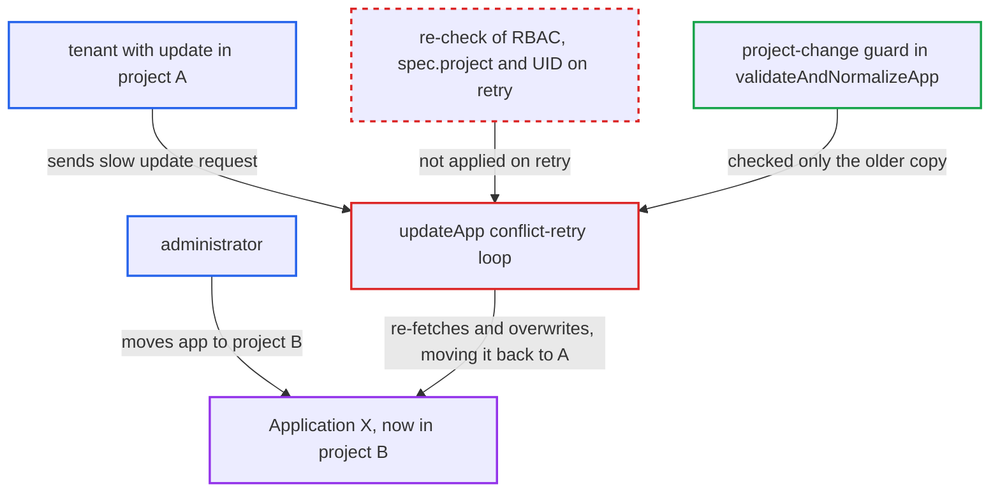

# Application update conflict-retry rewrites re-fetched app, bypassing project-change authorization

| Field | Value |
|---|---|
| ID | `find_018vQyjgivmfbQRikZyRgWCr` |
| Severity | **Low** |
| Status | open |
| CWE | CWE-367 — TOCTOU race condition |
| Created | 2026-10-27T21:26:00.412363Z |
| Claude Security | https://claude.ai/security/findings/find_018vQyjgivmfbQRikZyRgWCr |

## Description

A tenant with `update` rights on an application in project A can pull that application back into project A after an administrator moved it to project B, where the tenant has no `update` right. This needs a concurrent move that lands during a slow update request. The retry loop in `updateApp` re-fetches the app after a 409 conflict and overwrites it without re-checking authorization against the new state.

1. **attacker** sends `PUT /api/v1/applications/X` with `spec.project: A` and `validate` true. `getApplicationEnforceRBACClient` checks `update` on the app's project as it was at that moment, and `validateAndUpdateApp` then hands off to the `updateApp` retry loop. ([`server/application/application.go:976-996`](https://github.com/cx-benchmark/argo-cd/blob/b7bc418289a96130340ea79964c4491b416c14f2/server/application/application.go#L976-L996))
2. **`validateAndNormalizeApp`** reads the live app and applies the project-change guard only if its `spec.project` differs from the request. The guard needs `create` in the new project and `update` in the old one. Nothing is re-checked after this read. ([`server/application/application.go:1353-1379`](https://github.com/cx-benchmark/argo-cd/blob/b7bc418289a96130340ea79964c4491b416c14f2/server/application/application.go#L1353-L1379))
3. **`argo.ValidateRepo`** runs repo-server manifest generation and cluster discovery on a source the attacker chose. This runs before the first `Update`, so the attacker can keep the window open for seconds. ([`server/application/application.go:1387-1392`](https://github.com/cx-benchmark/argo-cd/blob/b7bc418289a96130340ea79964c4491b416c14f2/server/application/application.go#L1387-L1392))
4. **administrator** moves app X to project B, or X is deleted and recreated in B. This write lands after the guard's read but before the attacker's first `Update`. The report names it as the concurrent change the attack depends on.
5. **`updateApp`** gets a 409 conflict on the first `Update` and re-fetches the app by name. The re-fetched object now belongs to project B. The retry never compares its `spec.project` or UID with the copy that was authorized. ([`server/application/application.go:1030-1060`](https://github.com/cx-benchmark/argo-cd/blob/b7bc418289a96130340ea79964c4491b416c14f2/server/application/application.go#L1030-L1060))
6. **`updateApp`** copies the attacker's `Spec`, labels, annotations and finalizers onto the re-fetched app and writes it again. The write succeeds and puts the app back in project A, a transition that was never authorized. The retry loop discards the protection Kubernetes optimistic concurrency would have given. ([`server/application/application.go:1030-1060`](https://github.com/cx-benchmark/argo-cd/blob/b7bc418289a96130340ea79964c4491b416c14f2/server/application/application.go#L1030-L1060))

## Assessment

The attacker is a tenant with `applications, update` in project A on app X. They keep several overlapping `PUT /api/v1/applications/X` requests in flight with `spec.project: A` and `validate` true, each slowed by manifest generation. The attack works only if another principal, such as an administrator moving X to project B or X being deleted and recreated in B, writes inside the window. Any request that passed the guard read before that change gets the conflict and overwrites the app. Besides `Update`, the routes `UpdateSpec` and `Patch` reach the same code through `validateAndUpdateApp`. `Create` with `upsert` calls `updateApp` directly and gets the same unchecked retry. `TerminateOperation` has the same retry shape, but its window is tiny.

Impact: The attacker moves an app back into their own project without `update` in the project it was in at write time. This undoes the administrator's reassignment and keeps or recovers the `Application` object, with its name, history and tracked live resources, and drops any extra controls project B imposed. The written spec is still checked against project A, so no new sources or destinations from B are gained. The report finds no disclosure and no denial of service.

## Recommendation

`updateApp` reapplies a write authorized for one version of the Application onto a newer re-fetched version without re-deriving authorization. This breaks the rule that a project change requires `update` in the old project.

Fix criteria: On every retry, a write is authorized against the object it actually replaces. If the re-fetched app's `spec.project`, namespace or UID differs from the authorized snapshot, the update either re-runs the RBAC and project-change checks for that object or fails with a conflict. Test: move an app to a project where the caller lacks `update` while a slow caller update is in flight. The caller's write is refused and the app stays in the new project. The same rule is applied to the `TerminateOperation` retry loop.

## Evidence

**https://github.com/cx-benchmark/argo-cd**

- [`server/application/application.go:1030-1060`](https://github.com/cx-benchmark/argo-cd/blob/b7bc418289a96130340ea79964c4491b416c14f2/server/application/application.go#L1030-L1060)
- [`server/application/application.go:1353-1379`](https://github.com/cx-benchmark/argo-cd/blob/b7bc418289a96130340ea79964c4491b416c14f2/server/application/application.go#L1353-L1379)
- [`server/application/application.go:976-996`](https://github.com/cx-benchmark/argo-cd/blob/b7bc418289a96130340ea79964c4491b416c14f2/server/application/application.go#L976-L996)
- [`server/application/application.go:1387-1392`](https://github.com/cx-benchmark/argo-cd/blob/b7bc418289a96130340ea79964c4491b416c14f2/server/application/application.go#L1387-L1392)
- [`util/argo/argo.go:1011`](https://github.com/cx-benchmark/argo-cd/blob/b7bc418289a96130340ea79964c4491b416c14f2/util/argo/argo.go#L1011)
- [`server/application/application.go:413-424`](https://github.com/cx-benchmark/argo-cd/blob/b7bc418289a96130340ea79964c4491b416c14f2/server/application/application.go#L413-L424)

