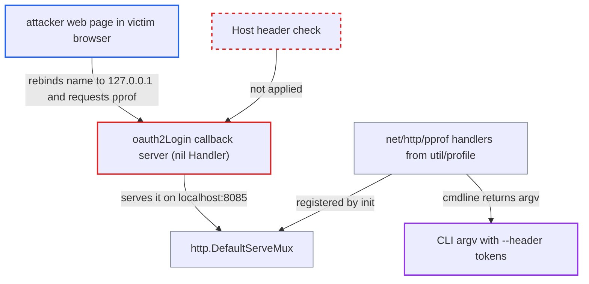

# argocd SSO login callback server serves DefaultServeMux, exposing ungated pprof

| Field | Value |
|---|---|
| ID | `find_01RNv4jsnTqjVJcquQ5RT85k` |
| Severity | **Low** |
| Status | open |
| CWE | CWE-489 — Active debug code |
| Created | 2026-10-27T21:29:57.700439Z |
| Claude Security | https://claude.ai/security/findings/find_01RNv4jsnTqjVJcquQ5RT85k |

## Description

A malicious web page can read the command line of the `argocd` CLI while the user is logging in with SSO. In the documented reverse-proxy setup that command line includes `--header` authentication tokens. The attack needs a victim browser that doesn't block public-to-loopback requests, and it only works during the login window. The cause is that the callback server in `login.go` serves the process-wide `http.DefaultServeMux`, which carries the pprof handlers, and it doesn't check the `Host` header.

1. **the user** starts a browser SSO login with `argocd login --sso` or `argocd relogin`. `oauth2Login` opens a temporary listener on `localhost:` plus the `--sso-port`, which defaults to 8085, and keeps it open until the callback completes. ([`cmd/argocd/commands/login.go:430-444`](https://github.com/cx-benchmark/argo-cd/blob/b7bc418289a96130340ea79964c4491b416c14f2/cmd/argocd/commands/login.go#L430-L444))
2. **the callback server in `oauth2Login`** serves `http.DefaultServeMux` instead of a private mux. The server is created with a nil `Handler`, and `/auth/callback` is added to the global mux with `http.HandleFunc`, so every handler on that mux is reachable on the port. ([`cmd/argocd/commands/login.go:396-397`](https://github.com/cx-benchmark/argo-cd/blob/b7bc418289a96130340ea79964c4491b416c14f2/cmd/argocd/commands/login.go#L396-L397))
3. **the `net/http/pprof` import in `util/profile`** registers the `/debug/pprof/` endpoints on `http.DefaultServeMux`. The registration happens in the package `init`, with no `profiler.enabled` gate, and the multi-call binary links this package into the `argocd` CLI. ([`util/profile/profile.go:3-30`](https://github.com/cx-benchmark/argo-cd/blob/b7bc418289a96130340ea79964c4491b416c14f2/util/profile/profile.go#L3-L30))
4. **the attacker's web page** rebinds its own name to `127.0.0.1` and polls `/debug/pprof/cmdline`. The server does not validate `Host`, so the browser treats the response as same-origin and lets the page read it. ([`cmd/argocd/commands/login.go:396-397`](https://github.com/cx-benchmark/argo-cd/blob/b7bc418289a96130340ea79964c4491b416c14f2/cmd/argocd/commands/login.go#L396-L397))
5. **`/debug/pprof/cmdline`** returns the CLI's full argv to the attacker's page. The argv includes any `--header` values, which are documented for authenticating through reverse proxies. ([`cmd/argocd/commands/root.go:86`](https://github.com/cx-benchmark/argo-cd/blob/b7bc418289a96130340ea79964c4491b416c14f2/cmd/argocd/commands/root.go#L86))

## Assessment

The attacker controls a web page that the victim has open in a browser that doesn't block public-to-loopback requests. Chrome's Private Network Access does block them. The page is served from `attacker:8085`, and the attacker rebinds that name to `127.0.0.1` and polls `/debug/pprof/cmdline`. The attack works only while the victim runs `argocd login HOST --sso` or `argocd relogin` and the callback server is waiting. The report rates it as high complexity. A client that can reach the loopback listener can call the pprof endpoints directly, with no authentication.

Impact: The attacker can read the CLI's argv, which in the reverse-proxy setup holds `--header` authentication tokens. The attacker also gets goroutine stacks, heap and allocation profiles, symbols and execution traces, none of which hold memory contents. Nothing can be written. Forced profiling only loads a short-lived CLI process. Local users on Linux and macOS gain nothing beyond what `/proc` or `ps` already show.

## Recommendation

The callback server serves the process-global `http.DefaultServeMux` (`login.go:396-397`), so it inherits the pprof handlers that the `net/http/pprof` `init` registers in every process of the multi-call binary. It also accepts any `Host`, so a DNS-rebinding page can read its responses.

Fix criteria: The SSO callback listener serves only `/auth/callback`, through a mux private to that server. It rejects requests whose `Host` is not the loopback name or address it is bound to. To verify, run `argocd login --sso` and, while it waits, send `GET http://localhost:8085/debug/pprof/cmdline`, which must return 404. A request with a foreign `Host` header must also be refused.

## Evidence

**https://github.com/cx-benchmark/argo-cd**

- [`cmd/argocd/commands/login.go:396-397`](https://github.com/cx-benchmark/argo-cd/blob/b7bc418289a96130340ea79964c4491b416c14f2/cmd/argocd/commands/login.go#L396-L397)
- [`cmd/argocd/commands/login.go:430-444`](https://github.com/cx-benchmark/argo-cd/blob/b7bc418289a96130340ea79964c4491b416c14f2/cmd/argocd/commands/login.go#L430-L444)
- [`util/profile/profile.go:3-30`](https://github.com/cx-benchmark/argo-cd/blob/b7bc418289a96130340ea79964c4491b416c14f2/util/profile/profile.go#L3-L30)
- [`cmd/main.go:13-23`](https://github.com/cx-benchmark/argo-cd/blob/b7bc418289a96130340ea79964c4491b416c14f2/cmd/main.go#L13-L23)
- [`cmd/argocd/commands/root.go:86`](https://github.com/cx-benchmark/argo-cd/blob/b7bc418289a96130340ea79964c4491b416c14f2/cmd/argocd/commands/root.go#L86)

