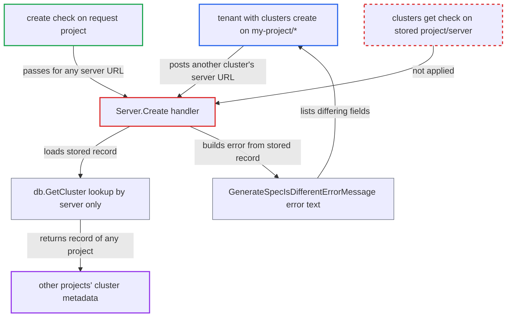

# Cluster Create's AlreadyExists path discloses other projects' cluster metadata without get check

| Field | Value |
|---|---|
| ID | `find_01GShSt63QSoiSQimWMBgatd` |
| Severity | **Low** |
| Status | open |
| CWE | CWE-863 — Incorrect authorization |
| Created | 2026-10-27T21:31:40.952145Z |
| Claude Security | https://claude.ai/security/findings/find_01GShSt63QSoiSQimWMBgatd |

## Description

A user who can only create clusters in their own project can learn metadata about clusters in other projects, or unscoped ones, that they may not view. They see that a record exists, which fields are set, label and annotation keys, and the auth mechanism. They can also confirm guessed name, label and namespace values. Secret values are not disclosed. The cause is `Server.Create`: on `AlreadyExists` it reads and reports on the stored record without checking `clusters, get` on that record's own project.

1. **attacker with `clusters, create, my-project/*`** sends a create request for another cluster's `server` URL. The request is `POST /api/v1/clusters` with `project` set to the attacker's project and `{tlsClientConfig:{insecure:true}}`. ([`server/cluster/cluster.go:144-157`](https://github.com/cx-benchmark/argo-cd/blob/b7bc418289a96130340ea79964c4491b416c14f2/server/cluster/cluster.go#L144-L157))
2. **the handler `Server.Create`** authorizes only `clusters, create` on the project and server from the request. The grant `my-project/*` matches any server URL, so the check passes. ([`server/cluster/cluster.go:144-157`](https://github.com/cx-benchmark/argo-cd/blob/b7bc418289a96130340ea79964c4491b416c14f2/server/cluster/cluster.go#L144-L157))
3. **`db.CreateCluster`** fails with `AlreadyExists`. The Secret name is derived from the server URL alone, so any cluster registered via API/CLI with that URL collides, whatever its project. ([`util/db/cluster.go:117-136`](https://github.com/cx-benchmark/argo-cd/blob/b7bc418289a96130340ea79964c4491b416c14f2/util/db/cluster.go#L117-L136))
4. **the handler `Server.Create`** loads the stored record with `s.db.GetCluster(ctx, c.Server)`. The lookup is by server URL only and has no project filter, so the record can belong to any project. ([`util/db/cluster.go:247-283`](https://github.com/cx-benchmark/argo-cd/blob/b7bc418289a96130340ea79964c4491b416c14f2/util/db/cluster.go#L247-L283))
5. **`Cluster.Equals`** reports the specs as different. It compares the full `Config` including tokens and keys, so without the stored credentials the caller always reaches the difference branch. ([`pkg/apis/application/v1alpha1/types.go:2407-2444`](https://github.com/cx-benchmark/argo-cd/blob/b7bc418289a96130340ea79964c4491b416c14f2/pkg/apis/application/v1alpha1/types.go#L2407-L2444))
6. **the handler `Server.Create`** returns `InvalidArgument` built by `argo.GenerateSpecIsDifferentErrorMessage`. The message joins every differing field path of the full, unsanitized stored record, with no `clusters, get` check on the record's own `<project>/<server>`. ([`util/argo/argo.go:1299-1318`](https://github.com/cx-benchmark/argo-cd/blob/b7bc418289a96130340ea79964c4491b416c14f2/util/argo/argo.go#L1299-L1318))
7. **attacker** resubmits the request with guessed values. Each response shows whether the guessed name, label values or namespace entries differ, which works as a yes/no oracle.

## Assessment

The attacker is an authenticated API user with the documented self-service grant `clusters, create, <proj>/*` and no `get` on other projects' clusters. They send `POST /api/v1/clusters` with another cluster's `server`, their own `project` and `{tlsClientConfig:{insecure:true}}`. The target record must have been registered via the API or CLI, so its Secret name derives from the URL. Its API server must also answer anonymous `/version`, because the connectivity probe uses the caller's own config. Repeated guesses turn the error into an oracle.

Impact: The attacker learns that a foreign or unscoped cluster exists and that its `Project` differs. They also learn which fields are set, the label and annotation keys, and the auth mechanism. They can confirm guessed name, label and namespace values. No credential values are disclosed, and nothing is modified because the upsert branch goes to `Update`, which enforces on the stored project.

## Recommendation

On `AlreadyExists`, `Create` reads, compares and reports on the stored cluster record without authorizing the caller against that record's own project. The only check made used the project from the request body.

Fix criteria: Before any comparison or response that depends on the stored record, the caller must hold `clusters, get` (and `update` for upsert) on the stored record's `<project>/<server>`. Otherwise the response is a generic error that lists no fields and does not vary with the stored content. Test: a `clusters, create, my-project/*` caller submitting an unscoped or other-project cluster's URL gets an identical error whatever the stored name, labels and config.

## Evidence

**https://github.com/cx-benchmark/argo-cd**

- [`server/cluster/cluster.go:159-177`](https://github.com/cx-benchmark/argo-cd/blob/b7bc418289a96130340ea79964c4491b416c14f2/server/cluster/cluster.go#L159-L177)
- [`server/cluster/cluster.go:144-157`](https://github.com/cx-benchmark/argo-cd/blob/b7bc418289a96130340ea79964c4491b416c14f2/server/cluster/cluster.go#L144-L157)
- [`util/db/cluster.go:117-136`](https://github.com/cx-benchmark/argo-cd/blob/b7bc418289a96130340ea79964c4491b416c14f2/util/db/cluster.go#L117-L136)
- [`util/db/cluster.go:247-283`](https://github.com/cx-benchmark/argo-cd/blob/b7bc418289a96130340ea79964c4491b416c14f2/util/db/cluster.go#L247-L283)
- [`util/argo/argo.go:1299-1318`](https://github.com/cx-benchmark/argo-cd/blob/b7bc418289a96130340ea79964c4491b416c14f2/util/argo/argo.go#L1299-L1318)
- [`pkg/apis/application/v1alpha1/types.go:2407-2444`](https://github.com/cx-benchmark/argo-cd/blob/b7bc418289a96130340ea79964c4491b416c14f2/pkg/apis/application/v1alpha1/types.go#L2407-L2444)
- [`server/cluster/cluster.go:211-222`](https://github.com/cx-benchmark/argo-cd/blob/b7bc418289a96130340ea79964c4491b416c14f2/server/cluster/cluster.go#L211-L222)
- [`server/repository/repository.go:467-471`](https://github.com/cx-benchmark/argo-cd/blob/b7bc418289a96130340ea79964c4491b416c14f2/server/repository/repository.go#L467-L471)
- [`docs/operator-manual/rbac.md:325-348`](https://github.com/cx-benchmark/argo-cd/blob/b7bc418289a96130340ea79964c4491b416c14f2/docs/operator-manual/rbac.md#L325-L348)

