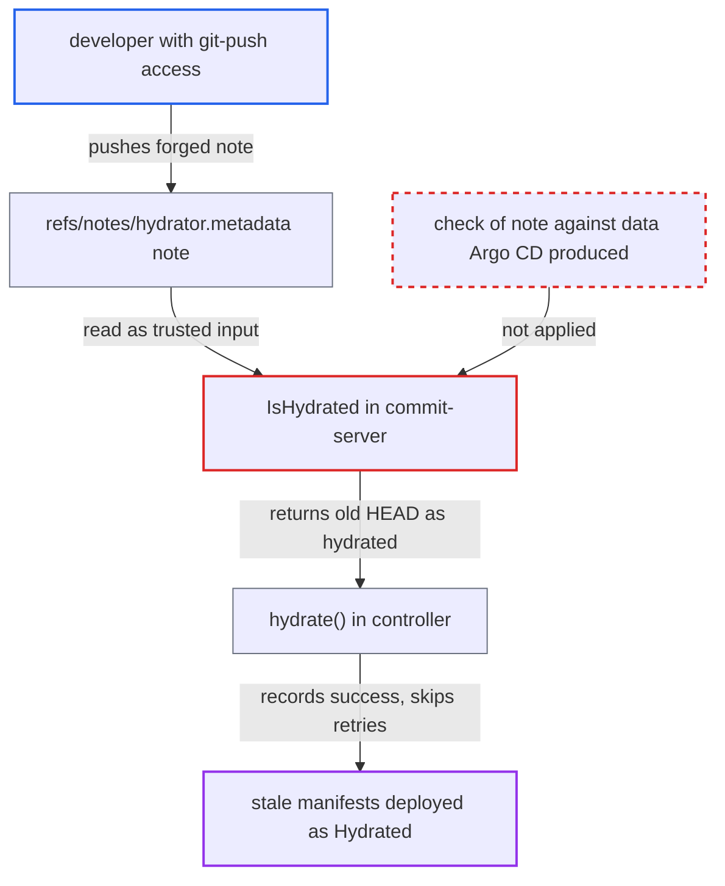

# Commit-server skips hydration based on an unauthenticated, repo-writable git note

| Field | Value |
|---|---|
| ID | `find_01NVQB7YR4ysGTzFgXFXigsY` |
| Severity | **Low** |
| Status | open |
| CWE | CWE-807 — Untrusted input in security decision |
| Created | 2026-10-27T21:30:02.986435Z |
| Claude Security | https://claude.ai/security/findings/find_01NVQB7YR4ysGTzFgXFXigsY |

## Description

A developer with push access to the destination repo can stop a chosen commit from being hydrated and deployed, while Argo CD still reports `Hydrated`. The attack works when branch protection keeps them off the hydrated and dry branches. It also needs them to win a race against webhook or polling latency. The cause is that `IsHydrated` trusts a git note under `refs/notes/hydrator.metadata`, which any repository writer can push. The note is never checked.

1. **attacker with push access** watches the dry branch for a new commit. The attacker is kept off the hydrated and dry branches by branch protection, but can still push other refs.
2. **attacker** pushes a forged note to `refs/notes/hydrator.metadata`. The note is `{"drySha":"C"}`, where `C` is the new dry commit. It is attached to the current hydrated HEAD and is pushed before commit-server runs. ([`util/git/client.go:2036-2054`](https://github.com/cx-benchmark/argo-cd/blob/b7bc418289a96130340ea79964c4491b416c14f2/util/git/client.go#L2036-L2054))
3. **the handler `handleCommitRequest`** checks out the target branch HEAD and calls `IsHydrated`. `IsHydrated` reads the note and compares its `drySha` with the requested dry SHA, without checking author, signature or consistency. ([`commitserver/commit/hydratorhelper.go:223-239`](https://github.com/cx-benchmark/argo-cd/blob/b7bc418289a96130340ea79964c4491b416c14f2/commitserver/commit/hydratorhelper.go#L223-L239))
4. **the handler `handleCommitRequest`** returns the existing HEAD as the hydrated SHA. The note matches, so nothing is written, committed, signed or pushed. ([`commitserver/commit/commit.go:156-177`](https://github.com/cx-benchmark/argo-cd/blob/b7bc418289a96130340ea79964c4491b416c14f2/commitserver/commit/commit.go#L156-L177))
5. **the controller function `hydrate()`** records the skipped run as `Phase: Hydrated`. It accepts `resp.HydratedSha` without checking that a new commit was made. It stores the new dry SHA with the old HEAD as `LastSuccessfulOperation`. ([`controller/hydrator/hydrator.go:561-565`](https://github.com/cx-benchmark/argo-cd/blob/b7bc418289a96130340ea79964c4491b416c14f2/controller/hydrator/hydrator.go#L561-L565))
6. **the controller dedupe check** skips every later request for that dry SHA, hard hydrate included. The stale manifests stay deployed until the next dry commit. ([`controller/hydrator/hydrator.go:456-461`](https://github.com/cx-benchmark/argo-cd/blob/b7bc418289a96130340ea79964c4491b416c14f2/controller/hydrator/hydrator.go#L456-L461))

## Assessment

The attacker is a developer with git-push access to the destination repo. Branch protection keeps them off the hydrated and dry branches, but it does not cover `refs/notes/*`. They wait for a new dry commit and push the forged note before commit-server runs. They must win the race against webhook or polling latency. A second route needs no race. A note that is not valid JSON makes `IsHydrated` return an error, and every hydration for that branch then fails until an operator removes the note.

Impact: The attacker can keep a chosen dry commit, such as a security fix or a credential revocation, from being hydrated and deployed while Argo CD reports `Hydrated`. They can repeat this for each later commit. A malformed note blocks all hydration for the branch until it is removed. They cannot inject manifest content, and no data is disclosed.

## Recommendation

(1) Commit-server skips hydration, and reports the existing HEAD as the result, based only on a git note fetched from the remote. Any repository writer can author that note, and it is not checked against anything commit-server produced itself.

Fix criteria: A note alone no longer causes hydration to be skipped. The skip is confirmed by data only Argo CD can produce. Examples are the `drySha` in the hydrated commit's own `hydrator.metadata` file, or a verified signature or author on the notes commit. A forged note for a dry SHA that was never hydrated leads to hydration or an explicit failure, never to a `Hydrated` status with stale manifests.

(2) A note that fails to parse makes `IsHydrated` return an error and aborts hydration. A repository writer can therefore block the hydration pipeline for a branch indefinitely.

Fix criteria: An unparseable or unexpected note no longer stops hydration. Commit-server treats it as absent and logs it. It then writes and compares manifests normally.

## Evidence

**https://github.com/cx-benchmark/argo-cd**

- [`commitserver/commit/commit.go:156-177`](https://github.com/cx-benchmark/argo-cd/blob/b7bc418289a96130340ea79964c4491b416c14f2/commitserver/commit/commit.go#L156-L177)
- [`commitserver/commit/hydratorhelper.go:223-239`](https://github.com/cx-benchmark/argo-cd/blob/b7bc418289a96130340ea79964c4491b416c14f2/commitserver/commit/hydratorhelper.go#L223-L239)
- [`util/git/client.go:2036-2054`](https://github.com/cx-benchmark/argo-cd/blob/b7bc418289a96130340ea79964c4491b416c14f2/util/git/client.go#L2036-L2054)
- [`controller/hydrator/hydrator.go:561-565`](https://github.com/cx-benchmark/argo-cd/blob/b7bc418289a96130340ea79964c4491b416c14f2/controller/hydrator/hydrator.go#L561-L565)
- [`controller/hydrator/hydrator.go:278-296`](https://github.com/cx-benchmark/argo-cd/blob/b7bc418289a96130340ea79964c4491b416c14f2/controller/hydrator/hydrator.go#L278-L296)
- [`controller/hydrator/hydrator.go:456-461`](https://github.com/cx-benchmark/argo-cd/blob/b7bc418289a96130340ea79964c4491b416c14f2/controller/hydrator/hydrator.go#L456-L461)

