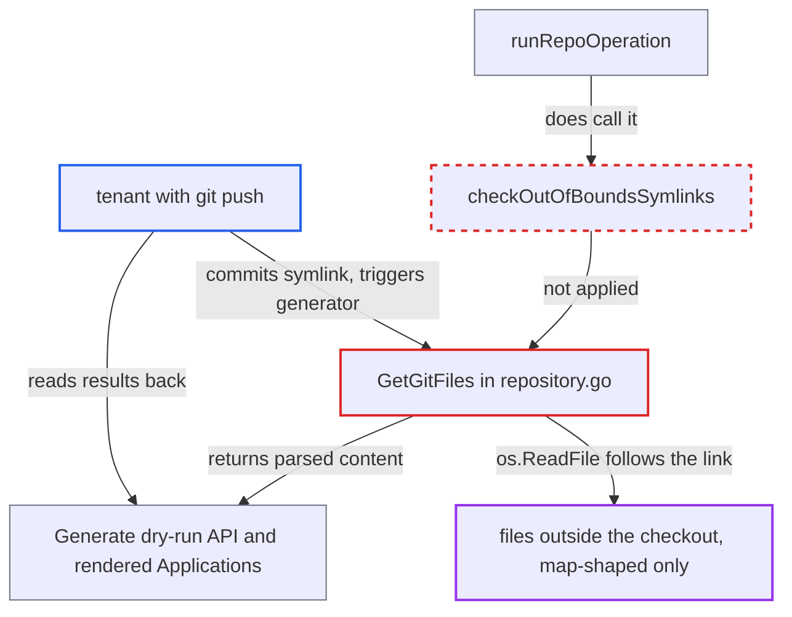

# GetGitFiles follows committed symlinks out of the checkout, bypassing the OOB symlink check

| Field | Value |
|---|---|
| ID | `find_01Si4imujCqmGYXEzhSGdjiJ` |
| Severity | **Low** |
| Status | open |
| CWE | CWE-61 — Symlink following |
| Created | 2026-10-27T21:28:59.736005Z |
| Claude Security | https://claude.ai/security/findings/find_01Si4imujCqmGYXEzhSGdjiJ |

## Description

A tenant who can push to a git repo read by an ApplicationSet git files generator can make the repo-server read files outside the checkout and show their contents. Only files that parse as a YAML/JSON map come back, and the attacker also needs a way to read the results. The cause is `GetGitFiles`, which reads committed symlinks with `os.ReadFile` and never runs `checkOutOfBoundsSymlinks`.

1. **attacker (tenant)** commits a symlink to an outside file. For example `apps/x/config.yaml` points to an absolute path or a relative `../../..` chain, at a path that matches the generator pattern.
2. **repo-server `GetGitFiles`** checks out the commit and lists tracked paths with `gitClient.LsFiles`. In the default mode `LsFiles` runs plain `git ls-files`, which lists the symlink under its own path without resolving it, and the checkout writes the link to disk as it is. ([`util/git/client.go:784-793`](https://github.com/cx-benchmark/argo-cd/blob/b7bc418289a96130340ea79964c4491b416c14f2/util/git/client.go#L784-L793))
3. **repo-server `GetGitFiles`** reads each path with `os.ReadFile`. `os.ReadFile` follows the symlink, and no out-of-bounds symlink check runs before the read. The bytes are returned and cached via `SetGitFiles`. ([`reposerver/repository/repository.go:3393-3408`](https://github.com/cx-benchmark/argo-cd/blob/b7bc418289a96130340ea79964c4491b416c14f2/reposerver/repository/repository.go#L3393-L3408))
4. **ApplicationSet generator code** parses each returned file as a YAML/JSON map. `parseFileParams` copies the keys into template parameters, so only map-shaped content gets through. ([`applicationset/generators/repo_path_utils.go:162-187`](https://github.com/cx-benchmark/argo-cd/blob/b7bc418289a96130340ea79964c4491b416c14f2/applicationset/generators/repo_path_utils.go#L162-L187))
5. **attacker** reads the parsed content back from the rendered Application. The dry-run `Generate` API with a template such as `{{ toJson . }}` echoes every parsed key. Viewing the generated Applications also works. ([`server/applicationset/applicationset.go:459-503`](https://github.com/cx-benchmark/argo-cd/blob/b7bc418289a96130340ea79964c4491b416c14f2/server/applicationset/applicationset.go#L459-L503))

## Assessment

The attacker is a tenant with git push to a repo that a git files generator reads. To read results back they also need `applicationsets` create (dry-run `Generate`) or view rights on the generated Applications. The attack runs through `Generate` or on the next controller run. The vulnerable path is the default, because the safer globbing mode is off by default (`applicationset_controller.go:329`, `argocd_server.go:367`). Reading another tenant's checkout needs a race with a concurrent git or helm process, via `/proc/<pid>/cwd`.

Impact: The attacker can read any file the repo-server user can read that parses as a YAML/JSON map. That includes other tenants' values or config files reached through `/proc/<pid>/cwd`. They also get an existence check for arbitrary paths, because a missing target gives an `open ...: no such file or directory` error. Each attempt reads one target, since a missing target aborts the call. PEM keys, `/proc/self/environ` and the service-account token are not echoed. The token is also not mounted.

## Recommendation

`GetGitFiles` follows repository-controlled symlinks when it reads tracked files. It has no out-of-bounds symlink validation like the one `runRepoOperation` applies, so the `AllowOutOfBoundsSymlinks` default-deny policy does not cover the ApplicationSet git files generator.

Fix criteria: Every file `GetGitFiles` returns resolves to a regular file inside the repository working copy, in both globbing modes, unless the operator has set `AllowOutOfBoundsSymlinks`. To verify, commit a symlink to `/etc/hostname` and a relative `../../..` chain at a path matching the generator pattern. The RPC must return an out-of-bounds error, or skip the file, rather than the target's content.

## Evidence

**https://github.com/cx-benchmark/argo-cd**

- [`reposerver/repository/repository.go:3393-3408`](https://github.com/cx-benchmark/argo-cd/blob/b7bc418289a96130340ea79964c4491b416c14f2/reposerver/repository/repository.go#L3393-L3408)
- [`util/git/client.go:784-793`](https://github.com/cx-benchmark/argo-cd/blob/b7bc418289a96130340ea79964c4491b416c14f2/util/git/client.go#L784-L793)
- [`reposerver/repository/repository.go:499-513`](https://github.com/cx-benchmark/argo-cd/blob/b7bc418289a96130340ea79964c4491b416c14f2/reposerver/repository/repository.go#L499-L513)
- [`applicationset/generators/repo_path_utils.go:162-187`](https://github.com/cx-benchmark/argo-cd/blob/b7bc418289a96130340ea79964c4491b416c14f2/applicationset/generators/repo_path_utils.go#L162-L187)
- [`server/applicationset/applicationset.go:459-503`](https://github.com/cx-benchmark/argo-cd/blob/b7bc418289a96130340ea79964c4491b416c14f2/server/applicationset/applicationset.go#L459-L503)
- [`cmd/argocd-applicationset-controller/commands/applicationset_controller.go:329`](https://github.com/cx-benchmark/argo-cd/blob/b7bc418289a96130340ea79964c4491b416c14f2/cmd/argocd-applicationset-controller/commands/applicationset_controller.go#L329)

