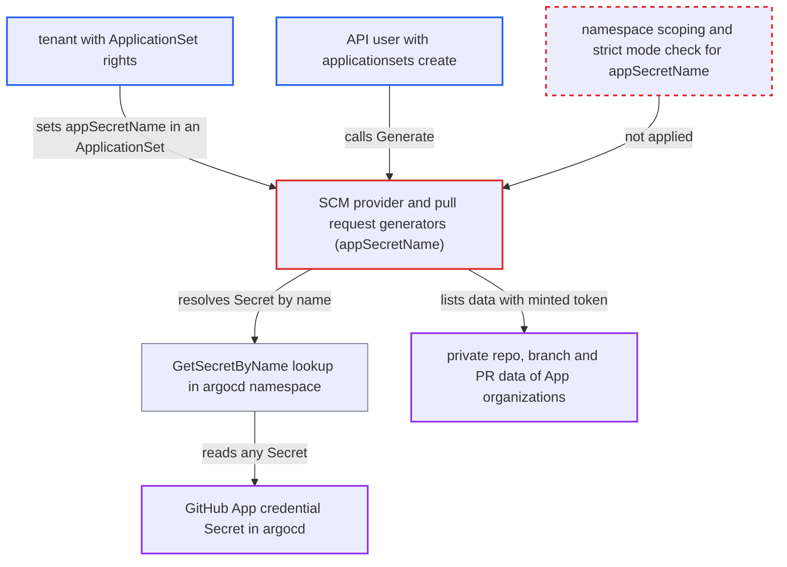

# GitHub App appSecretName resolves control-plane repo-creds, bypassing tokenRef namespace scoping and strict mode

| Field | Value |
|---|---|
| ID | `find_01RiHzBRaQg5AGxvY8T1VS8z` |
| Severity | **Low** |
| Status | open |
| CWE | CWE-639 — Authorization bypass |
| Created | 2026-10-27T21:20:59.277350Z |
| Claude Security | https://claude.ai/security/findings/find_01RiHzBRaQg5AGxvY8T1VS8z |

## Description

A tenant who can create ApplicationSets, or an API user with limited rights, can use a GitHub App credential stored in the control-plane `argocd` namespace without being allowed to. This lets them read private repository names, branches, pull-request metadata and file-path existence for every organization the App is installed in. The key itself is not disclosed. The cause is that `appSecretName` is looked up by name in the `argocd` namespace, with none of the namespace scoping or strict-mode checks that `tokenRef` gets.

1. **tenant or API user** creates an ApplicationSet that sets `appSecretName`. The value is the name of a GitHub App Secret in `argocd`, and the attacker also picks the `organization`, `owner` or `repo` to query.
2. **the SCM provider and pull request generators** pass `appSecretName` to `GetAuthSecret`. Nothing checks the ApplicationSet's namespace or `tokenRefStrictMode` before the name is resolved. ([`applicationset/generators/scm_provider.go:308-314`](https://github.com/cx-benchmark/argo-cd/blob/b7bc418289a96130340ea79964c4491b416c14f2/applicationset/generators/scm_provider.go#L308-L314))
3. **`GetAuthSecret` in `util/github_app/repos.go`** calls `GetRepoCredsBySecretName` with the given name. The Secret is found purely by name, and its private key and IDs are returned. ([`util/github_app/repos.go:20-40`](https://github.com/cx-benchmark/argo-cd/blob/b7bc418289a96130340ea79964c4491b416c14f2/util/github_app/repos.go#L20-L40))
4. **`GetSecretByName`** reads the Secret from the `argocd` namespace. It can return any Secret in that namespace, whatever the namespace of the ApplicationSet. ([`util/settings/settings.go:841-858`](https://github.com/cx-benchmark/argo-cd/blob/b7bc418289a96130340ea79964c4491b416c14f2/util/settings/settings.go#L841-L858))
5. **the controller or the `Generate` API** mints an installation token and queries GitHub for the chosen organization or repo. The results come back as generator parameters: repositories, branches, pull requests and path-existence results from `pathsExist` filters. ([`server/applicationset/applicationset.go:370-382`](https://github.com/cx-benchmark/argo-cd/blob/b7bc418289a96130340ea79964c4491b416c14f2/server/applicationset/applicationset.go#L370-L382))

## Assessment

The attacker is either a tenant allowed to create ApplicationSets in a tenant namespace (appset-in-any-namespace), or an API user with `applicationsets create` on a project. The deployment must have a GitHub App credential configured as a repository or repo-creds Secret in `argocd`. The attacker must know or guess the Secret's name. Setting `appSecretName` on either the SCM provider generator or the pull request generator works. The API route is `ApplicationSetService.Generate`, which forces strict mode for `tokenRef` but uses the same unrestricted GitHub App provider. The `--allowed-scm-providers` allow-list does not stop this. An empty GitHub API URL is allowed, so the client goes to github.com or to the App's configured enterprise URL.

Impact: The attacker gets the App's read access across project and tenant boundaries. That covers private repository inventory, branch names and SHAs, pull-request titles, authors and labels, and a path-existence oracle via `pathsExist` filters. The private key stays in the controller, and there is no write or availability impact.

## Recommendation

`appSecretName` is a key chosen by the ApplicationSet author into the control-plane Secret store. It has no namespace scoping and no type or label check, unlike `tokenRef`.

Fix criteria: GitHub App credentials used by a generator are subject to the same scoping as `tokenRef`. They resolve only from the ApplicationSet's namespace, or only from Secrets explicitly designated for SCM-generator use, honouring strict mode. They never resolve from another project's project-scoped repo-creds. An ApplicationSet in a tenant namespace that names a GitHub App Secret in `argocd` fails before any GitHub request. This is checked in both the controller and the `Generate` API.

## Evidence

**https://github.com/cx-benchmark/argo-cd**

- [`applicationset/generators/scm_provider.go:308-314`](https://github.com/cx-benchmark/argo-cd/blob/b7bc418289a96130340ea79964c4491b416c14f2/applicationset/generators/scm_provider.go#L308-L314)
- [`applicationset/generators/pull_request.go:230-236`](https://github.com/cx-benchmark/argo-cd/blob/b7bc418289a96130340ea79964c4491b416c14f2/applicationset/generators/pull_request.go#L230-L236)
- [`util/github_app/repos.go:20-40`](https://github.com/cx-benchmark/argo-cd/blob/b7bc418289a96130340ea79964c4491b416c14f2/util/github_app/repos.go#L20-L40)
- [`util/settings/settings.go:841-858`](https://github.com/cx-benchmark/argo-cd/blob/b7bc418289a96130340ea79964c4491b416c14f2/util/settings/settings.go#L841-L858)
- [`applicationset/utils/kubernetes.go:18-43`](https://github.com/cx-benchmark/argo-cd/blob/b7bc418289a96130340ea79964c4491b416c14f2/applicationset/utils/kubernetes.go#L18-L43)
- [`server/applicationset/applicationset.go:370-382`](https://github.com/cx-benchmark/argo-cd/blob/b7bc418289a96130340ea79964c4491b416c14f2/server/applicationset/applicationset.go#L370-L382)

