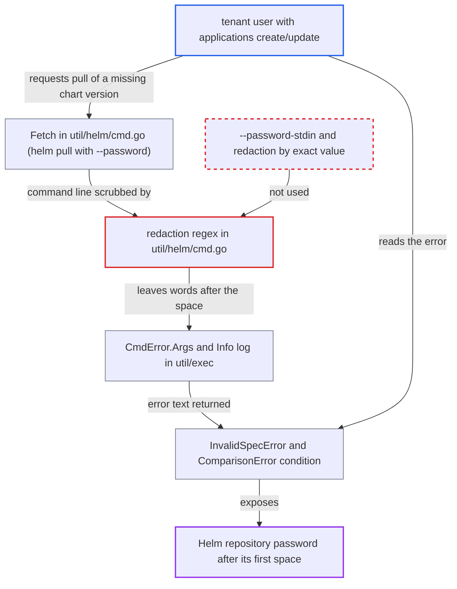

# Helm password passed on argv is only partially redacted in logs and user-visible errors

| Field | Value |
|---|---|
| ID | `find_013mRztRZPTQkzypwTq72svp` |
| Severity | **Low** |
| Status | open |
| CWE | CWE-209 — Information exposure |
| Created | 2026-10-27T21:28:21.562553Z |
| Claude Security | https://claude.ai/security/findings/find_013mRztRZPTQkzypwTq72svp |

## Description

A user with limited rights in Argo CD can read most of a Helm repository password when it contains a space. The same text is also written to the repo-server log. The attacker needs `applications, create/update` in a project that allows that repository. The cause is the regular expression in `util/helm/cmd.go` that scrubs `--password` from the logged command line. It stops at the first space.

1. **the attacker** creates or updates an Application that points at the Helm repository with a chart version that does not exist. The attacker needs `applications, create/update` in a project that permits the operator-configured repository, and that repository's password must contain a space. ([`reposerver/repository/repository.go:3074-3076`](https://github.com/cx-benchmark/argo-cd/blob/b7bc418289a96130340ea79964c4491b416c14f2/reposerver/repository/repository.go#L3074-L3076))
2. **the function `Fetch`** runs `helm pull` with the repository password on the command line as `--password <value>`. `RepoAdd` does the same for dependency repositories, so the password is part of the command line text. ([`util/helm/cmd.go:271`](https://github.com/cx-benchmark/argo-cd/blob/b7bc418289a96130340ea79964c4491b416c14f2/util/helm/cmd.go#L271))
3. **the code in `util/exec`** joins the arguments into one string with spaces and applies the redactor. The joined string no longer shows where the password argument ended, and the expression `(--username|--password) [^ ]*` replaces only text up to the first space, so `correct horse battery` becomes `****** horse battery`. ([`util/exec/exec.go:197-198`](https://github.com/cx-benchmark/argo-cd/blob/b7bc418289a96130340ea79964c4491b416c14f2/util/exec/exec.go#L197-L198))
4. **the redactor in `util/helm/cmd.go`** leaves every word of the password after its first space in the text. The expression matches `--password` followed by a run of non-space characters and nothing more. ([`util/helm/cmd.go:62-64`](https://github.com/cx-benchmark/argo-cd/blob/b7bc418289a96130340ea79964c4491b416c14f2/util/helm/cmd.go#L62-L64))
5. **`RunCommandExt`** logs the partly redacted command at Info level and stores it in `CmdError.Args` when helm exits with an error. The `CmdError` message includes this text and is passed up through `Fetch`, `ExtractChart` and `GenerateManifest`. ([`util/exec/exec.go:296-303`](https://github.com/cx-benchmark/argo-cd/blob/b7bc418289a96130340ea79964c4491b416c14f2/util/exec/exec.go#L296-L303))
6. **Argo CD** returns the error to the attacker as an `InvalidSpecError` on create/update. The repo-server error text, including the command line, becomes the message of the validation error. ([`util/argo/argo.go:1011-1022`](https://github.com/cx-benchmark/argo-cd/blob/b7bc418289a96130340ea79964c4491b416c14f2/util/argo/argo.go#L1011-L1022))
7. **the application controller** stores the same error in the Application's `ComparisonError` condition. Anyone with `applications, get` can read this condition. ([`controller/state.go:747-751`](https://github.com/cx-benchmark/argo-cd/blob/b7bc418289a96130340ea79964c4491b416c14f2/controller/state.go#L747-L751))

## Assessment

The attacker is an authenticated user with `applications, create/update` in a project that allows an operator-configured Helm repository. This is a tenant with limited rights. The attack needs that repository's password to contain a space, which the attacker cannot control. The attacker creates an Application with a chart version that does not exist, so the pull fails on demand. Anyone who can read the repo-server log, or who has `applications, get` and can read the `ComparisonError` condition, can also see the leaked text. The log line is written on every chart pull.

Impact: The attacker learns the repository password except its first space-separated word. This is a user who should only consume charts from that repository. Log readers see it too. It is limited to passwords that contain whitespace, and the report finds no effect on integrity or availability of Argo CD.

## Recommendation

Passwords are put on the helm command line and scrubbed afterwards with a regular expression that splits on whitespace. It cannot recover where the password ended.

Fix criteria: Secrets never appear in the command line text that is logged or put in errors. They are passed through stdin (`--password-stdin`) or a temporary file or environment variable, as `RegistryLogin` does, and redaction works on the exact known credential strings, not on a command line pattern. To check, configure a Helm repository with the password `a b c` and force a failed pull. Neither the log line nor the error returned to the API may contain `b c`.

## Evidence

**https://github.com/cx-benchmark/argo-cd**

- [`util/helm/cmd.go:62-64`](https://github.com/cx-benchmark/argo-cd/blob/b7bc418289a96130340ea79964c4491b416c14f2/util/helm/cmd.go#L62-L64)
- [`util/helm/cmd.go:271`](https://github.com/cx-benchmark/argo-cd/blob/b7bc418289a96130340ea79964c4491b416c14f2/util/helm/cmd.go#L271)
- [`util/exec/exec.go:197-198`](https://github.com/cx-benchmark/argo-cd/blob/b7bc418289a96130340ea79964c4491b416c14f2/util/exec/exec.go#L197-L198)
- [`util/exec/exec.go:296-303`](https://github.com/cx-benchmark/argo-cd/blob/b7bc418289a96130340ea79964c4491b416c14f2/util/exec/exec.go#L296-L303)
- [`reposerver/repository/repository.go:3074-3076`](https://github.com/cx-benchmark/argo-cd/blob/b7bc418289a96130340ea79964c4491b416c14f2/reposerver/repository/repository.go#L3074-L3076)
- [`util/argo/argo.go:1011-1022`](https://github.com/cx-benchmark/argo-cd/blob/b7bc418289a96130340ea79964c4491b416c14f2/util/argo/argo.go#L1011-L1022)
- [`controller/state.go:747-751`](https://github.com/cx-benchmark/argo-cd/blob/b7bc418289a96130340ea79964c4491b416c14f2/controller/state.go#L747-L751)

