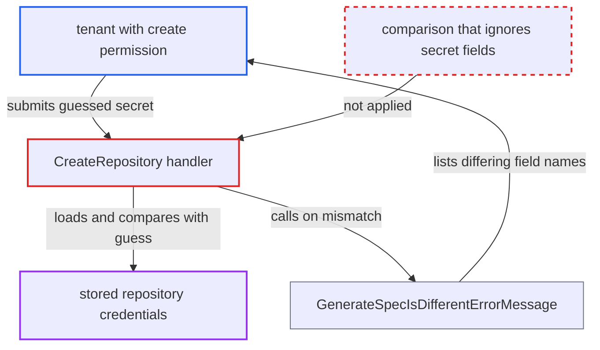

# Idempotent Create compares caller spec with stored secrets, giving a credential equality oracle

| Field | Value |
|---|---|
| ID | `find_01KHKQFkW9c27eCA9RJruJBi` |
| Severity | **Low** |
| Status | open |
| CWE | CWE-203 — Observable Discrepancy |
| Created | 2026-10-27T21:32:52.546820Z |
| Claude Security | https://claude.ai/security/findings/find_01KHKQFkW9c27eCA9RJruJBi |

## Description

A tenant with only `create` permission on a repository can check guesses against credentials that were hidden from them, such as an administrator-set password. Each create request says whether the guess matches. The practical risk is limited to weak, human-chosen secrets. `CreateRepository` compares the caller's spec with the stored secrets and reports the result.

1. **attacker (tenant)** reads the sanitized repository with `Get`. This shows every non-secret field, so the attacker can copy them exactly into a create request.
2. **attacker (tenant)** sends a create request for the same URL and project with a guessed secret. The request is `POST /api/v1/repositories`. It needs only `create` on `repositories, create, <proj>/<url>`, and the report mentions no rate limit or lock-out.
3. **the handler `CreateRepository`** loads the stored repository with its credentials and compares it to the request. When the repository already exists, it calls `s.db.GetRepository` and then `reflect.DeepEqual(existing, r)`. That compares `Password`, `BearerToken`, `SSHPrivateKey` and the other secret fields too. ([`server/repository/repository.go:467-489`](https://github.com/cx-benchmark/argo-cd/blob/b7bc418289a96130340ea79964c4491b416c14f2/server/repository/repository.go#L467-L489))
4. **the handler `CreateRepository`** returns success on a full match, or an error naming the differing fields. Without `upsert`, the error comes from `argo.GenerateSpecIsDifferentErrorMessage`, which lists the name of every field that differs. ([`util/argo/argo.go:1299-1318`](https://github.com/cx-benchmark/argo-cd/blob/b7bc418289a96130340ea79964c4491b416c14f2/util/argo/argo.go#L1299-L1318))
5. **attacker (tenant)** repeats with new guesses until the secret field is no longer listed. Success, or a diff list without `Password`, confirms the guess. Otherwise the field name is still listed.

## Assessment

The attacker is a tenant with `create` on `repositories` for a project, in the form `repositories, create, <proj>/*`. The project must contain a repository whose credentials an administrator set. The attacker reads the sanitized repository with `Get`, then posts the same URL and project with candidate secrets, one request per guess. The same pattern exists in `CreateWriteRepository`, in `CreateRepositoryCredentials` and `CreateWriteRepositoryCredentials` (which compare template secrets), and in `Server.Create` for clusters. For clusters, `existing.Equals(c)` compares `Config` including `BearerToken` and `KeyData`, and the error lists the differing config keys.

Impact: The attacker can confirm or brute-force hidden repository, credential-template or cluster secrets one field at a time. This is practical only for low-entropy secrets. For strong random tokens, it reveals only which credential type is configured. Nothing can be modified, and availability is not affected.

## Recommendation

The check for an already-existing object compares the caller's input with stored secret material. It then reports the outcome, including the names of differing fields, to a caller who may not read those secrets.

Fix criteria: The comparison either excludes secret fields (comparing only sanitized representations) or returns a generic 'already exists' error that does not depend on secret equality and does not list field names. Two create attempts that differ only in a secret field produce byte-identical responses.

## Evidence

**https://github.com/cx-benchmark/argo-cd**

- [`server/repository/repository.go:467-489`](https://github.com/cx-benchmark/argo-cd/blob/b7bc418289a96130340ea79964c4491b416c14f2/server/repository/repository.go#L467-L489)
- [`util/argo/argo.go:1299-1318`](https://github.com/cx-benchmark/argo-cd/blob/b7bc418289a96130340ea79964c4491b416c14f2/util/argo/argo.go#L1299-L1318)
- [`server/repocreds/repocreds.go:102-114`](https://github.com/cx-benchmark/argo-cd/blob/b7bc418289a96130340ea79964c4491b416c14f2/server/repocreds/repocreds.go#L102-L114)
- [`server/cluster/cluster.go:159-177`](https://github.com/cx-benchmark/argo-cd/blob/b7bc418289a96130340ea79964c4491b416c14f2/server/cluster/cluster.go#L159-L177)

