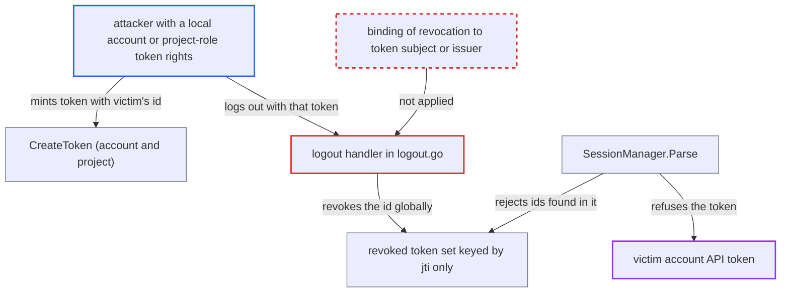

# Logout revokes a caller-chosen jti globally, letting one user disable other accounts' API tokens

| Field | Value |
|---|---|
| ID | `find_01WV2NHxkXuPUQ3TxN9aQZo7` |
| Severity | **Low** |
| Status | open |
| CWE | CWE-639 — Authorization bypass via user-controlled key |
| Created | 2026-10-27T21:24:41.945100Z |
| Claude Security | https://claude.ai/security/findings/find_01WV2NHxkXuPUQ3TxN9aQZo7 |

## Description

A low-privilege user can make another account's API token stop working, for a duration the attacker picks, and can repeat it. The attacker needs a local account with apiKey capability or the right to create project-role tokens, and must learn or guess the victim's token id. The cause is that logout in `server/logout/logout.go` revokes a token's `jti` globally, and creators choose that `jti` themselves.

1. **attacker** learns the victim's API-token id. `GetAccount` and `ListAccounts` return every account's token ids to anyone with `accounts, get`, and the builtin `role:readonly` grants that on `*`; human-chosen ids can also be guessed. ([`server/account/account.go:172-224`](https://github.com/cx-benchmark/argo-cd/blob/b7bc418289a96130340ea79964c4491b416c14f2/server/account/account.go#L172-L224))
2. **attacker** creates their own token whose id equals the victim's id. `CreateToken` uses the caller-supplied `r.Id` as the `jti` and only rejects ids already used in the caller's own account, and a local account may always create tokens for itself; project-role token creation uses `q.Id` the same way. ([`server/account/account.go:231-276`](https://github.com/cx-benchmark/argo-cd/blob/b7bc418289a96130340ea79964c4491b416c14f2/server/account/account.go#L231-L276))
3. **attacker** sends `GET /auth/logout` with that token in the `argocd.token` cookie. The handler verifies the token, which is valid, and then revokes its raw `jti` for `time.Until(exp)` without binding it to the token's subject; the attacker sets that duration through `expiresIn`. ([`server/logout/logout.go:100-131`](https://github.com/cx-benchmark/argo-cd/blob/b7bc418289a96130340ea79964c4491b416c14f2/server/logout/logout.go#L100-L131))
4. **revocation store** records the id as revoked for all accounts. The entry is stored as `revoked-token|<id>` with no subject or issuer, and it is sent to every replica. ([`util/session/state.go:145-159`](https://github.com/cx-benchmark/argo-cd/blob/b7bc418289a96130340ea79964c4491b416c14f2/util/session/state.go#L145-L159))
5. **`SessionManager.Parse`** rejects the victim's token. It checks the revoked set before it checks which account owns the id, so the victim gets `token is revoked, please re-login`. ([`util/session/sessionmanager.go:316-324`](https://github.com/cx-benchmark/argo-cd/blob/b7bc418289a96130340ea79964c4491b416c14f2/util/session/sessionmanager.go#L316-L324))

## Assessment

The attacker is an authenticated low-privilege user. This is either a local account with apiKey capability, or someone who can create project-role tokens (project `update` or a role group member). They need the victim's API-token id. They can read it with `argocd account get` if they hold `accounts, get` (granted by `role:readonly`), or guess a human-chosen id. The id can be revoked before the victim creates the token, and the attack can be repeated after the victim recreates it. The victim must use an API token whose id the attacker can learn.

Impact: The attacker can make other accounts' API tokens fail on every replica for a duration the attacker picks, which breaks their CI and automation access, and can repeat this. Login sessions with random ids, SSO tokens and project-role tokens are not affected as victims, because project-role tokens are never checked against the revoked set. No data is disclosed or modified beyond the revocation set.

## Recommendation

Revocation entries are keyed by a bare id that token creators can choose, and `Parse` honours them for every account, so one principal's logout revokes ids that belong to other principals' tokens.

Fix criteria: Logging out with a token affects only that token. Revocation is bound to the token's subject or issuer, or to another value the requester cannot collide with, or caller-chosen ids are no longer usable as revocation keys. To check this, create API tokens with the same id for two accounts (or a project-role token with that id), log out with one, and confirm the other account's token still authenticates.

## Evidence

**https://github.com/cx-benchmark/argo-cd**

- [`server/logout/logout.go:100-131`](https://github.com/cx-benchmark/argo-cd/blob/b7bc418289a96130340ea79964c4491b416c14f2/server/logout/logout.go#L100-L131)
- [`util/session/sessionmanager.go:316-324`](https://github.com/cx-benchmark/argo-cd/blob/b7bc418289a96130340ea79964c4491b416c14f2/util/session/sessionmanager.go#L316-L324)
- [`util/session/state.go:145-159`](https://github.com/cx-benchmark/argo-cd/blob/b7bc418289a96130340ea79964c4491b416c14f2/util/session/state.go#L145-L159)
- [`server/account/account.go:231-276`](https://github.com/cx-benchmark/argo-cd/blob/b7bc418289a96130340ea79964c4491b416c14f2/server/account/account.go#L231-L276)
- [`server/account/account.go:172-224`](https://github.com/cx-benchmark/argo-cd/blob/b7bc418289a96130340ea79964c4491b416c14f2/server/account/account.go#L172-L224)
- [`assets/builtin-policy.csv:16`](https://github.com/cx-benchmark/argo-cd/blob/b7bc418289a96130340ea79964c4491b416c14f2/assets/builtin-policy.csv#L16)
- [`server/project/project.go:109-126`](https://github.com/cx-benchmark/argo-cd/blob/b7bc418289a96130340ea79964c4491b416c14f2/server/project/project.go#L109-L126)

