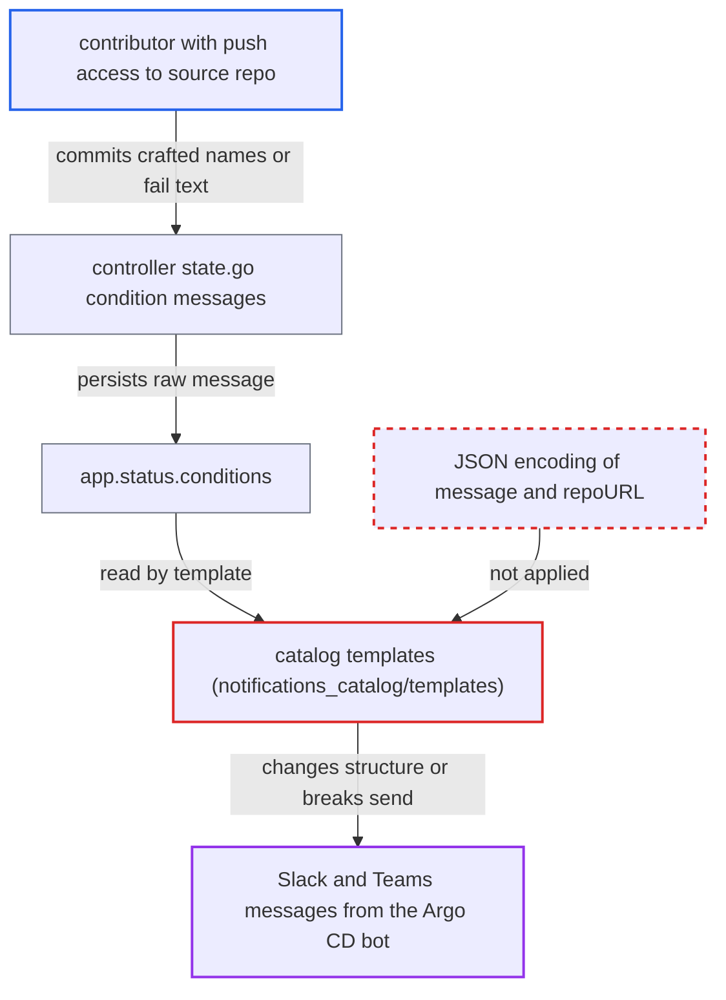

# Notification catalog splices unescaped condition messages into Slack/Teams JSON payloads

| Field | Value |
|---|---|
| ID | `find_01TQsiPnHPRqcnYrzGuKroWZ` |
| Severity | **Low** |
| Status | open |
| CWE | CWE-116 — Improper Output Encoding |
| Created | 2026-10-27T21:17:44.637530Z |
| Claude Security | https://claude.ai/security/findings/find_01TQsiPnHPRqcnYrzGuKroWZ |

## Description

A contributor who can push to a source repo of an Argo CD Application can change the layout and links of the Slack or Teams notification the Argo CD bot posts for that app, or stop it from being sent. It works when the app uses the notification catalog with a Slack or Teams service and a subscription. The catalog templates insert condition messages into JSON string literals without JSON encoding.

1. **contributor with push access** commits manifests or a chart with a crafted name or error text. Two `hook: Skip` manifests with the same group, kind, namespace and name are not applied, and the name holds a quote followed by JSON. A chart that calls `fail` with such text also works. ([`gitops-engine/pkg/sync/hook/hook.go:31-36`](https://github.com/cx-benchmark/argo-cd/blob/b7bc418289a96130340ea79964c4491b416c14f2/gitops-engine/pkg/sync/hook/hook.go#L31-L36))
2. **the controller in `controller/state.go`** copies the attacker's text into a condition message. `RepeatedResourceWarning` embeds the raw group, kind, namespace and name without validation. `ComparisonError` embeds the repo-server or Helm error text, including the `fail` argument. ([`controller/state.go:612-618`](https://github.com/cx-benchmark/argo-cd/blob/b7bc418289a96130340ea79964c4491b416c14f2/controller/state.go#L612-L618))
3. **the controller in `controller/state.go`** saves the condition to `app.status.conditions`. A failed target-state load also sets the sync status to Unknown, which fires the trigger `on-sync-status-unknown`. ([`controller/state.go:1168-1173`](https://github.com/cx-benchmark/argo-cd/blob/b7bc418289a96130340ea79964c4491b416c14f2/controller/state.go#L1168-L1173))
4. **the catalog trigger** fires and selects a catalog template. `on-sync-status-unknown` sends `app-sync-status-unknown` when `app.status.sync.status == 'Unknown'`. Other catalog triggers use the other templates the same way. ([`notifications_catalog/triggers/on-sync-status-unknown.yaml:1-4`](https://github.com/cx-benchmark/argo-cd/blob/b7bc418289a96130340ea79964c4491b416c14f2/notifications_catalog/triggers/on-sync-status-unknown.yaml#L1-L4))
5. **the catalog template** writes each condition message raw into a JSON string. The template uses `"value": "{{$c.message}}"` with no encoding, so a quote in the message ends the string and the rest is read as JSON structure. ([`notifications_catalog/templates/app-deployed.yaml:27-34`](https://github.com/cx-benchmark/argo-cd/blob/b7bc418289a96130340ea79964c4491b416c14f2/notifications_catalog/templates/app-deployed.yaml#L27-L34))
6. **the notification sender** posts the altered attachment or fails on invalid JSON. Go's `encoding/json` keeps the last duplicate key, so injected `title`, `title_link` and `fields` replace the real ones, and extra attachments can be added. If a quote or newline leaves the JSON invalid, the send fails and no notification appears.

## Assessment

The attacker needs git-push access to one source repo of an Application that is subscribed to a catalog trigger on a Slack or Teams service. They need no other access. Two routes put their text into a condition message: duplicated `hook: Skip` manifests with crafted names, or a chart that calls `fail`. A third value, `{{ .app.spec.source.repoURL }}`, is also spliced raw into `value` and `uri` strings, but changing it needs write access to the app spec. The report rests on an assumption about the pinned `github.com/argoproj/notifications-engine` version, whose source is not in the checkout. It assumes the engine renders these fields with `text/template` and then runs `json.Unmarshal` on the result, while `docs/operator-manual/notifications/templates.md:2` says html/template is used.

Impact: The attacker controls the structure and links of the attachments the trusted bot posts about the app. They can replace the title link that points to the Argo CD app page, replace fields, and add attachments or images, which allows convincing phishing. They can also suppress the app's Slack notifications, for example to hide a deployment. Nothing is disclosed, and only notifications for apps sourced from the attacker's repo are affected.

## Recommendation

The catalog templates build the Slack `attachments` and Teams `facts` and `potentialAction` JSON by string concatenation. They insert condition messages, condition types and repo URLs inside JSON string literals without encoding, so data can change the document structure.

Fix criteria: Every application-derived value placed in a catalog JSON payload is emitted as a properly JSON-encoded string, so quotes, backslashes and control characters cannot alter the structure. `install.yaml` is regenerated from the fixed templates. To verify, render each template against an app whose condition message and repoURL contain `\"},{`, `\\` and newlines. The output must parse as JSON with the same keys as for a benign app. The hostile characters must appear only inside the intended string values.

## Evidence

**https://github.com/cx-benchmark/argo-cd**

- [`notifications_catalog/templates/app-deployed.yaml:27-34`](https://github.com/cx-benchmark/argo-cd/blob/b7bc418289a96130340ea79964c4491b416c14f2/notifications_catalog/templates/app-deployed.yaml#L27-L34)
- [`notifications_catalog/templates/app-sync-succeeded.yaml:23-30`](https://github.com/cx-benchmark/argo-cd/blob/b7bc418289a96130340ea79964c4491b416c14f2/notifications_catalog/templates/app-sync-succeeded.yaml#L23-L30)
- [`notifications_catalog/templates/app-sync-status-unknown.yaml:28-35`](https://github.com/cx-benchmark/argo-cd/blob/b7bc418289a96130340ea79964c4491b416c14f2/notifications_catalog/templates/app-sync-status-unknown.yaml#L28-L35)
- [`notifications_catalog/templates/app-deployed.yaml:53-59`](https://github.com/cx-benchmark/argo-cd/blob/b7bc418289a96130340ea79964c4491b416c14f2/notifications_catalog/templates/app-deployed.yaml#L53-L59)
- [`notifications_catalog/templates/app-deployed.yaml:19`](https://github.com/cx-benchmark/argo-cd/blob/b7bc418289a96130340ea79964c4491b416c14f2/notifications_catalog/templates/app-deployed.yaml#L19)
- [`controller/state.go:612-618`](https://github.com/cx-benchmark/argo-cd/blob/b7bc418289a96130340ea79964c4491b416c14f2/controller/state.go#L612-L618)
- [`controller/state.go:747-751`](https://github.com/cx-benchmark/argo-cd/blob/b7bc418289a96130340ea79964c4491b416c14f2/controller/state.go#L747-L751)
- [`controller/state.go:1093-1094`](https://github.com/cx-benchmark/argo-cd/blob/b7bc418289a96130340ea79964c4491b416c14f2/controller/state.go#L1093-L1094)
- [`controller/state.go:1168-1173`](https://github.com/cx-benchmark/argo-cd/blob/b7bc418289a96130340ea79964c4491b416c14f2/controller/state.go#L1168-L1173)
- [`notifications_catalog/triggers/on-sync-status-unknown.yaml:1-4`](https://github.com/cx-benchmark/argo-cd/blob/b7bc418289a96130340ea79964c4491b416c14f2/notifications_catalog/triggers/on-sync-status-unknown.yaml#L1-L4)
- [`gitops-engine/pkg/sync/hook/hook.go:31-36`](https://github.com/cx-benchmark/argo-cd/blob/b7bc418289a96130340ea79964c4491b416c14f2/gitops-engine/pkg/sync/hook/hook.go#L31-L36)

