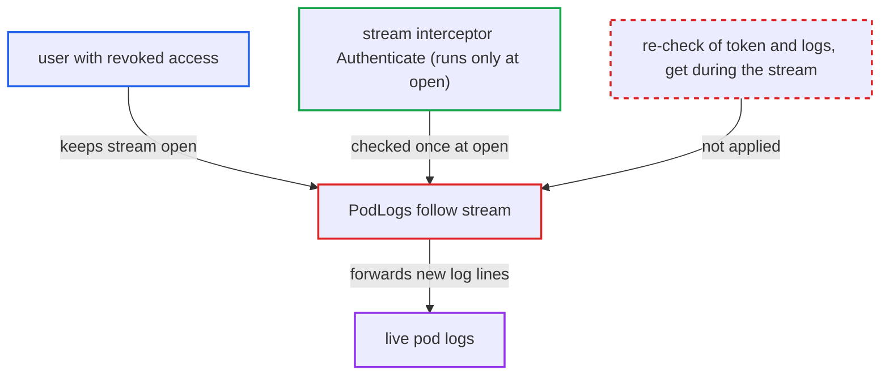

# PodLogs follow stream authorized only at open; revoked token or RBAC keeps streaming logs

| Field | Value |
|---|---|
| ID | `find_01TVYEqyo4jRZzYxfojA5qKW` |
| Severity | **Low** |
| Status | open |
| CWE | CWE-613 — Insufficient session expiration |
| Created | 2026-10-27T21:46:29.852181Z |
| Claude Security | https://claude.ai/security/findings/find_01TVYEqyo4jRZzYxfojA5qKW |

## Description

A user whose access has been withdrawn can keep reading live container logs from an application. This works only if they opened a `PodLogs` stream with `follow=true` while still authorized and keep the connection open. `PodLogs` checks `applications, get` and `logs, get` once, when the stream opens, and nothing re-checks the token or the policy afterwards. The exposure is read-only and limited to the pods selected when the stream opened.

1. **authenticated user** opens a `PodLogs` stream with `follow=true`. The user holds `applications, get` and `logs, get` on the application, so the one-time RBAC check passes. ([`server/application/application.go:1905-1912`](https://github.com/cx-benchmark/argo-cd/blob/b7bc418289a96130340ea79964c4491b416c14f2/server/application/application.go#L1905-L1912))
2. **the handler `PodLogs`** opens a log stream on each selected pod using Argo CD's own cluster credential. The pods are chosen from the resource tree at open time, and the kube stream is bound to `ws.Context()`, so it runs until the pod ends or the client disconnects. ([`server/application/application.go:1946-1976`](https://github.com/cx-benchmark/argo-cd/blob/b7bc418289a96130340ea79964c4491b416c14f2/server/application/application.go#L1946-L1976))
3. **the stream interceptor `grpc_auth.StreamServerInterceptor`** authenticates the caller only when the stream is established. `Authenticate` is not run again for the life of the stream. ([`server/server.go:1003-1014`](https://github.com/cx-benchmark/argo-cd/blob/b7bc418289a96130340ea79964c4491b416c14f2/server/server.go#L1003-L1014))
4. **administrator or the session itself** withdraws the user's access. This can be `/auth/logout` (revoked `jti`), token expiry, disabling the local account or changing its password, deleting a project-role token, or removing `logs, get` or `applications, get` from the user's policy.
5. **the forwarding goroutine in `PodLogs`** keeps sending every new log line to the client. It does no token verification or RBAC enforcement per entry or on a timer, so the stream survives the revocation. ([`server/application/application.go:1978-2043`](https://github.com/cx-benchmark/argo-cd/blob/b7bc418289a96130340ea79964c4491b416c14f2/server/application/application.go#L1978-L2043))

## Assessment

The attacker is an authenticated user who holds `logs, get` on an application. They open `PodLogs` with `follow=true` through gRPC, gRPC-web or the REST gateway's streaming endpoint, and keep the connection open. Their access is then withdrawn in any of the ways listed in the steps, and the open stream keeps delivering data. `Watch` is a second route. It re-enforces RBAC on each event with the claims captured at open, so policy changes do apply. A revoked or expired session still keeps receiving Application events, which include full spec, status and operation details.

Impact: The user keeps receiving new container log lines, and for `Watch` Application events, after their access is gone. This is read-only and limited to the pods selected when the stream opened. The dead token cannot open new streams.

## Recommendation

Streaming RPCs authenticate and authorize only when the stream is established. `PodLogs` with `follow` turns that single decision into an unlimited grant, so token revocation and RBAC changes do not affect an open log stream. `Watch` has the same gap for token revocation.

Fix criteria: An open `PodLogs` (and `Watch`) stream stops delivering data once the caller's token no longer verifies or the caller no longer holds the required RBAC. This can be done by periodically re-running `VerifyToken` and the `logs, get` / `applications, get` enforcement and ending the stream on failure, or by limiting the stream's lifetime to the token's remaining validity. To verify, open a follow stream, then revoke the token (logout) or remove `logs, get`. Confirm the stream ends within the re-check interval.

## Evidence

**https://github.com/cx-benchmark/argo-cd**

- [`server/application/application.go:1905-1912`](https://github.com/cx-benchmark/argo-cd/blob/b7bc418289a96130340ea79964c4491b416c14f2/server/application/application.go#L1905-L1912)
- [`server/application/application.go:1946-1976`](https://github.com/cx-benchmark/argo-cd/blob/b7bc418289a96130340ea79964c4491b416c14f2/server/application/application.go#L1946-L1976)
- [`server/application/application.go:1978-2043`](https://github.com/cx-benchmark/argo-cd/blob/b7bc418289a96130340ea79964c4491b416c14f2/server/application/application.go#L1978-L2043)
- [`server/server.go:1003-1014`](https://github.com/cx-benchmark/argo-cd/blob/b7bc418289a96130340ea79964c4491b416c14f2/server/server.go#L1003-L1014)
- [`server/application/application.go:1278-1305`](https://github.com/cx-benchmark/argo-cd/blob/b7bc418289a96130340ea79964c4491b416c14f2/server/application/application.go#L1278-L1305)

