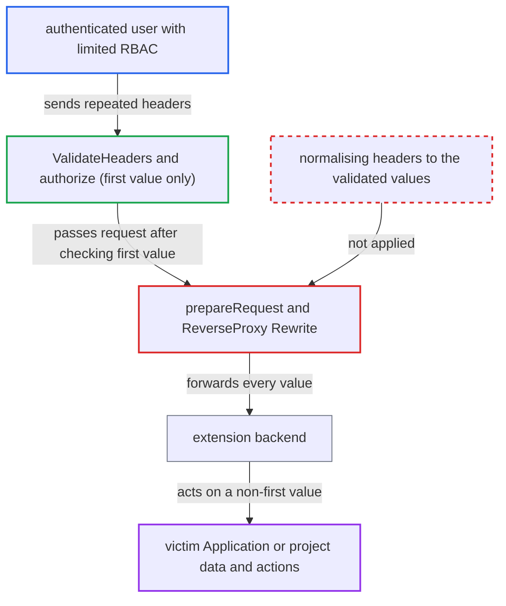

# Proxy extension authorizes only the first Argocd-Application-Name/Project-Name value but forwards every duplicate

| Field | Value |
|---|---|
| ID | `find_018hjg1WwkxkriKY3bgshvYn` |
| Severity | **Low** |
| Status | open |
| CWE | CWE-235 — HTTP parameter pollution |
| Created | 2026-10-27T21:18:28.634320Z |
| Claude Security | https://claude.ai/security/findings/find_018hjg1WwkxkriKY3bgshvYn |

## Description

An authenticated Argo CD user with limited RBAC may be able to make an extension backend act on an Application or project they have no permission for. This works only if proxy extensions are enabled and the backend uses a non-first value of a repeated header. The proxy handler in `server/extension/extension.go` authorizes only the first `Argocd-Application-Name` and `Argocd-Project-Name` value but forwards every value.

1. **authenticated attacker** sends an extension request with repeated headers. The first `Argocd-Application-Name` line names an app the attacker may read, the second names a victim app, and `Argocd-Project-Name` is repeated the same way.
2. **`ValidateHeaders`** reads only the first value of each header. It uses `http.Header.Get`, which returns just the first value of a repeated header, so later values are never parsed or validated. ([`server/extension/extension.go:109-138`](https://github.com/cx-benchmark/argo-cd/blob/b7bc418289a96130340ea79964c4491b416c14f2/server/extension/extension.go#L109-L138))
3. **`authorize`** checks permissions for the first values only. It enforces `applications, get`, the app/project match and the destination check for the single value held in `RequestResources`. ([`server/extension/extension.go:680-712`](https://github.com/cx-benchmark/argo-cd/blob/b7bc418289a96130340ea79964c4491b416c14f2/server/extension/extension.go#L680-L712))
4. **`prepareRequest`** leaves the two headers as the client sent them. It sets the namespace, cluster and user headers but never `Set`s the application and project headers to the validated values. ([`server/extension/extension.go:839-857`](https://github.com/cx-benchmark/argo-cd/blob/b7bc418289a96130340ea79964c4491b416c14f2/server/extension/extension.go#L839-L857))
5. **the proxy `Rewrite`** removes only `Authorization` and `Cookie` before forwarding. The cloned outbound headers keep every value of `Argocd-Application-Name` and `Argocd-Project-Name`, and each is sent as its own header line. ([`server/extension/extension.go:524-544`](https://github.com/cx-benchmark/argo-cd/blob/b7bc418289a96130340ea79964c4491b416c14f2/server/extension/extension.go#L524-L544))
6. **extension backend** resolves the repeated header to a non-first value. If its HTTP stack takes the last value, iterates all values or joins them, it works on the victim app. The documentation tells backends these headers are already authorized. ([`docs/developer-guide/extensions/proxy-extensions.md:286-291`](https://github.com/cx-benchmark/argo-cd/blob/b7bc418289a96130340ea79964c4491b416c14f2/docs/developer-guide/extensions/proxy-extensions.md#L286-L291))

## Assessment

The attacker is an authenticated Argo CD user with `applications, get` on one app and `extensions, invoke` on a configured extension. They send a request to `/extensions/<ext>/...` with two `Argocd-Application-Name` lines (their own app, then the victim app) and two `Argocd-Project-Name` lines. Two conditions are outside the attacker's control. Proxy extensions must be enabled, which is off by default (`--enable-proxy-extension` / `ARGOCD_SERVER_ENABLE_PROXY_EXTENSION`), and an operator must have configured a backend. The backend's HTTP stack must also pick a non-first value. Backends that read only the first value, such as Go `Header.Get`, receive the authorized value and are not affected.

Impact: `argocd-server` itself discloses nothing extra. It forwards an application and project identity it never authorized, under header names its documentation says it has validated. The integrity effect on the server is rated low.

Subsequent-system impact: A backend that resolves the repeated header to the attacker's second value scopes its work to an Application or project the caller cannot read. It may return that app's extension data or run an app-scoped action. The impact is limited to what that extension exposes or does per application.

## Recommendation

`server/extension/extension.go` authorizes the first value of `Argocd-Application-Name` and `Argocd-Project-Name` (in `ValidateHeaders` and `authorize`) but forwards the raw, possibly repeated headers (via `prepareRequest` and the `NewProxy` `Rewrite`). The authorization decision and the request the backend receives can disagree.

Fix criteria: The backend receives exactly one `Argocd-Application-Name` and one `Argocd-Project-Name` value, identical to the values `authorize` validated. Either the server rewrites them to the validated values, or it rejects requests with more than one value for either header. To verify, send two values for each header and confirm the backend sees only the authorized pair or the server answers 400.

## Evidence

**https://github.com/cx-benchmark/argo-cd**

- [`server/extension/extension.go:839-857`](https://github.com/cx-benchmark/argo-cd/blob/b7bc418289a96130340ea79964c4491b416c14f2/server/extension/extension.go#L839-L857)
- [`server/extension/extension.go:109-138`](https://github.com/cx-benchmark/argo-cd/blob/b7bc418289a96130340ea79964c4491b416c14f2/server/extension/extension.go#L109-L138)
- [`server/extension/extension.go:680-712`](https://github.com/cx-benchmark/argo-cd/blob/b7bc418289a96130340ea79964c4491b416c14f2/server/extension/extension.go#L680-L712)
- [`server/extension/extension.go:524-544`](https://github.com/cx-benchmark/argo-cd/blob/b7bc418289a96130340ea79964c4491b416c14f2/server/extension/extension.go#L524-L544)
- [`server/extension/extension.go:818`](https://github.com/cx-benchmark/argo-cd/blob/b7bc418289a96130340ea79964c4491b416c14f2/server/extension/extension.go#L818)
- [`docs/developer-guide/extensions/proxy-extensions.md:286-291`](https://github.com/cx-benchmark/argo-cd/blob/b7bc418289a96130340ea79964c4491b416c14f2/docs/developer-guide/extensions/proxy-extensions.md#L286-L291)

