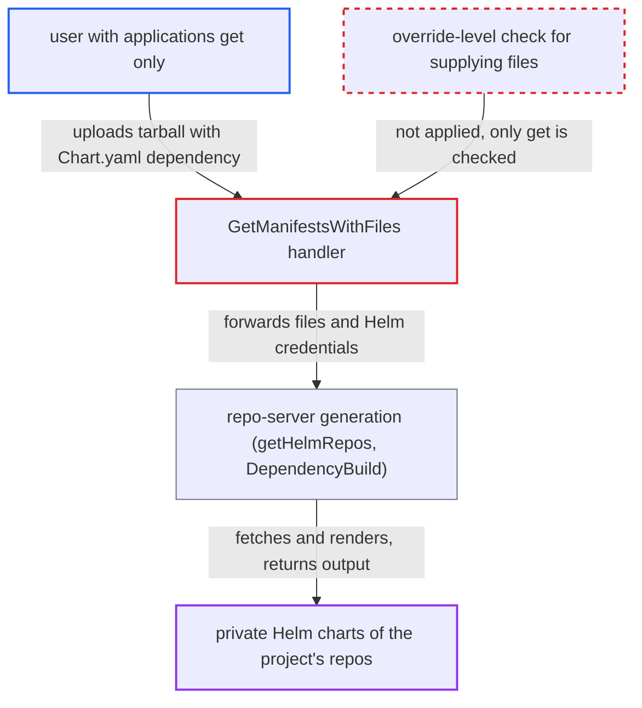

# Read-only app users render arbitrary charts from project Helm repos via GetManifestsWithFiles

| Field | Value |
|---|---|
| ID | `find_014Bs57sNqme3yxFz9n9XvMR` |
| Severity | **Low** |
| Status | open |
| CWE | CWE-863 — Incorrect Authorization |
| Created | 2026-10-27T21:28:59.674523Z |
| Claude Security | https://claude.ai/security/findings/find_014Bs57sNqme3yxFz9n9XvMR |

## Description

A user who may only view one Application can make the server fetch and render any chart, at any version, from private Helm repositories that the project permits. This normally needs `create`/`update` rights or the repo credentials. The attacker needs `applications, get` on one Application and a credentialed Helm repo permitted to the project. `Server.GetManifestsWithFiles` checks only `applications, get` before it passes the caller's uploaded files and the project's Helm credentials to the repo-server.

1. **attacker with `applications, get`** calls the streaming `GetManifestsWithFiles` RPC with a tarball. The tarball holds a `Chart.yaml` whose dependency names a chart in a private Helm repo that the project permits.
2. **the handler `GetManifestsWithFiles`** authorizes the call with only `applications, get`. No `override` or other privilege for supplying content is checked. ([`server/application/application.go:670-673`](https://github.com/cx-benchmark/argo-cd/blob/b7bc418289a96130340ea79964c4491b416c14f2/server/application/application.go#L670-L673))
3. **the handler `GetManifestsWithFiles`** streams the upload to the repo-server together with the project's Helm repos and credentials. The `ManifestRequest` carries `Repos: helmRepos` and `HelmRepoCreds: helmCreds`, built by `queryRepoServer` from every Helm repo and credential template the AppProject's `sourceRepos` permits. ([`server/application/application.go:720-752`](https://github.com/cx-benchmark/argo-cd/blob/b7bc418289a96130340ea79964c4491b416c14f2/server/application/application.go#L720-L752))
4. **the repo-server** extracts the upload and runs the normal manifest generation on it. The only content check is the out-of-bounds symlink check. ([`reposerver/repository/repository.go:753-792`](https://github.com/cx-benchmark/argo-cd/blob/b7bc418289a96130340ea79964c4491b416c14f2/reposerver/repository/repository.go#L753-L792))
5. **`getHelmRepos`** attaches stored credentials to each dependency named in the uploaded `Chart.yaml`. A dependency gets credentials if it matches a permitted repo by URL or `@name`, or a credential template by prefix. ([`reposerver/repository/repository.go:1168-1230`](https://github.com/cx-benchmark/argo-cd/blob/b7bc418289a96130340ea79964c4491b416c14f2/reposerver/repository/repository.go#L1168-L1230))
6. **`DependencyBuild`** logs in or runs `helm repo add` with those credentials and downloads the charts. The private charts are fetched with the project's credentials before `helm dependency build`. ([`util/helm/helm.go:86-111`](https://github.com/cx-benchmark/argo-cd/blob/b7bc418289a96130340ea79964c4491b416c14f2/util/helm/helm.go#L86-L111))
7. **the handler `GetManifestsWithFiles`** returns the rendered manifests to the caller. Only core `Secret` manifests are masked, so every other rendered resource goes back to the caller. ([`server/application/application.go:763-787`](https://github.com/cx-benchmark/argo-cd/blob/b7bc418289a96130340ea79964c4491b416c14f2/server/application/application.go#L763-L787))

## Assessment

The attacker is an Argo CD user or token with `applications, get` on one Application in project P. This is the limited-RBAC API user of the threat model. P must permit a Helm repo that has credentials. With `sourceRepos: ['*']`, as in the `default` project, that means every registered Helm repo. The attacker calls the `GetManifestsWithFiles` RPC with a tarball whose `Chart.yaml` names a chart in that repo. No victim takes part. The same upload also lets a `get`-only user run Kustomize and any matching Config Management Plugin on content they wrote, with the app repo's git credentials available. That is the position the threat model gives to a git-push actor. It also reaches the dependency-credential prefix-match leak without push access. The project treats caller-controlled sources as a boundary elsewhere. `GetAppDetails` refuses source values that are not in the app's history when the caller has only `get`. Supplying local manifests to `Sync` requires `applications, override`.

Impact: A read-only user gets the rendered content of any chart, at any version, in the private Helm repos and credential templates the project permits. Core Secrets are masked, nothing is deployed or stored, and the report rates the confidentiality loss as limited. Repo-server load is bounded by stream size limits, exec timeouts and the parallelism semaphore.

## Recommendation

The `GetManifestsWithFiles` call streams caller-written content into the repo-server generation pipeline under the read-only `applications, get` action. The project's Helm credentials therefore fetch and render whatever charts the caller's `Chart.yaml` names.

Fix criteria: Supplying local files for server-side generation requires a privilege that means the right to supply content, such as `applications, override` or a dedicated action. The check runs before any data reaches the repo-server. A `get`-only token calling `GetManifestsWithFiles` receives PermissionDenied. A caller holding the new privilege can still run `argocd app diff --local --server-side-generate`.

## Evidence

**https://github.com/cx-benchmark/argo-cd**

- [`server/application/application.go:670-673`](https://github.com/cx-benchmark/argo-cd/blob/b7bc418289a96130340ea79964c4491b416c14f2/server/application/application.go#L670-L673)
- [`server/application/application.go:720-752`](https://github.com/cx-benchmark/argo-cd/blob/b7bc418289a96130340ea79964c4491b416c14f2/server/application/application.go#L720-L752)
- [`server/application/application.go:447-467`](https://github.com/cx-benchmark/argo-cd/blob/b7bc418289a96130340ea79964c4491b416c14f2/server/application/application.go#L447-L467)
- [`reposerver/repository/repository.go:753-792`](https://github.com/cx-benchmark/argo-cd/blob/b7bc418289a96130340ea79964c4491b416c14f2/reposerver/repository/repository.go#L753-L792)
- [`reposerver/repository/repository.go:1168-1230`](https://github.com/cx-benchmark/argo-cd/blob/b7bc418289a96130340ea79964c4491b416c14f2/reposerver/repository/repository.go#L1168-L1230)
- [`reposerver/repository/repository.go:1424-1446`](https://github.com/cx-benchmark/argo-cd/blob/b7bc418289a96130340ea79964c4491b416c14f2/reposerver/repository/repository.go#L1424-L1446)
- [`util/helm/helm.go:86-111`](https://github.com/cx-benchmark/argo-cd/blob/b7bc418289a96130340ea79964c4491b416c14f2/util/helm/helm.go#L86-L111)
- [`server/application/application.go:763-787`](https://github.com/cx-benchmark/argo-cd/blob/b7bc418289a96130340ea79964c4491b416c14f2/server/application/application.go#L763-L787)
- [`server/repository/repository.go:360-366`](https://github.com/cx-benchmark/argo-cd/blob/b7bc418289a96130340ea79964c4491b416c14f2/server/repository/repository.go#L360-L366)
- [`server/application/application.go:2121`](https://github.com/cx-benchmark/argo-cd/blob/b7bc418289a96130340ea79964c4491b416c14f2/server/application/application.go#L2121)

