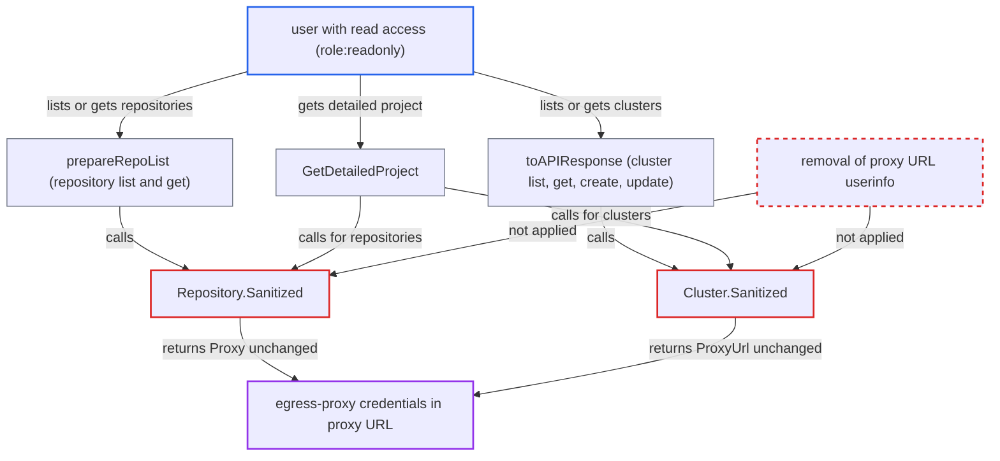

# Repository and cluster API responses disclose proxy URLs including embedded proxy credentials

| Field | Value |
|---|---|
| ID | `find_017BA1Sgi1bfbdL3t3MEpEED` |
| Severity | **Low** |
| Status | open |
| CWE | CWE-200 — Information exposure |
| Created | 2026-10-27T21:15:53.154049Z |
| Claude Security | https://claude.ai/security/findings/find_017BA1Sgi1bfbdL3t3MEpEED |

## Description

Any signed-in Argo CD user with read access can read the egress-proxy username and password that an administrator stored in a repository or cluster setting. This works only where an authenticating proxy is configured with `user:password@` in the URL. `Repository.Sanitized()` and `Cluster.Sanitized()` remove other secrets but return the proxy URL whole.

1. **administrator** configures an authenticating proxy by putting credentials in the proxy URL. Argo CD has no separate proxy username or password field, so userinfo in the URL (`user:password@proxy`) is the only way to set this up, and the proxy code uses it as the proxy login. ([`util/proxy/proxy.go:26-56`](https://github.com/cx-benchmark/argo-cd/blob/b7bc418289a96130340ea79964c4491b416c14f2/util/proxy/proxy.go#L26-L56))
2. **attacker with read access** calls `GET /api/v1/repositories`, `GET /api/v1/clusters` or `GET /api/v1/projects/{name}/detailed`. The built-in `role:readonly` already grants `repositories, get, *` and `clusters, get, *`, and the project route needs only `projects, get` on that project. ([`assets/builtin-policy.csv:12-13`](https://github.com/cx-benchmark/argo-cd/blob/b7bc418289a96130340ea79964c4491b416c14f2/assets/builtin-policy.csv#L12-L13))
3. **API handlers `prepareRepoList`, `toAPIResponse` and `GetDetailedProject`** build the response from sanitized copies of the repository and cluster objects. Each handler calls `Sanitized()` and treats the result as safe to return to anyone allowed to `get` the object. ([`server/repository/repository.go:218-225`](https://github.com/cx-benchmark/argo-cd/blob/b7bc418289a96130340ea79964c4491b416c14f2/server/repository/repository.go#L218-L225))
4. **`Repository.Sanitized()` and `Cluster.Sanitized()`** copy the proxy URL into the sanitized object unchanged. `Proxy` is copied at line 409 and `Config.ProxyUrl` is kept at line 2389, while passwords, keys and tokens are dropped. ([`pkg/apis/application/v1alpha1/repository_types.go:400-423`](https://github.com/cx-benchmark/argo-cd/blob/b7bc418289a96130340ea79964c4491b416c14f2/pkg/apis/application/v1alpha1/repository_types.go#L400-L423))
5. **Argo CD API** returns the proxy URL with its credentials in the `proxy` or `config.proxyUrl` field. The attacker reads `user:password@proxy` from the response. ([`pkg/apis/application/v1alpha1/types.go:2373-2396`](https://github.com/cx-benchmark/argo-cd/blob/b7bc418289a96130340ea79964c4491b416c14f2/pkg/apis/application/v1alpha1/types.go#L2373-L2396))

## Assessment

The attacker is any authenticated Argo CD user with `repositories, get` or `clusters, get`, for example the built-in `role:readonly`. A user with `projects, get` on a project that has scoped repositories or clusters also works. The routes are `GET /api/v1/repositories`, `GET /api/v1/clusters` (also reached through cluster get, create and update) and `GET /api/v1/projects/{name}/detailed`. It only works where the operator configured an authenticating proxy, which Argo CD supports solely through userinfo in the proxy URL.

Impact: The attacker learns the egress-proxy credentials that the administrator stored in the repository or cluster Secret, which the API otherwise withholds from readers. Repository, cluster and session credentials stay hidden, and nothing is modified.

## Recommendation

`Repository.Sanitized()` and `Cluster.Sanitized()` treat the proxy URL as non-sensitive and return it whole, although its userinfo carries a credential. Every API path that relies on them discloses it: repository list and get, cluster list, get, create and update, and the detailed project.

Fix criteria: No API response built from a sanitized Repository or Cluster contains the userinfo of a proxy URL. The password part is redacted or removed, and the proxy still works server-side. Listing repositories and clusters and fetching a detailed project with a `role:readonly` or project-reader token no longer returns the credentials. Test this with a repository that has `proxy: http://u:*@proxy:3128` and a cluster whose `proxyUrl` has credentials.

## Evidence

**https://github.com/cx-benchmark/argo-cd**

- [`pkg/apis/application/v1alpha1/repository_types.go:400-423`](https://github.com/cx-benchmark/argo-cd/blob/b7bc418289a96130340ea79964c4491b416c14f2/pkg/apis/application/v1alpha1/repository_types.go#L400-L423)
- [`pkg/apis/application/v1alpha1/types.go:2373-2396`](https://github.com/cx-benchmark/argo-cd/blob/b7bc418289a96130340ea79964c4491b416c14f2/pkg/apis/application/v1alpha1/types.go#L2373-L2396)
- [`util/proxy/proxy.go:26-56`](https://github.com/cx-benchmark/argo-cd/blob/b7bc418289a96130340ea79964c4491b416c14f2/util/proxy/proxy.go#L26-L56)
- [`pkg/apis/application/v1alpha1/types.go:4386-4391`](https://github.com/cx-benchmark/argo-cd/blob/b7bc418289a96130340ea79964c4491b416c14f2/pkg/apis/application/v1alpha1/types.go#L4386-L4391)
- [`server/repository/repository.go:218-225`](https://github.com/cx-benchmark/argo-cd/blob/b7bc418289a96130340ea79964c4491b416c14f2/server/repository/repository.go#L218-L225)
- [`server/cluster/cluster.go:473-482`](https://github.com/cx-benchmark/argo-cd/blob/b7bc418289a96130340ea79964c4491b416c14f2/server/cluster/cluster.go#L473-L482)
- [`server/project/project.go:313-329`](https://github.com/cx-benchmark/argo-cd/blob/b7bc418289a96130340ea79964c4491b416c14f2/server/project/project.go#L313-L329)
- [`assets/builtin-policy.csv:12-13`](https://github.com/cx-benchmark/argo-cd/blob/b7bc418289a96130340ea79964c4491b416c14f2/assets/builtin-policy.csv#L12-L13)

