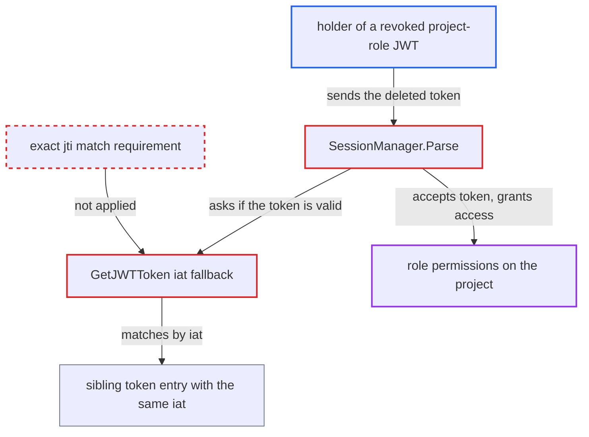

# Revoked project-role JWT still accepted when another token of the role shares its iat

| Field | Value |
|---|---|
| ID | `find_018R5eC3ictW8zACxb8ftrcP` |
| Severity | **Low** |
| Status | open |
| CWE | CWE-613 — Insufficient session expiration |
| Created | 2026-10-27T21:25:10.710355Z |
| Claude Security | https://claude.ai/security/findings/find_018R5eC3ictW8zACxb8ftrcP |

## Description

A holder of a revoked project-role token can keep using it, with every permission the role grants on that one project. This happens only when another token of the same role was issued in the same second, for example by scripted creation. The cause is `GetJWTToken`, called from `SessionManager.Parse`. When the token's `jti` finds no entry, it falls back to matching by `iat`.

1. **Token creator** issues two tokens of one role within the same second. `createToken` takes `iat` from the signing time at one-second precision and appends the new entry without checking for another entry of the role with the same `iat`, so both entries coexist with different IDs. ([`server/project/project.go:117-157`](https://github.com/cx-benchmark/argo-cd/blob/b7bc418289a96130340ea79964c4491b416c14f2/server/project/project.go#L117-L157))
2. **Admin** revokes the attacker's token. `RemoveJWTToken` removes only one entry, and the shipped CLI and UI send only the `iat`, so the sibling entry with the same `iat` stays in place. ([`pkg/apis/application/v1alpha1/app_project_types.go:119-141`](https://github.com/cx-benchmark/argo-cd/blob/b7bc418289a96130340ea79964c4491b416c14f2/pkg/apis/application/v1alpha1/app_project_types.go#L119-L141))
3. **Attacker** sends the revoked JWT to argocd-server. `VerifyToken` hands the `proj:<project>:<role>` token to `SessionManager.Parse`, which treats it as valid whenever `GetJWTToken` returns no error. ([`util/session/sessionmanager.go:285-297`](https://github.com/cx-benchmark/argo-cd/blob/b7bc418289a96130340ea79964c4491b416c14f2/util/session/sessionmanager.go#L285-L297))
4. **the method `GetJWTToken`** matches the token to the sibling's entry by `iat`. The lookup by `jti` misses, but the fallback accepts any entry of the role with the same `iat`, even though the token carries a `jti`. ([`pkg/apis/application/v1alpha1/app_project_types.go:97-116`](https://github.com/cx-benchmark/argo-cd/blob/b7bc418289a96130340ea79964c4491b416c14f2/pkg/apis/application/v1alpha1/app_project_types.go#L97-L116))
5. **the handler `SessionManager.Parse`** accepts the deleted token. No other check covers revocation, and `enforceProjectToken` evaluates policies only, so the token keeps its role permissions. ([`util/session/sessionmanager.go:285-297`](https://github.com/cx-benchmark/argo-cd/blob/b7bc418289a96130340ea79964c4491b416c14f2/util/session/sessionmanager.go#L285-L297))

## Assessment

The attacker holds one project-role JWT, for example a leaked token or one issued to a contractor or CI system. A second token of the same role must have been issued in the same second, for example by scripted or bulk creation. The attacker does not control this condition. The admin then revokes the attacker's token, through the API by id or through the CLI or UI by `iat`. Deleting by `iat` removes whichever same-`iat` entry is found first, so both JWTs keep working. The attacker keeps sending the token to argocd-server.

Impact: Revocation has no effect. The holder keeps every permission the role's policies grant on that project, such as get, sync, delete or exec on its applications. This lasts until the token expires (possibly never) or every same-`iat` sibling is also deleted. The reach is limited to that one role in one project.

## Recommendation

(1) `GetJWTToken`, as called from `SessionManager.Parse`, falls back to matching by issue time even when the presented token carries a `jti`. Deleting a token's entry therefore does not invalidate it while another entry of the role shares its `iat`.

Fix criteria: A project-role JWT that carries a `jti` is accepted only if an entry with exactly that ID exists for the role. Matching by `iat` applies only to legacy tokens without a `jti`. Test: create two tokens for one role in the same second and delete one by id. Confirm that `Parse` rejects the deleted token and still accepts the remaining one.

(2) The shipped CLI and UI revoke tokens by `iat` only, and token creation allows several entries of one role to share an `iat`. An operator cannot target one specific token.

Fix criteria: Deleting a specific token through the shipped clients removes exactly that token, identified by its ID. Alternatively, the server refuses to create or delete when the `iat` is ambiguous. Test: delete one of two same-second tokens through the CLI and through the UI. Confirm that only the intended token is revoked.

## Evidence

**https://github.com/cx-benchmark/argo-cd**

- [`pkg/apis/application/v1alpha1/app_project_types.go:97-116`](https://github.com/cx-benchmark/argo-cd/blob/b7bc418289a96130340ea79964c4491b416c14f2/pkg/apis/application/v1alpha1/app_project_types.go#L97-L116)
- [`util/session/sessionmanager.go:285-297`](https://github.com/cx-benchmark/argo-cd/blob/b7bc418289a96130340ea79964c4491b416c14f2/util/session/sessionmanager.go#L285-L297)
- [`server/project/project.go:117-157`](https://github.com/cx-benchmark/argo-cd/blob/b7bc418289a96130340ea79964c4491b416c14f2/server/project/project.go#L117-L157)
- [`pkg/apis/application/v1alpha1/app_project_types.go:119-141`](https://github.com/cx-benchmark/argo-cd/blob/b7bc418289a96130340ea79964c4491b416c14f2/pkg/apis/application/v1alpha1/app_project_types.go#L119-L141)
- [`cmd/argocd/commands/project_role.go:490-500`](https://github.com/cx-benchmark/argo-cd/blob/b7bc418289a96130340ea79964c4491b416c14f2/cmd/argocd/commands/project_role.go#L490-L500)
- [`ui/src/app/shared/services/projects-service.ts:162-167`](https://github.com/cx-benchmark/argo-cd/blob/b7bc418289a96130340ea79964c4491b416c14f2/ui/src/app/shared/services/projects-service.ts#L162-L167)

